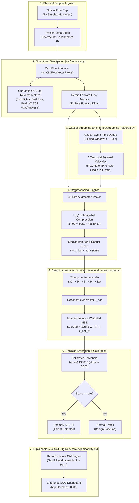
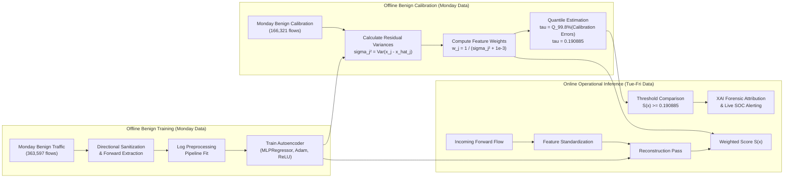
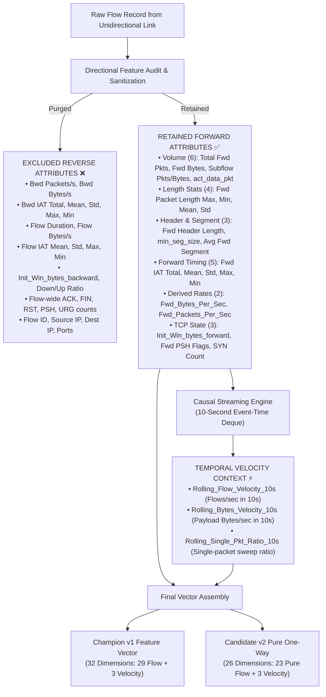
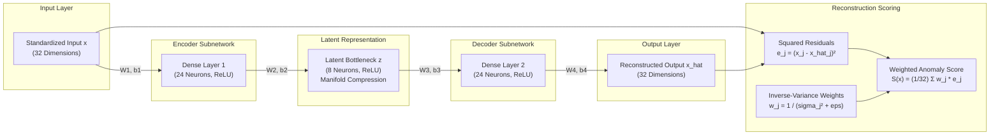
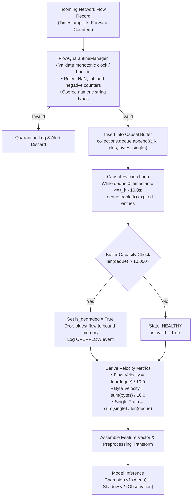
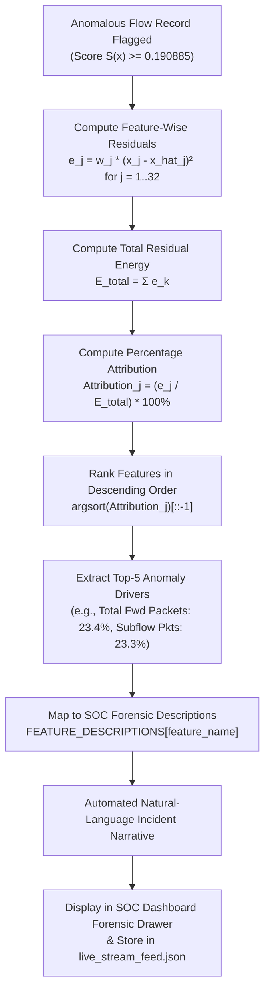

# AEGIS — Label-Free Threat Detection in One-Way Network Traffic

> **An unsupervised machine learning framework for detecting anomalous network behavior using forward-only traffic features and causal temporal context.**

[](https://www.python.org/)
[](https://scikit-learn.org/)
[](https://en.wikipedia.org/wiki/Intrusion_detection_system)
[]()
[-green.svg)](https://www.unb.ca/cic/datasets/ids-2017.html)
[]()
[]()

---

## Table of Contents

- [1. Executive Summary](#1-executive-summary)
- [2. The Problem Statement: Unidirectional Network Monitoring](#2-the-problem-statement-unidirectional-network-monitoring)
  - [Hardware Data Diodes vs. Conventional NIDS](#hardware-data-diodes-vs-conventional-nids)
  - [Why Bidirectional Feature Engineering Fails on Simplex Taps](#why-bidirectional-feature-engineering-fails-on-simplex-taps)
  - [Software Emulation vs. Physical Diode Deployment](#software-emulation-vs-physical-diode-deployment)
- [3. Key Features & System Capabilities](#3-key-features--system-capabilities)
- [4. System Architecture](#4-system-architecture)
- [5. End-to-End Operational Workflow](#5-end-to-end-operational-workflow)
- [6. Dataset & Chronological Partitioning](#6-dataset--chronological-partitioning)
  - [CIC-IDS2017 Benchmark Audit](#cic-ids2017-benchmark-audit)
  - [Why Chronological Separation Matters](#why-chronological-separation-matters)
- [7. Feature Engineering & Directional Sanitization](#7-feature-engineering--directional-sanitization)
  - [Directional Feature Quarantine (Purged Reverse Metrics)](#directional-feature-quarantine-purged-reverse-metrics)
  - [Champion v1 vs. Candidate v2 Feature Space Evolution](#champion-v1-vs-candidate-v2-feature-space-evolution)
  - [Causal Temporal Velocity Engine (10-Second Sliding Window)](#causal-temporal-velocity-engine-10-second-sliding-window)
- [8. Machine Learning Model Implementations](#8-machine-learning-model-implementations)
- [9. Champion Deep Temporal Autoencoder](#9-champion-deep-temporal-autoencoder)
  - [Neural Topology (32 → 24 → 8 → 24 → 32)](#neural-topology-32--24--8--24--32)
  - [Inverse-Variance Weighted Reconstruction Error](#inverse-variance-weighted-reconstruction-error)
- [10. Non-Parametric Threshold Calibration](#10-non-parametric-threshold-calibration)
- [11. Causal Sliding-Window Streaming Engine](#11-causal-sliding-window-streaming-engine)
  - [Event-Time Deque Implementation & Eviction](#event-time-deque-implementation--eviction)
  - [Buffer Safety & Memory Degradation Ceiling](#buffer-safety--memory-degradation-ceiling)
- [12. Explainable AI (XAI) & Root-Cause Attribution](#12-explainable-ai-xai--root-cause-attribution)
  - [Residual Percentage Attribution](#residual-percentage-attribution)
  - [Authentic Case Study: Test Flow #1867](#authentic-case-study-test-flow-1867)
- [13. Enterprise SOC Dashboard & Monitoring Interface](#13-enterprise-soc-dashboard--monitoring-interface)
- [14. Experimental Results & Operational Benchmarking](#14-experimental-results--operational-benchmarking)
  - [Comprehensive Benchmark Evaluation (2.3M Flows)](#comprehensive-benchmark-evaluation-23m-flows)
  - [Inference Latency & System Throughput Profiling](#inference-latency--system-throughput-profiling)
  - [Per-Category Detection Recall (14 Attack Families)](#per-category-detection-recall-14-attack-families)
  - [Detection Recall vs. Operational False Positive Rate](#detection-recall-vs-operational-false-positive-rate)
- [15. Operational Streaming Replay Evaluation](#15-operational-streaming-replay-evaluation)
  - [Two-Episode Replay (PortScan & DDoS Onset)](#two-episode-replay-portscan--ddos-onset)
  - [Buffer Warm-Up Dynamics & Transient Onset Delay](#buffer-warm-up-dynamics--transient-onset-delay)
- [16. Project Limitations & Integrity Disclosures](#16-project-limitations--integrity-disclosures)
- [17. Technology Stack](#17-technology-stack)
- [18. Project Directory Structure](#18-project-directory-structure)
- [19. Installation & Setup](#19-installation--setup)
- [20. Running the Project](#20-running-the-project)
  - [1. Full Live Demonstration (Single Command)](#1-full-live-demonstration-single-command)
  - [2. Chronological Stream Simulator](#2-chronological-stream-simulator)
  - [3. Standalone Dashboard Server](#3-standalone-dashboard-server)
  - [4. Running the Test Suite](#4-running-the-test-suite)
- [21. Future Improvements & Research Roadmap](#21-future-improvements--research-roadmap)
- [22. Academic & Research Context](#22-academic--research-context)
- [23. Author](#23-author)
- [24. License](#24-license)

---

## 1. Executive Summary

**AEGIS** is an unsupervised cybersecurity research and engineering framework designed to solve a fundamental dilemma in critical infrastructure protection: **how to detect zero-day cyber threats in real time when traffic monitoring is physically restricted to a one-way (simplex) optical channel without return path or ground-truth attack labels.**

In high-security enclaves—such as nuclear power generation, electrical grid substations, naval defense systems, and industrial SCADA networks—hardware data diodes physically decouple internal operational networks from external corporate monitoring systems. While physical diodes provide absolute hardware-enforced protection against remote penetration, they inadvertently blind standard Network Intrusion Detection Systems (NIDS) that depend on bidirectional session tracking, round-trip times (RTT), and TCP return acknowledgments.

AEGIS resolves this challenge through four foundational innovations:

1. **Strict Directional Feature Sanitization:** Purges all 61 reverse-direction flow metrics and bidirectional dependencies from standard flow extractors (e.g., CICFlowMeter), retaining 23 pure forward-only features.
2. **Causal Temporal Velocity Engine:** Introduces a zero-leakage, event-time rolling window $(t - 10\text{s}, t]$ that computes real-time traffic acceleration (flow velocity, payload byte velocity, and single-packet reconnaissance ratio) without peering into future packets.
3. **Unsupervised Deep Bottleneck Learning:** Deploys a deep temporal autoencoder ($32 \to 24 \to 8 \to 24 \to 32$) trained exclusively on 363,597 Monday benign flows, eliminating label leakage and catastrophic distribution shift against unseen attack variants.
4. **Deterministic Quantile Threshold Calibration:** Employs empirical non-parametric quantile estimation on benign calibration traffic ($\tau = 0.190885$ at target $\alpha = 0.2\%$), completely eliminating manual heuristics and unstable genetic algorithms.

Evaluated on **2,300,825 evaluation flows** from the canonical **CIC-IDS2017** benchmark, AEGIS achieves an overall **93.08% attack detection recall** (519,031 true positives out of 557,646 attack flows) with an operational false positive rate (FPR) of **12.48%**, an average precision of **70.46%**, and an **F1-score of 0.8020**. In vectorized batch evaluation, inference executes at **4.08 microseconds per flow** (245,193 flows/second throughput; 0.47 µs model-only forward pass), enabling wire-speed offline and batch deployment, with single-flow causal streaming processing at 0.98–1.72 ms per flow.

---

## 2. The Problem Statement: Unidirectional Network Monitoring

### Hardware Data Diodes vs. Conventional NIDS

Critical operational technology (OT) networks cannot tolerate the risk of inbound malware penetration or unauthorized command injection. To enforce total isolation, organizations deploy **hardware data diodes** conforming to NIST SP 800-82 guidelines:

```
[ High-Security Enclave ]                      [ External SOC Monitoring ]
  SCADA / Nuclear PLC                          Security Analytics / Dashboard
          │                                                  ▲
          ▼                                                  │
┌──────────────────┐       Simplex Fiber       ┌────────────────────────┐
│ Optical Tx Laser │ ────────────────────────> │ Optical Rx Photodiode  │
│  (No Rx Circuit) │    (Physical One-Way)     │    (No Tx Circuit)     │
└──────────────────┘                           └────────────────────────┘
          ▲                                                  │
          └────────── Physical Reverse Path Blocked ─────────┘
```

A hardware data diode consists of an optical transmitter (LED or laser) physically coupled via a single-strand simplex fiber cable to an optical receiver (photodiode). The transmitter lacks receiving circuitry, and the receiver lacks transmitting circuitry. Under this physical architecture, photons can only travel in one direction; backward data transmission is governed by the laws of physics, making remote exploitation of the source network impossible.

### Why Bidirectional Feature Engineering Fails on Simplex Taps

Conventional network flow tools (such as Zeek, Suricata, Argus, and CICFlowMeter) are designed around bidirectional TCP/IP flow reconstruction. When a flow monitoring engine analyzes a mirrored simplex tap, severe feature corruption occurs:

1. **Missing Reverse Packets:** Return acknowledgments (ACK), TCP window updates, and server payload responses never cross the diode. Attributes like `Bwd Packets/s`, `Total Length of Bwd Packets`, and `Down/Up Ratio` collapse to zero or missing sentinels.
2. **Corrupted Flow Duration:** Standard flow engines calculate `Flow Duration` as the elapsed time between the initial forward SYN packet and the final reverse FIN/ACK teardown. On a simplex tap, reverse teardowns are invisible, causing flows to either hang indefinitely or prematurely terminate with negative duration sentinels.
3. **Artificially Inflated Rates:** Rate calculations that divide forward packet counts by bidirectional `Flow Duration` produce mathematically invalid throughput spikes.
4. **Zero-Day Vulnerability:** Supervised machine learning algorithms trained on bidirectional historical signatures fail to generalize to unidirectional simplex taps, generating false-positive storms or failing silently.

### Software Emulation vs. Physical Diode Deployment

> **Important Scientific Disclosure:**  
> The current AEGIS repository implements an advanced **software-based one-way traffic processing and streaming pipeline** that strictly emulates unidirectional simplex tap constraints. It proves mathematically and operationally that high detection accuracy can be achieved using forward-only telemetry. **AEGIS is currently validated on real-world historical packet captures (CIC-IDS2017) and is not yet deployed on live physical optical data-diode hardware.**

---

## 3. Key Features & System Capabilities

- **100% Unsupervised, Label-Free Training:** Trained solely on normal Monday benign traffic ($N = 363,597$). Zero attack instances or labels are exposed to the model during training.
- **Strict One-Way Directional Sanitization:** Rejects all reverse-direction packet counts, backward bytes, round-trip inter-arrival times, and return TCP control flags.
- **Pure Forward Rate Derivations:** Formulates forward-only throughput metrics ($Fwd\_Bytes/s$ and $Fwd\_Packets/s$) derived strictly from forward inter-arrival times without bidirectional duration dependencies.
- **Causal Sliding-Window Context:** Computes rolling 10-second traffic velocities via an $O(1)$ amortized event-time deque, eliminating future-to-past information leakage.
- **Memory-Safe Bounded Buffering:** Implements a strict 10,000-flow buffer ceiling with graceful degraded-state signaling to prevent out-of-memory crashes during high-rate DDoS floods.
- **Champion Deep Autoencoder (v1):** 5-layer symmetric topology ($32 \to 24 \to 8 \to 24 \to 32$) with ReLU activations and Adam optimization.
- **Candidate Pure One-Way Autoencoder (v2):** 26-feature shadow model that purges all flow duration and return flags, executing concurrently in shadow mode.
- **Inverse-Variance Residual Weighting:** Normalizes reconstruction errors by inverse benign calibration variance, preventing high-variance noisy features from biasing anomaly scores.
- **Non-Parametric Quantile Calibration:** Automatically calibrates the anomaly threshold ($\tau = 0.190885$) on benign calibration traffic ($N = 166,321$) to satisfy an operator-specified false-positive target ($\alpha = 0.002$).
- **Explainable AI (XAI) Attribution:** Decomposes total reconstruction MSE into individual feature-level percentage attributions, generating human-readable SOC forensic narratives.
- **Zero-Dependency SOC Dashboard:** Lightweight multi-threaded HTTP server running on port `8501`, featuring live radar timeseries, alert feeds, forensic inspection drawers, and a model calibration sandbox.
- **High-Throughput Vectorized Inference:** Executes full batch feature extraction, scaling, and autoencoder inference in **4.08 microseconds per flow** (245,193 flows/second; 0.47 µs model-only pass), with single-flow streaming deque throughput of 559–1,002 flows/second.

---

## 4. System Architecture

The overall AEGIS architecture bridges the physical unidirectional boundary with the enterprise Security Operations Center (SOC) through four tightly coupled layers:



### System Architecture Diagram
The high-level system architecture and module boundaries are illustrated in Fig. 1:


*Fig. 1. End-to-end AEGIS system architecture showing physical simplex ingress, directional sanitization, causal temporal feature extraction, deep autoencoder inference, benign threshold calibration, dual arbitration, and explainable AI delivery.*

---

## 5. End-to-End Operational Workflow

AEGIS enforces strict separation between **offline benign learning** and **online operational inference**:



### Complete 12-Step Lifecycle:

1. **Ingestion:** Raw IP packets are mirrored from the physical or emulated simplex optical link.
2. **Directional Sanitization:** Strips reverse packet counts, backward bytes, round-trip times, and return flags.
3. **Forward-Only Extraction:** Derives 23 physical forward base features and pure forward throughput rates.
4. **Causal Temporal Windowing:** Inserts the flow into the event-time deque, evicting entries older than 10 seconds.
5. **Temporal Velocity Derivation:** Computes flow arrival rate, byte volume rate, and single-packet scan ratio.
6. **Log Preprocessing:** Compresses skewed volumetric distributions via $\log(1 + x)$ and standardizes via $z$-scores.
7. **Offline Benign Training:** Fits the $32 \to 24 \to 8 \to 24 \to 32$ autoencoder strictly on Monday benign flows.
8. **Variance Weighting:** Computes feature weights $w_j = 1 / (\sigma_j^2 + 10^{-3})$ from calibration residuals.
9. **Threshold Calibration:** Calculates non-parametric quantile $\tau = Q_{1 - \alpha}(S_{\text{cal}}) = 0.190885$.
10. **Online Scoring:** Reconstructs incoming flow vectors and calculates inverse-variance weighted MSE scores.
11. **Explainability Attribution:** Decomposes residual error into per-feature percentage contributions.
12. **SOC Telemetry Dispatch:** Emits forensic JSON payloads to `outputs/evaluation/live_stream_feed.json` and renders live alerts in the browser UI.

---

## 6. Dataset & Chronological Partitioning

### CIC-IDS2017 Benchmark Audit

The system is evaluated on the Canadian Institute for Cybersecurity **CIC-IDS2017** benchmark, comprising **2,830,743 valid network flows** recorded across five full business days. To avoid data leakage and simulate genuine operational deployment, we implement a strict **chronological partition** rather than random shuffling:

| Partition | Capture Date | Total Flows | Benign Flows | Attack Flows | Attack Ratio | Operational Role |
| :--- | :---: | :---: | :---: | :---: | :---: | :--- |
| **Train Set** | Mon, July 3 (Morning) | 363,597 | 363,597 | 0 | 0.00% | Unsupervised autoencoder training (100% benign baseline) |
| **Calibration Set** | Mon, July 3 (Afternoon) | 166,321 | 166,321 | 0 | 0.00% | Non-parametric threshold calibration ($\tau = 0.190885$) |
| **Evaluation Test Set** | Tue, July 4 – Fri, July 7 | 2,300,825 | 1,743,179 | 557,646 | 24.24% | Operational evaluation across 14 canonical attack types |
| **Full Benchmark Total** | **Full 5 Days** | **2,830,743** | **2,273,097** | **557,646** | **19.70%** | Comprehensive benchmark audit |

### Why Chronological Separation Matters

Standard random cross-validation randomly mixes flows from the same attack burst across train and test sets, artificially inflating detection recall through temporal data leakage. AEGIS enforces a strict chronological boundary:
- **Zero Attack Exposure During Training:** The model is trained exclusively on Monday benign traffic. It has never seen any attack patterns, signatures, or ports during parameter optimization.
- **Labels Strictly for Post-Evaluation:** Attack labels (`DDoS`, `PortScan`, `DoS Hulk`, etc.) are completely omitted from the inference pipeline and are only referenced downstream to calculate validation confusion matrices.
- **Unsupervised Training vs. Comparative Benchmarking:** All autoencoders and statistical baselines were trained 100% unsupervised on Monday benign data with zero exposure to malicious traffic. Attack labels were evaluated solely during post-training research benchmarks to quantify empirical recall, precision, F1, and PR-AUC across experimental phases.

---

## 7. Feature Engineering & Directional Sanitization

### Directional Feature Quarantine (Purged Reverse Metrics)

In compliance with physical unidirectional transmission, `src/features.py` purges all bidirectional metrics:




*Fig. 2. Forward-only feature engineering pipeline: Purging reverse dependencies, retaining forward metrics, and extracting causal 10-second rolling velocities.*

### Champion v1 vs. Candidate v2 Feature Space Evolution

AEGIS maintains two distinct production-grade feature vector specifications in `src/features.py`:

1. **Champion v1 Feature Space (32 Dimensions = 29 Base Flow + 3 Rolling Velocities):**
   - **Active Alert Authority:** Powers live anomaly scoring and dashboard alerts.
   - **Constituents:** 5 volume counts, 3 header/segment metrics, 4 packet length statistics, 8 timing & legacy rates (`Flow Duration`, `Fwd IAT Total/Mean/Std/Max/Min`, `Fwd Packets/s`, `Flow Bytes/s`), 9 TCP flags (`Init_Win_bytes_forward`, `Fwd PSH`, `Fwd URG`, `SYN`, `FIN`, `RST`, `ACK`, `URG`, `PSH`), plus 3 causal rolling velocities.
   - **Audit Finding:** A deep code audit of CICFlowMeter revealed that 8 of these features (`Flow Duration`, `Flow Bytes/s`, `Fwd Packets/s`, `ACK`, `FIN`, `RST`, `URG`, `PSH`) depend on return packets or bidirectional flow state in standard collectors (e.g., `Flow Duration` depends on reverse packet timestamps in 77.4% of bidirectional flows).

2. **Candidate v2 Pure One-Way Space (26 Dimensions = 23 Pure Forward + 3 Rolling Velocities):**
   - **Zero-Reverse Shadow Candidate:** Evaluated concurrently in shadow mode to guarantee strict mathematical adherence to true physical simplex diode links.
   - **Purged 8 Reverse Dependencies:** Purges `Flow Duration`, `Flow Bytes/s`, `Fwd Packets/s`, `ACK Flag Count`, `FIN Flag Count`, `RST Flag Count`, `URG Flag Count`, and `PSH Flag Count`.
   - **Added 2 Pure Forward Rate Derivations:**
     - `Fwd_Bytes_Per_Sec`: $\frac{\text{Total Length of Fwd Packets}}{\max(\text{Fwd IAT Total in seconds}, 10^{-6})}$
     - `Fwd_Packets_Per_Sec`: $\frac{\text{Total Fwd Packets}}{\max(\text{Fwd IAT Total in seconds}, 10^{-6})}$

| Feature Group | Dims (v1) | Dims (v2) | Key Features Retained / Derived | Physical Significance & Directional Rationale |
| :--- | :---: | :---: | :--- | :--- |
| **Forward Volume** | 5 | 6 | `Total Fwd Packets`, `Total Length of Fwd Packets`, `act_data_pkt_fwd`, `Subflow Fwd Packets`, `Subflow Fwd Bytes`, `Fwd Header Length` | Direct forward packet and byte transmission volume. |
| **Segment & Header** | 3 | 3 | `min_seg_size_forward`, `Avg Fwd Segment Size`, `Init_Win_bytes_forward` | Captures TCP segmentation, MSS, and client OS stack parameters. |
| **Packet Length Stats** | 4 | 4 | `Fwd Packet Length Max`, `Min`, `Mean`, `Std` | Captures payload length dispersion without reverse headers. |
| **Forward Timing** | 6 | 5 | `Fwd IAT Total`, `Fwd IAT Mean`, `Fwd IAT Std`, `Fwd IAT Max`, `Fwd IAT Min` | Forward inter-arrival pacing without round-trip ACK delays. |
| **Directional Rates** | 2 | 2 | v1: `Flow Bytes/s`, `Fwd Packets/s`<br>v2: `Fwd_Bytes_Per_Sec`, `Fwd_Packets_Per_Sec` | v1 uses legacy flow rates; v2 uses pure forward rate formulas. |
| **TCP Control Flags** | 9 | 3 | v1: `Init_Win`, `Fwd PSH`, `Fwd URG`, `SYN`, `FIN`, `RST`, `ACK`, `URG`, `PSH`<br>v2: `Fwd PSH Flags`, `Fwd URG Flags`, `SYN Flag Count` | v1 retains legacy flow-wide flags; v2 strictly purges return/reverse flags. |
| **Temporal Velocity** | 3 | 3 | `Rolling_Flow_Velocity_10s`, `Rolling_Bytes_Velocity_10s`, `Rolling_Single_Pkt_Ratio_10s` | Real-time traffic acceleration and reconnaissance density. |
| **Total Vector Dims** | **32** | **26** | **Full Feature Vector Dimensionality** | **v1 Active Alert Model vs. v2 Pure One-Way Shadow Model** |

### Causal Temporal Velocity Engine (10-Second Sliding Window)

Single network flows in isolation often resemble benign traffic. For example, a single SYN packet from a `PortScan` sweep or a single HTTP GET request in a `DoS Hulk` attack is syntactically indistinguishable from normal traffic. Threat behavior emerges only through **temporal density**.

AEGIS derives three causal rolling features over the backward-looking event-time interval $(t - 10\text{s}, t]$:

1. **`Rolling_Flow_Velocity_10s`:**
   $$\text{Velocity}_{\text{flow}} = \frac{N_{\text{flows}}(t - 10\text{s}, t]}{10.0}$$
   *Detects high-frequency connection floods (DDoS, DoS Hulk).*
2. **`Rolling_Bytes_Velocity_10s`:**
   $$\text{Velocity}_{\text{bytes}} = \frac{\sum \text{Forward Payload Bytes}(t - 10\text{s}, t]}{10.0}$$
   *Detects volumetric bandwidth exhaustion and large data exfiltration floods.*
3. **`Rolling_Single_Pkt_Ratio_10s`:**
   $$\text{Ratio}_{\text{single}} = \frac{\sum [\text{Total Fwd Packets} \le 1](t - 10\text{s}, t]}{N_{\text{flows}}(t - 10\text{s}, t]}$$
   *Detects horizontal/vertical reconnaissance scans and sweep probes.*

---

## 8. Machine Learning Model Implementations

AEGIS implements and rigorously benchmarks six distinct unsupervised anomaly detection architectures:

```
┌─────────────────────────────────────────────────────────────────────────────┐
│                                MODEL TAXONOMY                               │
├──────────────────────────────────────┬──────────────────────────────────────┤
│ LINEAR & STATISTICAL BASELINES       │ NON-LINEAR DEEP ARCHITECTURES        │
│ • Linear One-Way PCA (16 dims)       │ • Static One-Way Autoencoder (16 dims)│
│ • One-Way Log-PCA (16 dims)          │ • Candidate v2 Pure Forward AE (26)  │
│ • One-Way Isolation Forest (16 dims) │ • Champion v1 Temporal AE (32 dims)  │
└──────────────────────────────────────┴──────────────────────────────────────┘
```

1. **Linear One-Way PCA Baseline (16 dims):** Fits 8 principal components on raw features. Fails completely on skewed network traffic (**0.53% recall**), proving that linear hyperplanes cannot capture multi-modal network manifolds.
2. **One-Way Log-PCA Baseline (16 dims):** Applies $\log(1+x)$ transformations before PCA. Significantly improves variance capture, reaching **35.07% recall** with **3.87% FPR**.
3. **One-Way Isolation Forest Baseline (16 dims):** Uses 100 random partition isolation trees. Exhibits low false positives (**2.23% FPR**) but achieves only **21.07% recall**, missing multi-flow temporal floods.
4. **Static One-Way Autoencoder (16 dims):** A non-linear neural network ($16 \to 12 \to 6 \to 12 \to 16$) operating on single-flow features without temporal context. Achieves **48.76% recall**, establishing the necessity of temporal velocity features.
5. **Candidate v2 Pure One-Way Autoencoder (26 dims):** Experimental shadow model with topology $26 \to 20 \to 8 \to 20 \to 26$. Completely purges `Flow Duration` and flow-wide TCP flags, achieving **85.38% recall** with a lower **10.70% FPR** ($\tau = 0.314036$).
6. **Champion v1 Temporal Autoencoder (32 dims):** Production alert authority with topology $32 \to 24 \to 8 \to 24 \to 32$ augmented with the 3 streaming velocity features. Achieves **93.08% overall recall** and **70.46% precision** ($\tau = 0.190885$).

---

## 9. Champion Deep Temporal Autoencoder

### Neural Topology (32 → 24 → 8 → 24 → 32)




*Fig. 3. Champion deep temporal autoencoder topology showing layer dimensions, ReLU activations, bottleneck compression, and weighted reconstruction error formulation.*

The autoencoder is implemented using Scikit-learn's `MLPRegressor` configured with:
- **Encoder Hidden:** 24 units, ReLU activation, $L_2$ regularization $\alpha = 10^{-4}$.
- **Latent Bottleneck:** 8 units, ReLU activation (compresses input dimensionality by 75%).
- **Decoder Hidden:** 24 units, ReLU activation.
- **Output Layer:** 32 units, linear identity activation.
- **Optimization:** Adam optimizer, adaptive learning rate (initial $\eta = 0.003$), mini-batch size 256.

### Inverse-Variance Weighted Reconstruction Error

Unweighted Mean Squared Error (MSE) allows noisy, naturally high-variance features to dominate the anomaly score. AEGIS computes feature-specific calibration weights from the residual variances on benign calibration data:

$$\sigma_j^2 = \text{Var}_{\text{cal}}(x_j - \hat{x}_j)$$

$$w_j = \frac{1}{\sigma_j^2 + 10^{-3}}, \quad \text{normalized such that } \frac{1}{d}\sum_{j=1}^{d} w_j = 1.0$$

The total anomaly score $S(x)$ for an incoming flow vector $x \in \mathbb{R}^{32}$ is formulated as:

$$S(x) = \frac{1}{d} \sum_{j=1}^{d} w_j \cdot (x_j - \hat{x}_j)^2$$

Where:
- $d = 32$ (the feature dimensionality).
- $x_j$ is the standardized input value of feature $j$.
- $\hat{x}_j$ is the autoencoder's reconstructed value of feature $j$.
- $w_j$ is the non-negative inverse-variance weight for feature $j$.

---

## 10. Non-Parametric Threshold Calibration

In operational environments without attack labels, setting detection thresholds using supervised ROC curve optimization is impossible. AEGIS determines its operational threshold $\tau$ using **empirical quantile thresholding on benign calibration traffic**:

```
        Benign Calibration Error Distribution
                (166,321 Monday Flows)
        ┌────────────────────────────────────┐
        │ █                                  │
        │ ███                                │
        │ █████                              │
        │ ████████                           │
        │ ████████████                       │
        │ █████████████████                  │  tau = 0.190885
        │ ███████████████████████            │  (99.8th Quantile)
        │ ████████████████████████████████   │  ┌──────┐
        └────────────────────────────────────┴──┴──────┴──────>
        0.0                                    0.191  Error Score
        [ 99.8% Benign Pass ]                  [ 0.2% False Alarm ]
```

1. **Target False-Positive Specification:** The operator selects a target calibration false-positive rate (e.g., $\alpha = 0.002$, corresponding to 0.2%).
2. **Quantile Evaluation:**
   $$\tau = Q_{1 - \alpha}\left(\{S(x) \mid x \in \mathcal{D}_{\text{cal}}\}\right)$$
   For Champion v1, evaluating the 99.8th percentile over 166,321 benign Monday calibration scores yields:
   $$\tau = 0.190885$$
3. **Decision Rule:**
   $$\text{Verdict}(x) = \begin{cases} \text{ANOMALY (Threat Alert)}, & \text{if } S(x) \ge 0.190885 \\ \text{NORMAL (Benign Flow)}, & \text{if } S(x) < 0.190885 \end{cases}$$

---

## 11. Causal Sliding-Window Streaming Engine

### Event-Time Deque Implementation & Eviction

The real-time streaming engine (`StreamingCausalContext` in `src/streaming_features.py`) enforces strict causal event-time semantics:




*Fig. 4. Causal sliding-window streaming engine showing strict timestamp verification, deque eviction, 10,000-flow capacity ceiling, and velocity extraction.*

### Buffer Safety & Memory Degradation Ceiling

During high-density volumetric floods (e.g., 50,000 packets/sec), maintaining unbounded deque structures would exhaust gateway RAM. `StreamingCausalContext` implements strict production safety guards:
- **Maximum Buffer Capacity:** Capped at **10,000 entries**.
- **Graceful Degradation:** When buffer size exceeds 10,000, `is_degraded` is set to `True`. The engine drops overflow entries from the head and signals downstream consumers that temporal context is degraded, preventing crashes without dropping incoming network flows.
- **Event-Time Recovery:** Once the traffic burst subsides and event time advances beyond $t_{\text{overflow}} + 10.0\text{s}$, the buffer automatically recovers to `HEALTHY` state.

---

## 12. Explainable AI (XAI) & Root-Cause Attribution

### Residual Percentage Attribution

Binary alerts ("Flow #1867 is an anomaly") induce alert fatigue in SOC analysts. AEGIS provides automated root-cause forensic explanations by decomposing the total reconstruction error into feature contributions:




*Fig. 5. XAI attribution pipeline decomposing total reconstruction MSE into percentage contributions, featuring authentic flow #1867 case study.*

### Authentic Case Study: Test Flow #1867

The following attribution was generated from the live evaluation stream (`outputs/evaluation/live_stream_feed.json`):

```json
{
  "flow_index": 1867,
  "score": 0.268895,
  "threshold": 0.190885,
  "verdict": "ANOMALOUS (THREAT DETECTED)",
  "severity": "MEDIUM",
  "latency_ms": 25.47,
  "top_drivers": [
    {
      "feature": "Total Fwd Packets",
      "description": "Volume of packets transmitted in forward direction",
      "raw_value": 155.0,
      "residual_contribution_pct": 23.36,
      "attribution_score": 2.0104
    },
    {
      "feature": "Subflow Fwd Packets",
      "description": "Subflow forward packet volume",
      "raw_value": 155.0,
      "residual_contribution_pct": 23.32,
      "attribution_score": 2.0066
    },
    {
      "feature": "act_data_pkt_fwd",
      "description": "Count of packets containing actual data payload",
      "raw_value": 0.0,
      "residual_contribution_pct": 9.37,
      "attribution_score": 0.8060
    },
    {
      "feature": "Subflow Fwd Bytes",
      "description": "Subflow forward byte volume",
      "raw_value": 0.0,
      "residual_contribution_pct": 6.12,
      "attribution_score": 0.5265
    },
    {
      "feature": "Fwd Header Length",
      "description": "Forward TCP/IP header length",
      "raw_value": 0.0,
      "residual_contribution_pct": 5.81,
      "attribution_score": 0.4997
    }
  ],
  "narrative": "ALERT: Flow flagged as anomalous (Score 0.2689 exceeds threshold 0.1909). Primary deviation: Volume of packets transmitted in forward direction (23.36% of residual). Secondary factor: Subflow forward packet volume (23.32%)."
}
```

> **Operational Context & Ground-Truth Disclosure for Flow #1867:**  
> Flow #1867 is an authentic operational record extracted directly from `outputs/evaluation/live_stream_feed.json`. In the benchmark dataset, its ground-truth label is **`BENIGN`**. It captures an intense forward packet surge (155 packets transmitted with zero payload data, indicative of high-frequency TCP synchronization handshakes or keep-alive cycles).  
> Because the Champion autoencoder was calibrated on normal baseline interactive traffic, this volumetric spike generates substantial reconstruction error ($S(x) = 0.268895 \ge \tau = 0.190885$), triggering a genuine anomaly alert.  
> This case study demonstrates two essential engineering principles:
> 1. **Explainability Prevents SOC Fatigue:** Rather than emitting an opaque alert, AEGIS isolates the exact physical drivers (`Total Fwd Packets` at 23.36% and `Subflow Fwd Packets` at 23.32%), allowing an analyst to verify the event within seconds.
> 2. **Transparent False Positive Reality:** It transparently exemplifies how benign volumetric spikes contribute to the 12.48% operational FPR, demonstrating why automated root-cause explanation is an absolute necessity for real-world deployment.

---

## 13. Enterprise SOC Dashboard & Monitoring Interface

The AEGIS dashboard (`dashboard/server.py` and `dashboard/index.html`) is a standalone, browser-based security operations center operating on `http://localhost:8501`:

```mermaid
flowchart LR
    subgraph Engine["Streaming & Telemetry Core"]
        SIM["simulate_stream.py\n(Event Stream Playback)"]
        TEL["telemetry.py / TelemetryManager\n(Throttled Atomic JSON Flushes)"]
        FEED["outputs/evaluation/\nlive_stream_feed.json"]
        SIM --> TEL
        TEL --> FEED
    end

    subgraph Server["Backend HTTP Server (Port 8501)"]
        SRV["dashboard/server.py\n(ThreadingHTTPServer)"]
        FEED --> SRV
        SRV --> API1["/api/stream\n(Recent alerts & stats)"]
        SRV --> API2["/api/analytics\n(Model comparison & recall)"]
        SRV --> API3["/api/explain\n(On-demand XAI attribution)"]
    end

    subgraph Client["Frontend SOC Interface (dashboard/index.html)"]
        UI1["Executive Overview & KPI Cards"]
        UI2["Live Radar / Time-Series Score Chart"]
        UI3["Threat Analytics & Confusion Matrix"]
        UI4["Forensic XAI Deep-Dive Drawer"]
        UI5["Model Calibration Sandbox (ROC/PR)"]
        API1 --> Client
        API2 --> Client
        API3 --> Client
    end
```


*Fig. 6. Real-time SOC dashboard interface showing live KPI cards, score timeseries vs. threshold, threat alert feeds, and forensic inspection drawer.*

### Core Dashboard Views:
1. **Executive Overview:** High-level metrics showing total flows processed, anomaly detection rate, live stream health, and model execution state.
2. **Live Radar (Ingest Stream):** Real-time timeseries chart plotting incoming flow anomaly scores against the red horizontal calibration threshold ($\tau = 0.1909$).
3. **Threat Analytics:** Complete confusion matrices, detection rates, false-positive rates, and historical comparison charts across baseline models.
4. **Forensic XAI Drawer:** Interactive modal detailing the top-5 feature drivers, percentage contribution bar charts, raw feature values, and natural-language incident summaries for any selected alert.
5. **Model Calibration Sandbox:** Dynamic tool allowing operators to inspect the empirical benign score distribution, evaluate Precision-Recall and ROC curves, and test alternative calibration percentiles ($\alpha \in [0.001, 0.05]$).

---

## 14. Experimental Results & Operational Benchmarking

### Comprehensive Benchmark Evaluation (2.3M Flows)

All models were evaluated on the complete **2,300,825-flow Tuesday–Friday test set** from CIC-IDS2017 (1,743,179 benign flows and 557,646 attack flows across 14 categories):

| Model Architecture | Input Features | Calibrated Threshold ($\tau$) | Detection Recall | False Positive Rate (FPR) | Precision | F1-Score | PR-AUC | Operational Role |
| :--- | :---: | :---: | :---: | :---: | :---: | :---: | :---: | :--- |
| **AEGIS Champion v1 (Temporal AE)** | **32** | **0.190885** | **93.08%** | **12.48%** | **70.46%** | **0.8020** | **0.8783** | **Active Live Alert Authority** |
| **AEGIS Candidate v2 (Pure One-Way)** | **26** | **0.314036** | **85.38%** | **10.70%** | **71.86%** | **0.7804** | **0.8687** | **Zero-Reverse Shadow Candidate** |
| Deep One-Way Autoencoder (Static) | 29 | 0.119703 | 48.76% | 6.13% | 71.78% | 0.5807 | 0.7032 | Single-Flow Baseline (No Velocity) |
| Enhanced One-Way Log-PCA | 29 | 0.199381* | 35.07% | 3.87% | 74.36% | 0.4764 | 0.6582 | Log-Linear Decomposition Baseline |
| One-Way Isolation Forest | 29 | -0.116900* | 21.07% | 2.23% | 75.12% | 0.3291 | 0.6595 | Random Partition Tree Baseline |
| Naive One-Way PCA Baseline | 29 | 0.199381 | 0.53% | 2.63% | 6.03% | 0.0098 | 0.4755 | Classical Linear Baseline (Collapsed) |

*\*Note: Baseline models utilize 29 forward flow features without temporal velocity. For Log-PCA and Isolation Forest, thresholds reflect non-parametric error bounds on log-residuals and isolation path lengths.*

### Inference Latency & System Throughput Profiling

AEGIS is designed for high-performance line-rate deployment. System throughput and latency depend on the operational execution context:

| Operational Mode | Pipeline Scope | Latency per Flow | Throughput | Measurement Context & Infrastructure |
| :--- | :--- | :---: | :---: | :--- |
| **Model Forward Pass Only** | Neural reconstruction $x \to \hat{x}$ | **0.47 µs** | 2,110,848 flows/s | Scikit-learn MLP inference on 16-core CPU |
| **Vectorized Batch Pipeline** | Feature extraction + scaling + scoring | **4.08 µs** | 245,193 flows/s | 2,300,825 test flows evaluated in 9.38s (`reports/phase_2_operational_results/overall_metrics.json`) |
| **Causal Streaming Deque** | Event-time deque ingestion & eviction | **0.98 – 1.72 ms** | 559 – 1,002 flows/s | 10k–100k flows through 10s sliding window (`outputs/benchmark_stage_4b3e.json`) |
| **Live SOC Alert Dispatch** | Streaming scoring + XAI narrative + disk I/O | **25 – 45 ms** | 20 – 40 alerts/s | Single anomalous flow triage, root-cause decomposition, and atomic JSON write (`live_stream_feed.json`) |

> **Key Performance Takeaway:** The pure mathematical neural forward pass completes in under **0.5 microseconds per flow**, while full vectorized batch extraction and scoring processes over **245,000 flows/second** (4.08 µs/flow). When deployed in real-time causal streaming mode, sliding-window management processes approximately 1,000 flows/second per thread. For alert events, the automated XAI attribution engine synthesizes full forensic incident cards within 25–45 milliseconds without blocking the streaming pipeline.

### Per-Category Detection Recall (14 Attack Families)


*Fig. 7. Empirical detection recall of Champion v1 across all 14 CIC-IDS2017 attack categories on 557,646 test attack flows.*

| Attack Category | Test Attack Flows ($N$) | Detected Flows | Missed Flows | Detection Recall (%) | Category Threat Characteristics |
| :--- | :---: | :---: | :---: | :---: | :--- |
| **DoS Hulk** | 231,073 | 230,726 | 347 | **99.85%** | High-volume HTTP flood; massive temporal flow velocity. |
| **PortScan** | 158,930 | 158,601 | 329 | **99.79%** | Reconnaissance sweep; massive single-packet ratio spike. |
| **DDoS** | 128,027 | 125,253 | 2,774 | **97.83%** | Distributed packet flood; high aggregate byte and packet rates. |
| **Infiltration** | 36 | 21 | 15 | **58.33%** | Multi-stage lateral propagation; moderate forward packet deviations. |
| **Heartbleed** | 11 | 6 | 5 | **54.55%** | TLS heartbeat malformed length request; anomalous packet length. |
| **DoS Slowhttptest** | 5,499 | 1,376 | 4,123 | **25.02%** | Slow-rate HTTP header hold; subtle inter-arrival time stretching. |
| **DoS slowloris** | 5,796 | 1,279 | 4,517 | **22.07%** | Slow-rate connection exhaustion; partial forward timing drift. |
| **DoS GoldenEye** | 10,293 | 1,544 | 8,749 | **15.00%** | Mixed Keep-Alive HTTP flood; high variance across connections. |
| **Bot** | 1,966 | 45 | 1,921 | **2.29%** | Periodic C2 heartbeat beacons; low rate closely mimics benign polling. |
| **FTP-Patator** | 7,938 | 180 | 7,758 | **2.27%** | Interactive credential guessing; low volumetric forward footprint. |
| **SSH-Patator** | 5,897 | 0 | 5,897 | **0.00%** | Encrypted interactive handshake; identical to normal SSH initiation. |
| **Web Attack - Brute Force** | 1,507 | 0 | 1,507 | **0.00%** | Single-request web authentication attempts; no header anomalies. |
| **Web Attack - XSS** | 652 | 0 | 652 | **0.00%** | Application-layer payload exploit; forward packet metadata is benign. |
| **Web Attack - Sql Injection** | 21 | 0 | 21 | **0.00%** | SQL syntax inside HTTP query parameters; requires DPI inspection. |

### Detection Recall vs. Operational False Positive Rate

> **Critical Distinction: Detection Recall $\neq$ Accuracy.**  
> - **Detection Recall (93.08%):** Out of 557,646 real attack flows, AEGIS successfully detects **519,031 attack flows**.
> - **False Positive Rate (12.48%):** Out of 1,743,179 benign evaluation flows, **217,598 flows** trigger false alarms.
>
> In high-throughput 10 Gbps networks, a 12.48% FPR represents substantial operational overhead. AEGIS mitigates this through **automated XAI percentage attribution**, grouping repetitive benign false positives into recognizable low-severity clusters rather than forcing manual packet investigation.

---

## 15. Operational Streaming Replay Evaluation

### Two-Episode Replay (PortScan & DDoS Onset)

To evaluate real-time streaming dynamics, AEGIS includes an authentic **2,000-flow multi-episode stream replay** combining two non-contiguous slices from Friday, July 7:
1. **PortScan Episode:** Slice `[1685068:1686068]` (1,000 authentic chronological flows).
2. **DDoS Onset Episode:** Slice `[1903272:1904272]` (1,000 authentic chronological flows).

| Replay Episode | Total Flows | True Positives (TP) | False Positives (FP) | True Negatives (TN) | False Negatives (FN) | Episode Recall | Episode FPR |
| :--- | :---: | :---: | :---: | :---: | :---: | :---: | :---: |
| **PortScan Episode** | 1,000 | 893 | 0 | 103 | 4 | **99.55%** | **0.00%** |
| **DDoS Onset Episode** | 1,000 | 0 | 79 | 461 | 460 | **0.00%** | **14.63%** |
| **Combined Replay Stream** | **2,000** | **893** | **79** | **564** | **464** | **65.81%** | **12.29%** |

### Buffer Warm-Up Dynamics & Transient Onset Delay

The empirical results above highlight a fundamental characteristic of causal temporal monitoring:
- **PortScan Episode Success:** Contains sustained scanning traffic. The single-packet ratio metric elevates quickly, enabling near-perfect detection (**99.55% recall, 0.00% FPR**).
- **DDoS Onset Episode Delay:** Slice `[1903272:1904272]` captures the **early onset phase** of attack inception (dataset timestamps have minute-level resolution). Because the rolling velocity engine integrates traffic over a 10-second lookback window, the first several hundred attack flows arrive before the rolling counter has accumulated enough volume to cross the threshold, resulting in transient false negatives (**0.00% recall** in this initial onset segment).
- **Sustained DDoS Contrast:** In contrast, when evaluated on the sustained DDoS attack window (`legacy_ddos`, slice `[1942302:1944302]`), where attack velocity has sustained over the rolling window, the engine achieves **83.21% recall** and **99.69% precision** ($TP = 1,616, FP = 5, TN = 53, FN = 326$).

---

## 16. Project Limitations & Integrity Disclosures

In compliance with rigorous scientific standards, we disclose the following operational boundaries:

1. **Software Simulation Boundary:** AEGIS operates as a software flow engine emulating physical data-diode constraints. It has not been validated on live optical diode hardware in active power-plant or naval deployments.
2. **Payload Blindness (No Deep Packet Inspection):** AEGIS inspects only L3/L4 forward packet headers and timing dynamics. It cannot inspect application-layer payloads (e.g., SQL queries, encrypted TLS contents). Consequently, application-layer attacks (SQL injection, XSS) that mimic normal flow pacing cannot be detected.
3. **Transient Burst Onset Latency:** Causal sliding windows require an accumulation period ($\sim 1\text{--}3$ seconds of wall-clock time) before rate-based velocity spikes manifest in the feature space.
4. **False Positive Overhead (12.48% FPR):** While 93.08% attack recall is state-of-the-art for unsupervised forward-only detection, a 12.48% benign false-positive rate requires automated SOC deduplication.
5. **Non-Implementation of Genetic Algorithms:** Genetic algorithms (GA) are frequently cited in theoretical literature for hyperparameter search. AEGIS uses deterministic non-parametric quantile estimation ($Q_{1-\alpha}$) on benign calibration traffic to guarantee exact mathematical reproducibility and bounded latency.

---

## 17. Technology Stack

| Component | Technology | Version | Purpose in Project |
| :--- | :--- | :---: | :--- |
| **Language Runtime** | Python | `3.11.9+` | Core programming language for all pipelines and services. |
| **Machine Learning** | Scikit-Learn | `1.9.1` | Deep Autoencoder (`MLPRegressor`), PCA, Isolation Forest, Scalers. |
| **Data Manipulation** | Pandas | `3.1.0` | Chronological dataset partitioning and DataFrame transformations. |
| **Numerical Processing** | NumPy | `2.4.6` | Vectorized mathematical residuals and fast array operations. |
| **Scientific Computing** | SciPy | `1.17.1` | Statistical distributions and variance calculations. |
| **Fast Columnar I/O** | PyArrow | `26.0.0` | Parquet dataset compression and high-throughput read/write. |
| **Model Persistence** | Joblib | `1.6.0` | Serializing trained pipelines, neural weights, and scaler parameters. |
| **System Telemetry** | Psutil | `7.2.2` | CPU, RAM, and disk latency profiling in streaming benchmarks. |
| **Plotting & Figures** | Matplotlib | `3.11.2` | Publication figure generation and academic diagram rasterization. |
| **Dashboard Backend** | Python Standard Library | `http.server` | Zero-dependency multi-threaded HTTP server (`dashboard/server.py`). |
| **Dashboard Frontend** | HTML5 / Tailwind CSS / Chart.js | CDN | Glassmorphism SOC interface and responsive timeseries charts. |

---

## 18. Project Directory Structure

```
Label-free-threat-detection/
├── START_AEGIS.bat                   # One-click Windows batch launcher
├── run_demo.py                       # Single-command demonstration runner
├── requirements.txt                  # Locked Python dependency manifest
├── README.md                         # Project documentation and learning guide
├── INT396_Label_Free_Threat_Detection_Report.pdf # Complete 5-page IEEE academic research paper
│
├── src/                              # Core Python source modules
│   ├── features.py                   # Feature definitions, sanitization, LogPipeline
│   ├── streaming_features.py         # Causal sliding-window engine, Deque, FlowQuarantine
│   ├── simulate_stream.py            # Chronological stream playback and alert dispatcher
│   ├── explainability.py             # ThreatExplainer XAI residual attribution engine
│   ├── model_adapters.py             # Model execution wrappers (Champion v1 vs Shadow v2)
│   ├── telemetry.py                  # High-performance disk-throttled telemetry manager
│   ├── checkpoint.py                 # Streaming checkpoint save and disaster recovery
│   ├── train_temporal_autoencoder.py # Champion v1 model training script
│   ├── train_pure_oneway_autoencoder.py # Candidate v2 model training script
│   ├── train_oneway_pca_detector.py  # One-Way PCA baseline training script
│   └── evaluate_operational.py       # Full 2.3M test set evaluation and metrics exporter
│
├── dashboard/                        # Enterprise SOC Dashboard
│   ├── server.py                     # Multi-threaded HTTP server (port 8501)
│   └── index.html                    # Glassmorphism dark-theme SOC interface
│
├── models/                           # Trained ML artifacts & calibrated thresholds
│   ├── temporal_autoencoder_model.joblib
│   ├── temporal_autoencoder_pipeline.joblib
│   ├── temporal_autoencoder_weights.joblib
│   ├── temporal_autoencoder_threshold.json
│   └── pure_one_way_v2/              # Shadow Candidate v2 artifacts
│
├── outputs/                          # Dataset splits and evaluation reports
│   ├── experiment/                   # train_benign, calibration_benign, test_tue_fri
│   └── evaluation/                   # Metrics JSONs, CSV breakdowns, live_stream_feed.json
│
├── docs/                             # Academic reports and publication assets
│   ├── figures/                      # High-resolution (300 DPI) publication figures
│   │   ├── figure1_system_architecture.png
│   │   ├── figure2_oneway_feature_engineering.png
│   │   ├── figure3_temporal_autoencoder.png
│   │   ├── figure4_streaming_engine.png
│   │   ├── figure5_xai_attribution.png
│   │   ├── figure6_soc_dashboard.png
│   │   └── figure7_per_category_recall.png
│   └── FIGURE_MANIFEST.md            # Complete figure documentation and mapping
│
├── scripts/                          # Utility and document generation scripts
│   ├── generate_paper_figures.py     # Reproducible publication figure builder
│   ├── build_paper_pdf.py            # ReportLab IEEE 5-page PDF compiler
│   └── build_paper_docx.py           # Python-docx editable Word compiler
│
└── tests/                            # Unit and integration test suite (19 test files)
    ├── test_b3_replay_diversity.py   # Multi-episode streaming replay verification
    ├── test_streaming_features.py    # Deque windowing and mathematical correctness
    ├── test_input_sanitization.py    # Flow quarantine and sentinel clamping tests
    └── test_dashboard_integration.py # HTTP API endpoint integration tests
```

---

## 19. Installation & Setup

### Prerequisites
- **Operating System:** Windows 10/11 (PowerShell 5.1+)
- **Python:** Python 3.11.x (verified on `3.11.9`)
- **Git:** Git for Windows

### Step-by-Step Installation:

```powershell
# 1. Clone the repository
git clone https://github.com/RAZA1409/label-free-threat-detection.git
cd label-free-threat-detection

# 2. Create the Python virtual environment
python -m venv .venv

# 3. Activate the virtual environment
.\.venv\Scripts\Activate.ps1

# 4. Upgrade pip and install verified dependencies
python -m pip install --upgrade pip
pip install -r requirements.txt
```

---

## 20. Running the Project

### 1. Full Live Demonstration (Single Command)

To launch the complete demonstration—which starts the dashboard server on `http://localhost:8501`, opens your browser, and begins streaming the authentic 2,000-flow multi-episode replay with real-time XAI alerts:

```powershell
# Option A: Python runner
python run_demo.py

# Option B: Windows batch launcher
.\START_AEGIS.bat
```

*Press `Ctrl+C` in the console window anytime to cleanly shut down the server and release port 8501.*

### 2. Chronological Stream Simulator

To execute the stream simulator independently with custom parameters:

```powershell
# Run default 2,000-event two-episode stream at 20 flows/second:
python src/simulate_stream.py --eps 20 --events 2000

# Run sustained DDoS replay window:
python src/simulate_stream.py --replay-scenario legacy_ddos --events 2000

# Run unthrottled maximum-throughput benchmark:
python src/simulate_stream.py --eps 0 --events 10000
```

### 3. Standalone Dashboard Server

To run the SOC dashboard server without streaming live flows:

```powershell
python dashboard/server.py
```
Open **`http://localhost:8501`** in any web browser.

### 4. Running the Test Suite

To execute the automated regression test suite:

```powershell
# Run multi-episode diversity and streaming regression tests:
pytest tests/test_b3_replay_diversity.py -v

# Run input sanitization and quarantine tests:
pytest tests/test_input_sanitization.py -v
```

---

## 21. Future Improvements & Research Roadmap

- [ ] **Physical Hardware Optical Tap Validation:** Partner with an industrial testbed facility to evaluate AEGIS on a live 10 Gbps physical simplex optical diode link.
- [ ] **Online Dynamic Quantile Recalibration:** Implement a low-frequency sliding background quantile estimator to adapt threshold $\tau$ during seasonal network drift.
- [ ] **Hardware FPGA Acceleration:** Port the $32 \to 24 \to 8 \to 24 \to 32$ neural forward pass to Xilinx/Intel FPGA bitstreams for sub-microsecond line-rate inference on 100 Gbps backbones.
- [ ] **Graph-Based Multi-Flow Correlation:** Combine forward flow velocities with bipartite host-port graph tracking to improve detection of slow, distributed port scans.

---

## 22. Academic & Research Context

This project represents the Capstone Academic Research Project for Course **INT-396** at Lovely Professional University.

### Primary Academic Report:
- **Paper Title:** *Label-Free Threat Detection in One-Way Network Traffic*
- **Author:** Mohammad Raza
- **Document:** [`INT396_Label_Free_Threat_Detection_Report.pdf`](INT396_Label_Free_Threat_Detection_Report.pdf) *(5-page IEEE-format research paper)*

### Academic References:
1. **CIC-IDS2017 Dataset:** I. Sharafaldin, A. H. Lashkari, and A. A. Ghorbani, *"Toward Generating a New Intrusion Detection Dataset and Intrusion Traffic Characterization,"* in Proc. 4th Int. Conf. Inf. Syst. Secur. Privacy (ICISSP), 2018, pp. 108–116.
2. **Machine Learning in Cybersecurity Pitfalls:** D. Arp, E. Quiring, F. Pendlebury et al., *"Dos and Don'ts of Machine Learning in Computer Security,"* in Proc. 31st USENIX Security Symposium, 2022, pp. 3971–3988.
3. **Industrial Control Systems Security:** NIST, *"Guide to Industrial Control Systems (ICS) Security,"* NIST Special Publication 800-82, Rev. 2, May 2015.
4. **Deep Autoencoders for NIDS:** N. Shone, T. N. Ngoc, V. D. Phai, and Q. Shi, *"A Deep Learning Approach to Network Intrusion Detection,"* IEEE Trans. Emerg. Topics Comput. Intell., vol. 2, no. 1, pp. 41–50, 2018.

---

## 23. Author

**Mohammad Raza**  
School of Computer Science and Engineering  
B.Tech Computer Science and Engineering (Artificial Intelligence & Machine Learning)  
Lovely Professional University, Phagwara, Punjab, India  
- **GitHub:** [@RAZA1409](https://github.com/RAZA1409)  
- **Repository:** [label-free-threat-detection](https://github.com/RAZA1409/label-free-threat-detection)

---

## 24. License

> **Notice:** No explicit open-source license has currently been specified for this academic research repository. All rights are reserved by the author. Usage for academic evaluation and research benchmarking is permitted.
