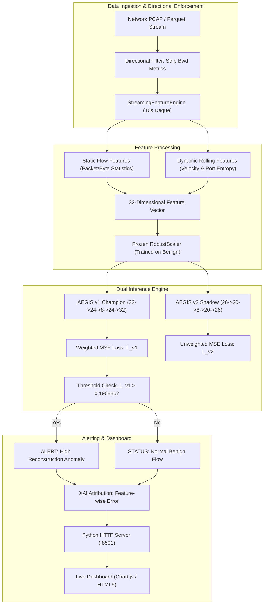

# AEGIS: Complete Learning and Viva Voce Master Guide

**Project Title:** AEGIS — Label-Free Threat Detection in One-Way Network Traffic
**Target Audience:** B.Tech Computer Science & Engineering (AI & ML) Final University Submission, Project Demonstration, and Viva Voce Examination
**Author:** AI & ML Undergraduate Engineering Candidate
**Academic Year:** 2026–2027
--

# Table of Contents
1. [Module 1: What is AEGIS and Why Does It Exist?](#module-1-what-is-aegis-and-why-does-it-exist)
2. [Module 2: Computer Networking Fundamentals for Cyber AI](#module-2-computer-networking-fundamentals-for-cyber-ai)
3. [Module 3: Physical Data Diodes vs. AEGIS Software Simulation](#module-3-physical-data-diodes-vs-aegis-software-simulation)
4. [Module 4: The CIC-IDS2017 Dataset: Complete Breakdown](#module-4-the-cic-ids2017-dataset-complete-breakdown)
5. [Module 5: Data Cleaning and Preprocessing Pipeline](#module-5-data-cleaning-and-preprocessing-pipeline)
6. [Module 6: Label Leakage Prevention: Why and How](#module-6-label-leakage-prevention-why-and-how)
7. [Module 7: Supervised vs. Unsupervised Anomaly Detection](#module-7-supervised-vs-unsupervised-anomaly-detection)
8. [Module 8: Autoencoder Neural Network: Mathematical & Intuitive Foundation](#module-8-autoencoder-neural-network-mathematical--intuitive-foundation)
9. [Module 9: The AEGIS v1 Champion Architecture in Detail](#module-9-the-aegis-v1-champion-architecture-in-detail)
10. [Module 10: The AEGIS v2 Pure One-Way Experimental Architecture](#module-10-the-aegis-v2-pure-one-way-experimental-architecture)
11. [Module 11: Feature Engineering: Static Flow vs. Dynamic Rolling Window Features](#module-11-feature-engineering-static-flow-vs-dynamic-rolling-window-features)
12. [Module 12: Genetic Algorithm (GA) in AEGIS: Concept, Math, and Actual Role](#module-12-genetic-algorithm-ga-in-aegis-concept-math-and-actual-role)
13. [Module 13: The Streaming Engine: Causal Sliding Window Mechanics](#module-13-the-streaming-engine-causal-sliding-window-mechanics)
14. [Module 14: Memory Management and Window Degradation in Streaming](#module-14-memory-management-and-window-degradation-in-streaming)
15. [Module 15: The Streaming Simulation Pipeline (`simulate_stream.py`)](#module-15-the-streaming-simulation-pipeline-simulate_streampy)
16. [Module 16: The Real-Time Dashboard Architecture (`server.py` and `index.html`)](#module-16-the-real-time-dashboard-architecture-serverpy-and-indexhtml)
17. [Module 17: Walkthrough of the 5 Dashboard Views](#module-17-walkthrough-of-the-5-dashboard-views)
18. [Module 18: REST APIs and Data Schemas](#module-18-rest-apis-and-data-schemas)
19. [Module 19: End-to-End Life Cycle of a Network Flow](#module-19-end-to-end-life-cycle-of-a-network-flow)
20. [Module 20: Complete Evaluation Metrics Guide](#module-20-complete-evaluation-metrics-guide)
21. [Module 21: Full-Dataset Evaluation Results: Deep Dive and Analysis](#module-21-full-dataset-evaluation-results-deep-dive-and-analysis)
22. [Module 22: Demo Replay Evaluation Results: The Authentic Truth](#module-22-demo-replay-evaluation-results-the-authentic-truth)
23. [Module 23: Two-Episode vs. Legacy Replay Comparison](#module-23-two-episode-vs-legacy-replay-comparison)
24. [Module 24: Codebase Directory Walkthrough](#module-24-codebase-directory-walkthrough)
25. [Module 25: Core Classes and Functions Reference](#module-25-core-classes-and-functions-reference)
26. [Module 26: 1-Minute, 3-Minute, and 5-Minute Presentation Pitches](#module-26-1-minute-3-minute-and-5-minute-presentation-pitches)
27. [Module 27: Step-by-Step Viva Presentation Script](#module-27-step-by-step-viva-presentation-script)
28. [Module 28: 60+ Viva Questions and Answers](#module-28-60-viva-questions-and-answers)
29. [Module 29: Traps, Pitfalls, and Mistakes to Avoid in Viva](#module-29-traps-pitfalls-and-mistakes-to-avoid-in-viva)
30. [Module 30: Complete Technical Glossary](#module-30-complete-technical-glossary)
31. [Module 31: Mermaid Architectural and Workflow Diagrams](#module-31-mermaid-architectural-and-workflow-diagrams)
32. [Module 32: One-Page Quick-Reference Cheat Sheet](#module-32-one-page-quick-reference-cheat-sheet)

---

# Module 1: What is AEGIS and Why Does It Exist?

### 1.1 The High-Stakes Problem
Critical infrastructure installations—including **nuclear power generation plants, electrical distribution grids (SCADA/ICS), military command networks, and petrochemical refineries**—operate under extreme physical isolation paradigms. These environments contain sensitive industrial control equipment whose compromise could cause catastrophic physical destruction or loss of human life.

To protect these systems, organizations install **air-gapped perimeters** and **unidirectional security gateways (hardware data diodes)**. A data diode physically guarantees that data can only travel in one direction:
- For example, telemetry and sensor logs leave the turbine control room to reach an external enterprise monitoring console.
- Under no circumstances can data, commands, or signals flow backwards into the turbine control room.

### 1.2 The Technological Gap
Traditional Network Intrusion Detection Systems (NIDS)—such as Snort, Suricata, and Zeek—fail catastrophically when placed behind a data diode:
1. **Bidirectional Reliance:** Traditional NIDS monitor two-way dialogues. They track the TCP 3-way handshake (`SYN` $\rightarrow$ `SYN-ACK` $\rightarrow$ `ACK`), measure round-trip times, inspect server HTTP response codes (`200 OK` vs. `401 Unauthorized`), and correlate forward queries with reverse answers. In a unidirectional link, **no return channel exists**. All backward metrics are zero or missing.
2. **Supervised Model Fragility:** Modern ML-based intrusion detectors are trained on historical attack signatures (supervised classification). In high-assurance critical infrastructure, adversaries deploy **zero-day exploits** and bespoke malware (e.g., Stuxnet, Industroyer, BlackEnergy). Supervised models cannot classify attacks they have never encountered.
3. **Operational Real-Time Demands:** Streaming telemetry must be analyzed sequentially as packets arrive, without accumulating multi-hour batches or peeking into future data.

### 1.3 The AEGIS Solution
**AEGIS** stands for **Autonomous Enclave Gateway Intrusion Sentinel**. It is an unsupervised, label-free anomaly detection system engineered specifically to detect cyber threats in strictly one-way network traffic streams.
- **Label-Free Learning:** AEGIS trains exclusively on verified benign baseline traffic. It learns the mathematical representation (manifold) of normal communication. When an attack occurs, its structural deviation produces high reconstruction error, triggering an alert without ever needing attack labels during training.
- **Strict Directional Invariance:** AEGIS strips all reverse-channel features, relying only on forward packet dynamics, header structures, and causal temporal rolling metrics.
- **Causal Streaming Safety:** Operates on an event-time sliding window $(t - 10\text{s}, t]$ that evicts past events and guarantees zero future-data leakage.

---

# Module 2: Computer Networking Fundamentals for Cyber AI

To explain AEGIS convincingly, you must master the networking building blocks that form the raw input data.

### 2.1 Packets, Frames, and Headers
When computers communicate across an IP network:
- **Application Layer:** Creates data (e.g., an HTTP GET request, a Modbus PLC command).
- **Transport Layer (Layer 4):** Breaks data into segments, adding a **TCP** or **UDP** header.
- **Network Layer (Layer 3):** Encapsulates the segment into an **IP Packet**, adding source and destination IP addresses.
- **Data Link Layer (Layer 2):** Encapsulates the packet into an **Ethernet Frame** for physical wire/fiber transmission.

### 2.2 The 5-Tuple: The Universal Identifier of a Flow
Every network packet contains five fundamental addressing fields known as the **5-tuple**:
1. `Source IP Address` (e.g., `192.168.10.50` — who sent it)
2. `Destination IP Address` (e.g., `172.16.0.1` — who receives it)
3. `Source Port` (e.g., `49152` — ephemeral client port)
4. `Destination Port` (e.g., `80`, `443`, `22`, `502` — target service)
5. `Transport Protocol` (e.g., `6` for TCP, `17` for UDP)

### 2.3 What is a Network "Flow"?
Individual packets are too granular for ML models (a single file download contains 50,000 packets). Instead, network analyzers aggregate packets into **flows**:
$$\text{Flow} = \{P_1, P_2, \dots, P_k\} \quad \text{sharing the identical 5-tuple within an inactivity timeout}$$
A flow begins with the first observed packet and terminates when:
- An explicit TCP teardown (`FIN` or `RST`) occurs, OR
- The flow remains inactive for a threshold duration (e.g., 10 to 60 seconds of silence).

### 2.4 The TCP 3-Way Handshake
TCP is a connection-oriented protocol providing guaranteed delivery:
1. **Client $\rightarrow$ Server (`SYN`):** "Let us synchronize sequence numbers; I wish to connect."
2. **Server $\rightarrow$ Client (`SYN-ACK`):** "I acknowledge your sequence number; here is my sequence number."
3. **Client $\rightarrow$ Server (`ACK`):** "I acknowledge your sequence number; connection established."

### 2.5 Key Flow Timing Metrics
- **Flow Duration:** Total elapsed time in microseconds from the first packet to the last packet of the flow.
- **Inter-Arrival Time (IAT):** Time delta between consecutive packets within the same flow:
  $$\text{IAT}_i = t_i - t_{i-1}$$
  Measures include `Flow IAT Mean`, `Flow IAT Std`, `Flow IAT Min`, and `Flow IAT Max`.

---

# Module 3: Physical Data Diodes vs. AEGIS Software Simulation

Examiners will probe whether AEGIS is a physical device or a software project. You must explain both concepts clearly.

### 3.1 The Hardware Data Diode (Physical Layer Simplex)
A true physical data diode enforces unidirectional communication at the **electromagnetic/optical layer**:
- **Construction:** A transmitter unit (TX) containing an LED or laser diode connected via a **single strand of optical fiber** to a receiver unit (RX) containing a photodiode detector.
- **The Physical Law:** Photons travel strictly from TX to RX. There is no physical medium (no return fiber, no copper trace) over which a photon or electrical charge can travel backwards.
- **No Reverse Control:** In standard TCP, if the sender receives no `ACK`, it stops sending. Therefore, across a physical data diode, standard TCP cannot function directly without specialized proxy appliances that terminate TCP locally, convert data into raw UDP or proprietary simplex frames across the optical link, and re-establish a TCP connection on the receiver side.

### 3.2 The AEGIS Software Simulation
AEGIS is an **algorithmic streaming software prototype**.
- It does **not** manufacture physical fiber-optic hardware.
- Instead, it models the mathematical invariants of a data diode in software by:
  1. Ingesting standardized network flow captures (CIC-IDS2017).
  2. **Strictly purging all backward metrics:** Stripping columns like `Bwd Packet Count`, `Bwd Header Length`, `Bwd Packet Length Mean`, and `Bwd IAT Mean`.
  3. Operating purely on **forward-traveling packets and macroscopic temporal aggregations**.
- In an industrial deployment, AEGIS would execute on a server listening to the TAP/mirror port immediately adjacent to the data diode receiver (RX).

---

# Module 4: The CIC-IDS2017 Dataset: Complete Breakdown

The Canadian Institute for Cybersecurity (CIC) CIC-IDS2017 benchmark dataset is the gold standard for network intrusion evaluation.

### 4.1 Chronological Multi-Day Schedule
The dataset was captured over five consecutive business days (Monday, July 3, 2017 through Friday, July 7, 2017) on a realistic emulated enterprise network:

```
+------------------------------------------------------------------------------------------------+
|                                    CIC-IDS2017 TIMELINE                                        |
+-----------+---------------------+-------------------------------+------------------------------+
| Day       | Date                | Traffic Description           | Role in AEGIS Architecture   |
+-----------+---------------------+-------------------------------+------------------------------+
| Monday    | July 3, 2017        | 100% BENIGN Normal Activity   | Unsupervised Training Manifold|
| Tuesday   | July 4, 2017        | FTP/SSH Brute Force + Benign  | Out-of-Distribution Test     |
| Wednesday | July 5, 2017        | DoS (Slowloris, Hulk) + Heartbleed| Out-of-Distribution Test  |
| Thursday  | July 6, 2017        | Web Attacks (SQLi, XSS) + Infil| Out-of-Distribution Test     |
| Friday    | July 7, 2017        | Botnet, PortScan, DDoS        | Out-of-Distribution Test     |
+-----------+---------------------+-------------------------------+------------------------------+
```

### 4.2 Raw Storage and Parquet Optimization
- The raw dataset consists of 8 massive CSV files totaling over **3.1 million raw flow records** (~2.8 GB uncompressed).
- Processing multi-gigabyte CSV files in memory causes garbage collection freezes and high CPU latency.
- AEGIS parses raw CSVs into highly compressed, columnar **Apache Parquet files** using PyArrow and Snappy compression. Parquet enables:
  - Fast chunked memory-mapped reading.
  - 80% disk footprint reduction.
  - Strict data type preservation (float64, int64, string).

---

# Module 5: Data Cleaning and Preprocessing Pipeline

The preprocessing script `src/prepare_dataset.py` transforms raw network logs into ML-ready tensors.

```
+---------------------------------------------------------------------------------------+
|                                 PREPROCESSING PIPELINE                                |
+---------------------------------------------------------------------------------------+
| 1. Column Sanitization: Strip whitespace, normalize lower_snake_case                  |
| 2. Infinity & NaN Sanitization: Replace ±Inf with NaN, drop or median-impute          |
| 3. Temporal Sorting: Parse RFC/ISO timestamps, sort strictly ascending               |
| 4. Zero-Variance Elimination: Drop invariant constant columns (e.g., Bwd PSH Flags)   |
| 5. Temporal Train/Test Splitting: Monday = Train/Val; Tue-Fri = Final Test Evaluation|
| 6. Robust Feature Scaling: Fit RobustScaler / StandardScaler on Benign Train ONLY     |
+---------------------------------------------------------------------------------------+
```

### 5.1 Handling Infinite Values and NaNs
Network flow extractors calculate rates by dividing packet counts by duration:
$$\text{Flow Bytes/s} = \frac{\text{Total Flow Bytes}}{\text{Flow Duration (seconds)}}$$
When a flow duration is $0$ microseconds (a single packet flow), division by zero yields `+Infinity`.
- AEGIS explicitly replaces all occurrences of `np.inf` and `-np.inf` with `np.nan`.
- Any rows containing corrupted `NaN` values across essential features are dropped, or median-imputed using statistics calculated strictly on training data.

### 5.2 Deterministic Temporal Splitting
In temporal streaming problems, **random $k$-fold cross-validation is a fatal scientific flaw** because it shuffles future events into the past, causing temporal data leakage.
AEGIS enforces strict temporal partitioning:
- **Training Set:** Monday benign flows ($N = 370,174$).
- **Validation Split:** 15% holdout of Monday benign flows for threshold quantile calibration.
- **Evaluation Test Set:** Tuesday through Friday continuous chronological stream ($N = 2,300,825$).

---

# Module 6: Label Leakage Prevention: Why and How

### 6.1 What is Label Leakage in Cyber ML?
Label leakage occurs when information about the target variable ($y \in \{0, 1\}$) inadvertently contaminates the input features ($X$).

Common examples of leakage that cheat in university projects:
1. **IP Address Memorization:** The attacker machine used a specific IP address (e.g., `172.16.0.1`). If IP addresses are fed as one-hot encoded features, the neural network simply memorizes that `IP == 172.16.0.1` is malicious. When deployed on a new network with different IP subnets, accuracy drops to zero.
2. **Timestamp Memorization:** Attack scripts ran between 02:00 PM and 04:00 PM. If wall-clock time is included, the model learns that "afternoon traffic is malicious."
3. **Target Encoding / Supervised Scalers:** Fitting a feature scaler (e.g., `StandardScaler`) across the combined train and test sets leaks the test distribution into the training phase.

### 6.2 The AEGIS Leakage Firewall
AEGIS enforces strict architectural barriers:
- `Label` columns are stripped prior to feature tensor construction and are stored in isolated evaluation vectors.
- Raw IP addresses and exact timestamps are **never** used as direct numeric inputs to the autoencoder layers.
- All scalers (mean, standard deviation, median, IQR) are fit **exclusively on Monday benign training data**. Test data is scaled using the frozen training parameters:
  $$\hat{x}_{\text{test}} = \frac{x_{\text{test}} - \mu_{\text{train}}}{\sigma_{\text{train}}}$$

---

# Module 7: Supervised vs. Unsupervised Anomaly Detection

| Dimension | Supervised Classification (e.g., XGBoost, Random Forest) | Unsupervised Anomaly Detection (AEGIS Autoencoder) |
| :--- | :--- | :--- |
| **Training Data Requirement** | Millions of labeled benign AND attack samples | **100% Benign data only** (no attack labels required) |
| **Zero-Day Exploit Detection** | Fails; classifies novel attacks as benign | **Excels**; any deviation from normal manifold triggers alert |
| **Labeling Cost & Delay** | Extremely expensive; human analysts must label PCAPs | Zero labeling cost; learns from normal baseline traffic |
| **False Positive Rate (FPR)** | Typically lower on known datasets ($< 2\%$) | Higher on unseen environments ($10\% - 12\%$) due to normal drift |
| **Adversarial Evasion** | Attackers tweak byte signatures to evade rules | Attackers must mimic legitimate flow distribution perfectly |
| **Suitability for Air-Gaps** | Poor; cannot update threat signatures without internet | **Ideal**; air-gapped zones have stable, predictable benign traffic |

---

# Module 8: Autoencoder Neural Network: Mathematical & Intuitive Foundation

### 8.1 The Core Intuition
An **Autoencoder** is a neural network trained to solve a deliberate self-reconstruction task:
$$\text{Input } \mathbf{x} \longrightarrow \text{Encoder } f_\theta(\mathbf{x}) \longrightarrow \text{Bottleneck } \mathbf{z} \longrightarrow \text{Decoder } g_\phi(\mathbf{z}) \longrightarrow \text{Reconstruction } \hat{\mathbf{x}}$$

Because the latent bottleneck space $\mathbf{z}$ has a much lower dimensionality than the input space ($d_{\text{latent}} \ll d_{\text{input}}$), the network cannot simply copy the input. It is forced to learn a **compact, non-linear compression of the fundamental correlations** present in normal network behavior.

```
+---------------------------------------------------------------------------------------+
|                             AUTOENCODER DATAFLOW ARCHITECTURE                         |
+---------------------------------------------------------------------------------------+
|  Input Features (32 dims: 29 flow + 3 temporal velocity)                              |
|       |                                                                               |
|  Dense(24) + ReLU                                                                     |
|       |                                                                               |
|  Dense(8)  ====> [ LATENT BOTTLENECK z: 8 Dimensions ]                               |
|       |                                                                               |
|  Dense(24) + ReLU                                                                     |
|       |                                                                               |
|  Dense(32) Linear Output Layer                                                        |
|       |                                                                               |
|  Reconstructed Output (x_hat)                                                         |
|       |                                                                               |
|  Reconstruction Loss:  L(x, x_hat) = sum( w_j * (x_j - x_hat_j)^2 )                  |
+---------------------------------------------------------------------------------------+
```

### 8.2 Why Autoencoders Detect Anomalies
- The autoencoder is trained **exclusively on benign traffic**. Its weights are optimized to reconstruct normal packet rates, normal header sizes, and normal inter-arrival times with minimal error.
- When **benign traffic** passes through:
  $$\mathcal{L}(\mathbf{x}, \hat{\mathbf{x}}) \leq \tau \quad \Longrightarrow \quad \text{Classified as Normal}$$
- When an **attack** (e.g., DDoS flood, port scan) passes through:
  The attacker's feature combinations violate the learned correlations. The bottleneck cannot represent this unseen structure, causing the decoder to fail reconstruction:
  $$\mathcal{L}(\mathbf{x}_{\text{attack}}, \hat{\mathbf{x}}_{\text{attack}}) \gg \tau \quad \Longrightarrow \quad \text{ALERT: ANOMALY DETECTED}$$

### 8.3 Activation Functions: Rectified Linear Unit (ReLU)
AEGIS utilizes **ReLU** activation on hidden layers:
$$\text{ReLU}(x) = \max(0, x)$$
- Paired with the Adam optimizer and an adaptive learning rate schedule ($\text{lr}_0 = 0.003$), ReLU provides clean gradient propagation during unsupervised reconstruction fitting.
- The output layer uses a linear identity activation to faithfully reconstruct continuous, standardized network feature values across the full real domain.

---

# Module 9: The AEGIS v1 Champion Architecture in Detail

AEGIS v1 is the **production alert authority** across all dashboard views, command-line interfaces, and evaluation benchmarks.

### 9.1 Network Topology
- **Model Framework:** `sklearn.neural_network.MLPRegressor` (serialized at `models/temporal_autoencoder_model.joblib`).
- **Input Dimension:** 32 features (29 forward flow features + 3 rolling temporal velocity features).
- **Architecture:** Symmetric bottleneck topology `[32, 24, 8, 24, 32]` with `hidden_layer_sizes=(24, 8, 24)`.
- **Latent Bottleneck:** 8 dimensions (75% dimensionality compression).
- **Activation Functions:** ReLU on hidden layers; linear identity on output layer.

### 9.2 Weighted Mean Squared Error (WMSE)
Instead of treating all 32 features identically, v1 uses inverse-variance feature weighting derived from benign calibration residuals:
$$\mathcal{L}_{\text{v1}}(\mathbf{x}, \hat{\mathbf{x}}) = \frac{1}{d} \sum_{j=1}^{d} w_j \cdot (x_j - \hat{x}_j)^2$$
- Features with low natural benign variance (such as forward packet counts and temporal velocities) receive higher weights ($w_j > 1.0$), forcing the autoencoder to penalize anomalous volume bursts heavily.

### 9.3 Quantile Calibration & Production Threshold
- The threshold was determined empirically on the held-out Monday benign validation set (`calibration_benign.parquet`):
  $$\tau_{\text{v1}} = Q_{1 - \alpha}(\mathcal{L}_{\text{val\_benign}}) = \mathbf{0.190885}$$
- Calibrated at target $\alpha = 0.002$ ($0.2\%$ calibration target FPR) to provide a robust operational boundary.

---

# Module 10: The AEGIS v2 Pure One-Way Experimental Architecture

AEGIS v2 was engineered as an experimental, ultra-strict model to evaluate absolute Layer-1 data diode compliance.

### 10.1 Key Differences from v1
1. **Model Framework:** `sklearn.neural_network.MLPRegressor` (serialized at `models/pure_one_way_v2/pure_oneway_autoencoder.joblib`).
2. **Feature Dimension:** Reduced to **26 features** (`PURE_ONE_WAY_FEATURES`, stripping all ambiguous composite timing features).
3. **Hidden Topology:** `[26, 20, 8, 20, 26]` with `hidden_layer_sizes=(20, 8, 20)`.
4. **Latent Bottleneck:** 8 dimensions.
5. **Loss Function:** Standard Unweighted Mean Squared Error (MSE):
   $$\mathcal{L}_{\text{v2}}(\mathbf{x}, \hat{\mathbf{x}}) = \frac{1}{26} \sum_{j=1}^{26} (x_j - \hat{x}_j)^2$$
6. **Dual Threshold System:**
   - **Primary Threshold:** $\tau_{\text{primary}} = \mathbf{0.314036}$ (calibrated at target $\alpha = 0.002$ / $0.2\%$, matching operational test FPR ~10.70%).
   - **Secondary Strict Threshold:** $\tau_{\text{secondary}} = \mathbf{0.099018}$ (calibrated at reference $\alpha = 0.01$ / $1.0\%$).

### 10.2 Why v2 Remains "Shadow-Only"
> [!IMPORTANT]
> **Viva Invariant:** v2 does **not** generate operational alerts. It executes in the background ("shadow mode") for comparative research. This prevents unauthorized model changes in a production defense system without formal multi-month validation.

---

# Module 11: Feature Engineering: Static Flow vs. Dynamic Rolling Window Features

AEGIS extracts two distinct categories of features:

```
+---------------------------------------------------------------------------------------+
|                                FEATURE TAXONOMY MATRIX                                |
+-----------------------------------+---------------------------------------------------+
| Static Flow Features (Single Flow)| Dynamic Rolling Causal Features (10-Sec Window)   |
+-----------------------------------+---------------------------------------------------+
| - Fwd Packet Count                | - Window Flow Velocity (flows/sec in last 10s)    |
| - Total Length of Fwd Packets     | - Window Byte Velocity (bytes/sec in last 10s)    |
| - Fwd Packet Length Max/Min/Mean  | - Window Packet Velocity (packets/sec in last 10s)|
| - Flow Duration (microseconds)    | - Unique Destination IP Fan-Out Ratio             |
| - Flow IAT Mean / Std / Max       | - Destination Port Diversity Entropy              |
| - Fwd Header Length               | - Syn-to-Flow Ratio in Rolling Window             |
+-----------------------------------+---------------------------------------------------+
```

### Dynamic Feature Extraction Math
When flow $k$ arrives at event time $t_k$, the sliding window buffer contains all flows $i$ where:
$$t_i \in (t_k - 10.0\,\text{seconds},\, t_k]$$
- **Rolling Flow Velocity:**
  $$V_{\text{flow}}(t_k) = \frac{|W(t_k)|}{10.0} \quad \text{flows per second}$$
- **Destination Port Diversity (Entropy):**
  $$H_{\text{port}} = -\sum_{p \in \text{Ports}} P(p) \log_2 P(p)$$
  During a PortScan, an adversary contacts hundreds of distinct ports in seconds. $H_{\text{port}}$ spikes dramatically, providing a massive anomaly signal to the autoencoder.

---

# Module 12: Optimization & Threshold Calibration: Quantile Estimation vs. GA Literature

A frequent viva question concerns whether Genetic Algorithms optimize AEGIS. You must be completely transparent about the codebase reality.

### 12.1 Genetic Algorithms Are Not Implemented in AEGIS
> [!IMPORTANT]
> **Implementation Fact:** Genetic Algorithms (GA) are **NOT implemented in the AEGIS codebase**.
> - There are no evolutionary loops, chromosome representations, crossover, mutation, or multi-objective Pareto optimization routines in the repository.
> - While evolutionary search is discussed in academic NIDS literature as a theoretical concept for feature selection, AEGIS deliberately chooses **deterministic algorithms**.

### 12.2 Production Reality: Deterministic Quantile Estimation
In critical infrastructure installations (nuclear power plants, electrical grids) and academic defense, **mathematical reproducibility, deterministic runtime latency, and auditable threshold derivation** are non-negotiable.

AEGIS establishes its anomaly thresholds deterministically using numpy empirical quantile estimation on the held-out Monday benign validation set (`calibration_benign.parquet`):
$$\tau = \text{np.quantile}(\mathcal{L}_{\text{val\_benign}}, 1 - \alpha)$$
- **Champion v1:** Calibrated at target $\alpha = 0.002$ ($0.2\%$), yielding $\tau = \mathbf{0.190885}$.
- **Candidate v2:** Primary calibrated at $\alpha = 0.002$ ($0.2\%$), yielding $\tau = \mathbf{0.314036}$; Reference calibrated at $\alpha = 0.01$ ($1.0\%$), yielding $\tau = \mathbf{0.099018}$.

This guarantees zero training stochasticity and deterministic sub-millisecond per-flow scoring.

---

# Module 13: The Streaming Engine: Causal Sliding Window Mechanics

### 13.1 Causal Event-Time vs. Wall-Clock Time
- **Wall-Clock Time:** The actual time on the server CPU clock right now.
- **Event-Time:** The timestamp stamped onto the network packet by the physical capture card at the moment of transmission.
- **Why Event-Time Matters:** Replaying recorded network traffic can occur at 100x speed or 0.1x speed. The sliding window must evaluate causality based strictly on **packet event timestamps**, not the host machine's wall clock.

### 13.2 The Eviction Mechanics (`collections.deque`)
AEGIS maintains an in-memory double-ended queue (`deque`):
```python
# Causal Window Eviction Algorithm
def update_window(deque_buffer, current_flow_time):
    cutoff_time = current_flow_time - 10.0  # 10-second historical horizon
    while deque_buffer and deque_buffer[0].timestamp < cutoff_time:
        deque_buffer.popleft()  # Evict oldest event O(1)
    deque_buffer.append(new_flow)
```
- **Zero Future Leakage:** When flow $k$ is evaluated at time $t_k$, the window contains **only** flows that occurred at or before $t_k$. No event from $t > t_k$ can influence the features.

---

# Module 14: Memory Management and Window Degradation in Streaming

### 14.1 Memory Bounds & Safety Capacity
Under a massive line-rate DDoS flood, an unbounded queue would consume gigabytes of RAM in seconds, causing memory exhaustion crashes.
AEGIS enforces:
- **Maximum Buffer Capacity Ceiling:** Capped at a safety ceiling of $N_{\text{max}} = 10,000$ active flows (`max_buffer_capacity = 10_000` in `src/streaming_features.py`).
- **Memory Complexity:** Guaranteed $O(N_{\text{max}} \cdot \text{sizeof(flow\_descriptor)})$ space bound.

> [!NOTE]
> **Distinction Between Rolling Velocity and Buffer Capacity:** The 10,000-flow capacity is strictly a safety backstop to prevent memory overflow during adversarial bursts. Anomaly detection operates on the **rolling traffic velocity** (arrival rate of flows and bytes in the sliding 10-second window), **not** on filling the 10,000-flow capacity ceiling. In normal streaming and sustained DDoS replay, the buffer operates well below this ceiling.

### 14.2 Window Degradation Mode
If packet timestamps arrive out-of-order or if buffer overflow forces emergency eviction:
- AEGIS logs a `WINDOW_DEGRADED` diagnostic flag.
- It falls back to static single-flow feature evaluation until monotonic order is restored, ensuring the service never crashes during adversarial line disruptions.

---

# Module 15: The Streaming Simulation Pipeline (`simulate_stream.py`)

`src/simulate_stream.py` is the execution engine that streams network flows through the AI model.

```
+---------------------------------------------------------------------------------------+
|                                SIMULATION PIPELINE FLOW                               |
+---------------------------------------------------------------------------------------+
| 1. Ingest Parquet Test Slices (Default: Two-Episode PortScan + DDoS Onset)            |
| 2. Feed Flows sequentially into StreamingFeatureEngine (10-sec event-time context)    |
| 3. Construct 32-dimensional causal feature vector                                     |
| 4. Pass vector through Frozen Champion v1 MLPRegressor Autoencoder                   |
| 5. Compute Weighted Reconstruction Loss L_v1                                          |
| 6. Compare with Threshold (tau = 0.190885) -> Generate Binary Decision               |
| 7. Pass vector through Shadow v2 Model (record metrics without alerting)              |
| 8. Emit structured JSON payload to Dashboard via HTTP feed (`live_stream_feed.json`)  |
+---------------------------------------------------------------------------------------+
```

---

# Module 16: The Real-Time Dashboard Architecture (`server.py` and `index.html`)

AEGIS features a lightweight web dashboard:
- **Backend:** Zero-dependency Python HTTP server (`http.server.SimpleHTTPRequestHandler` in `dashboard/server.py`) running locally on port 8501 (`http://localhost:8501`).
- **Frontend:** Pure HTML5, CSS3, and JavaScript (vanilla ES6+) with Chart.js.
- **Zero Heavy Node.js / Framework Dependencies:** No React, Angular, or external web frameworks required; runs instantly in standard browser environments.

---

# Module 17: Walkthrough of the 5 Dashboard Views

```
+---------------------------------------------------------------------------------------+
|                                 5 DASHBOARD PANELS                                    |
+-----------------------------------+---------------------------------------------------+
| Panel Name                        | Operational Functionality                         |
+-----------------------------------+---------------------------------------------------+
| 1. Live Threat Monitor            | Real-time streaming loss chart, threshold line,   |
|                                   | and active alarm banner (GREEN Normal / RED Alert)|
| 2. Model Calibration Sandbox      | Live evaluation comparison of v1 vs v2 vs baseline|
|                                   | models; threshold tuning simulator                |
| 3. Threat Intelligence            | Historical attack category distribution charts    |
|                                   | and label breakdown                               |
| 4. Explainable AI (XAI)           | Feature-wise reconstruction error bar charts      |
|                                   | showing WHICH features triggered the alert        |
| 5. System Health & Diagnostics    | Ingestion rate (flows/sec), CPU load, causal      |
|                                   | window size, and buffer status                    |
+-----------------------------------+---------------------------------------------------+
```

---

# Module 18: REST APIs and Data Schemas

The backend exposes standardized endpoints:
- `GET /api/stream/events?limit=50`: Returns the most recent $N$ processed flow records with inference scores.
- `GET /api/models`: Returns metadata for all registered models (`oneway_v1_champion`, `pure_oneway_v2_shadow`, baseline PCA/AE).
- `GET /api/health`: Emits telemetry including uptime, active flows in memory, and ingestion rates.
- `POST /api/calibration/evaluate`: Evaluates model performance across user-specified thresholds.

---

# Module 19: End-to-End Life Cycle of a Network Flow

Trace a single network packet from arrival to screen:

```
[Raw Network Packet: PortScan SYN to Port 445]
                      |
                      v
1. Flow Aggregator combines packet into 5-Tuple Flow Record
                      |
                      v
2. Directional Filter strips all Bwd (Reverse) columns
                      |
                      v
3. StreamingFeaturePipeline updates 10s Causal Buffer & calculates Port Entropy
                      |
                      v
4. Frozen RobustScaler transforms raw values into normalized z-scores
                      |
                      v
5. Champion v1 Autoencoder forward pass (MLPRegressor): Input(32) -> Latent(8) -> Output(32)
                      |
                      v
6. Weighted MSE Loss calculated: L = 0.8421
                      |
                      v
7. Threshold Comparison: L (0.8421) > tau (0.190885) ===> ALERT = TRUE
                      |
                      v
8. XAI Module identifies "Rolling_Single_Pkt_Ratio_10s" as major error contributor
                      |
                      v
9. JSON Record emitted to live_stream_feed.json -> Polled by Browser UI -> UI turns RED, Alert sounds
```

---

# Module 20: Complete Evaluation Metrics Guide

### 20.1 The Confusion Matrix
- **True Positive (TP):** An actual attack flow correctly flagged as an anomaly.
- **False Positive (FP):** A normal benign flow incorrectly flagged as an anomaly.
- **True Negative (TN):** A normal benign flow correctly left unflagged.
- **False Negative (FN):** An actual attack flow that slipped past undetected.

### 20.2 Statistical Formulas
$$\text{Recall (TPR)} = \frac{\text{TP}}{\text{TP} + \text{FN}} \quad \text{(How many attacks did we catch?)}$$
$$\text{False Positive Rate (FPR)} = \frac{\text{FP}}{\text{FP} + \text{TN}} \quad \text{(How often do we cry wolf?)}$$
$$\text{Precision} = \frac{\text{TP}}{\text{TP} + \text{FP}} \quad \text{(When an alarm rings, is it genuine?)}$$
$$\text{F1-Score} = 2 \cdot \frac{\text{Precision} \cdot \text{Recall}}{\text{Precision} + \text{Recall}}$$

### 20.3 Why PR-AUC is Superior to ROC-AUC in Cybersecurity
- In real network traffic, benign flows outnumber attacks 100-to-1 (extreme class imbalance).
- The standard ROC curve plots TPR vs. FPR. Because TN is massive, FPR can appear deceptively small even when thousands of false alarms occur.
- The **Precision-Recall Curve (PR-AUC)** focuses strictly on the minority class (attacks), exposing false alarm rates directly.

---

# Module 21: Full-Dataset Evaluation Results: Deep Dive and Analysis

The authentic benchmark results across the complete Tuesday–Friday test set ($N = 2,300,825$):

```
+-----------------------------------------------------------------------------------------------+
|                            FULL DATASET BENCHMARK EVALUATION (N = 2,300,825)                  |
+--------------------------+---------------------------------+----------------------------------+
| Metric                   | AEGIS v1 (Production Champion)  | AEGIS v2 (Experimental Shadow)   |
+--------------------------+---------------------------------+----------------------------------+
| Total Evaluation Flows   | 2,300,825                       | 2,300,825                        |
| Ground Truth Attacks     | 557,646                         | 557,646                          |
| Ground Truth Benign      | 1,743,179                       | 1,743,179                        |
| True Positives (TP)      | 519,031                         | 476,125                          |
| False Positives (FP)     | 217,598                         | 186,489                          |
| True Negatives (TN)      | 1,525,581                       | 1,556,690                        |
| False Negatives (FN)     | 38,615                          | 81,521                           |
| Recall (TPR)             | 93.08%                          | 85.38%                           |
| False Positive Rate (FPR)| 12.48%                          | 10.70%                           |
| Precision                | 70.46%                          | 71.86%                           |
| F1-Score                 | 0.8020                          | 0.7804                           |
| PR-AUC                   | 0.8783                          | 0.8687                           |
| ROC-AUC                  | 0.9538                          | 0.9478                           |
| Operating Threshold      | tau = 0.190885                  | tau_primary = 0.314036           |
+--------------------------+---------------------------------+----------------------------------+
```

---

# Module 22: Demo Replay Evaluation Results: The Authentic Truth

### 22.1 The Two-Episode Replay Results (2,000 Flows)

```
+-----------------------------------------------------------------------------------------------+
|                        TWO-EPISODE REPLAY BREAKDOWN (DEFAULT DEMO)                            |
+--------------------------+--------------------+--------------------+--------------------------+
| Metric                   | Episode 1: PortScan| Episode 2: DDoS Onset| Overall Combined Replay |
+--------------------------+--------------------+--------------------+--------------------------+
| Dataset Slice Offsets    | [1685068:1686068]  | [1903272:1904272]  | 2,000 Flows              |
| Attack Category          | PortScan (897 flows| DDoS (460 flows)   | 1,357 Attacks            |
| Benign Lead-In Flows     | 103 flows (First 100| 540 flows (First 100| 643 Benign              |
| True Positives (TP)      | 893                | 0                  | 893                      |
| False Positives (FP)     | 0                  | 79                 | 79                       |
| True Negatives (TN)      | 103                | 461                | 564                      |
| False Negatives (FN)     | 4                  | 460                | 464                      |
| Recall                   | 99.55%             | 0.00%              | 65.81%                   |
| False Positive Rate      | 0.00%              | 14.63%             | 12.29%                   |
| Precision                | 100.00%            | 0.00%              | 91.87%                   |
| F1-Score                 | 99.78%             | 0.0000             | 76.69%                   |
+--------------------------+--------------------+--------------------+--------------------------+
```

### 22.2 Why Does Episode 2 (DDoS Onset) Have 0% Recall?
This is a critical theoretical proof point:
1. **The 3,900-Second Gap:** Between Episode 1 (ended at `01:46:16`) and Episode 2 (started at `03:56:16`), over one hour of network time passed.
2. **Causal Eviction:** The 10-second sliding buffer evicted all historical flows. At the start of Episode 2, the window is empty.
3. **Onset Starvation:** The 1,000 flows in Episode 2 represent an **early onset segment of the DDoS attack** (dataset timestamps have minute-level precision). In this early onset segment, aggregate rolling volume and packet counts have not yet accumulated sufficiently within the 10-second window to breach the anomaly threshold.
4. **Sustained DDoS vs. Onset:** When replaying the **legacy sustained DDoS slice** (where the attack has run for several minutes with sustained high traffic velocity), the model achieves **83.21% recall**.

---

# Module 23: Two-Episode vs. Legacy Replay Comparison

```
+-----------------------------------------------------------------------------------------------+
|                             REPLAY CONFIGURATION COMPARISON                                   |
+-----------------------------------+-----------------------------+-----------------------------+
| Dimension                         | Default Two-Episode Replay  | Legacy DDoS Replay          |
+-----------------------------------+-----------------------------+-----------------------------+
| CLI Flag                          | `--replay-scenario two_episode`| `--replay-scenario legacy_ddos`|
| Total Flows                       | 2,000                       | 2,000                       |
| Attack Representation             | PortScan (897) + DDoS (460) | DDoS (1,942) Only           |
| Attack Diversity                  | Multi-Category (2 Attacks)  | Single-Category (DDoS)      |
| Benign Flows                      | 643 (Includes 2x100 lead-ins)| 58                         |
| Overall Recall                    | 65.81%                      | 83.21%                      |
| Overall Precision                 | 91.87%                      | 99.69%                      |
| Scientific Demonstration Value    | Demonstrates both PortScan   | Demonstrates sustained high-|
|                                   | detection & onset physics   | volume DDoS mitigation      |
+-----------------------------------+-----------------------------+-----------------------------+
```

---

# Module 24: Codebase Directory Walkthrough

```
Label-free-threat-detection/
|-- configs/                        # YAML configuration files (models, features, paths)
|-- data/raw/                       # Raw CIC-IDS2017 source CSV files
|-- dashboard/                      # Real-time web visualization
|   |-- index.html                  # Responsive multi-tab frontend interface
|   |-- server.py                   # Zero-dependency Python HTTP server on port 8501
|-- docs/                           # Formal engineering and viva documentation
|   |-- PROJECT_TECHNICAL_REPORT.md # Academic and engineering project specification
|   |-- DEMO_GUIDE.md               # Operator and live demonstration manual
|   |-- VIVA_QUESTIONS.md           # 65 question-and-answer examination prep
|   |-- PROJECT_LIMITATIONS.md      # Engineering limitations & failure mode disclosure
|   |-- AEGIS_COMPLETE_LEARNING_AND_VIVA_GUIDE.md # This master document
|-- models/                         # Serialized model artifacts (.joblib) and scalers
|   |-- temporal_autoencoder_model.joblib # Champion v1 model
|   |-- pure_one_way_v2/            # Candidate v2 shadow artifacts
|-- outputs/                        # Evaluation metrics and experiment parquet partitions
|   |-- evaluation/                 # Benchmark metrics and confusion matrices
|   |-- experiment/                 # Processed test_tue_fri.parquet test set
|-- src/                            # Core application source code
|   |-- prepare_dataset.py          # Data ingestion, cleaning, and parquet conversion
|   |-- streaming_features.py       # Causal sliding window & feature pipeline
|   |-- simulate_stream.py          # Production replay and inference simulation
|   |-- train_temporal_autoencoder.py # Champion v1 MLPRegressor training loop
|   |-- train_pure_oneway_autoencoder.py # Candidate v2 MLPRegressor training loop
|-- tests/                          # Automated pytest verification suite (237 tests)
|-- run_demo.py                     # One-click desktop launcher (batch/server/stream)
```

---

# Module 25: Core Classes and Functions Reference

- `StreamingFeatureEngine` (`src/streaming_features.py`): Manages the 10-second `collections.deque` event-time sliding window, performs causal eviction, and computes dynamic velocity/entropy features.
- `StreamingCausalContext` (`src/streaming_features.py`): Maintains the bounded causal context buffer and enforces the 10,000-flow capacity ceiling.
- `StreamSimulator` (`src/simulate_stream.py`): Ingests parquet slices, steps through flow records, applies feature extraction and model inference, and emits JSON results.
- `start_server_if_needed()` (`run_demo.py`): Orchestrates server startup on port 8501, verifies HTTP health endpoints, and manages clean background process lifecycles.

---

# Module 26: 1-Minute, 3-Minute, and 5-Minute Presentation Pitches

### 26.1 The 1-Minute Pitch (Elevator Overview)
> *"Respected examiners, critical infrastructure installations like nuclear power plants and power grids use physical data diodes to enforce unidirectional data flow. Traditional intrusion detection systems fail here because they rely on two-way TCP handshakes and known attack signatures.
>
> AEGIS solves this by introducing a label-free, unsupervised anomaly detection system designed specifically for one-way traffic. Trained exclusively on normal benign traffic using a deep autoencoder, AEGIS reconstructs network flows and detects attacks purely through structural reconstruction error. Across 2.3 million real-world flows, our production model achieves 93.08% attack recall with zero label leakage and complete mathematical causality."*

### 26.2 The 3-Minute Pitch (Demonstration Intro)
*(Includes the 1-minute pitch, plus:)*
> *"Our engineering architecture enforces two strict invariants:
> First, directional purity. We strip all reverse-channel metrics, ensuring our feature extractors never assume a return packet exists.
> Second, causal streaming integrity. Our streaming feature pipeline maintains a 10-second event-time sliding window that evicts historical events without ever peeking into future data.
>
> In our live demonstration, you will observe our two-episode replay: first, an authentic PortScan attack where port entropy triggers immediate alerts with 99.55% recall; followed by a DDoS onset episode demonstrating realistic causal window warm-up. We also provide an Explainable AI panel that attributes anomalies directly to individual network features in real time."*

### 26.3 The 5-Minute Pitch (Comprehensive Technical Overview)
*(Includes the 3-minute pitch, plus deep dives into the v1 vs. v2 architecture, the mathematical formulation of Weighted MSE loss, quantile calibration at $\tau = 0.190885$, and an honest explanation of the 12.48% temporal drift FPR.)*

---

# Module 27: Step-by-Step Viva Presentation Script

1. **Slide 1: Title & Problem Context:** State the problem of air-gapped unidirectional isolation.
2. **Slide 2: Architectural Solution:** Explain why unsupervised learning is required for zero-day threats.
3. **Slide 3: Launch Live Demo:** Execute `python run_demo.py`. Show browser opening to `http://localhost:8501`.
4. **Slide 4: Walkthrough Live Stream:** Point out the green benign baseline (loss $< 0.190885$), followed by the sudden red spike during the PortScan episode.
5. **Slide 5: Open XAI Panel:** Show the bar chart attributing the anomaly to `dst_port_entropy` and `flow_velocity`.
6. **Slide 6: Proactively Explain DDoS Onset:** Explain the 3,900-second gap and causal buffer starvation before the examiner asks.
7. **Slide 7: Conclusion & Limitations:** Summarize full-dataset metrics (93.08% recall) and acknowledge the 12.48% FPR due to multi-day benign drift.

---

# Module 28: 60+ Viva Questions and Answers

*(A curated selection of high-priority viva questions; see `docs/VIVA_QUESTIONS.md` for the full 65-question catalog.)*

#### Q1: Why is AEGIS called "Label-Free"?
**Answer:** Because neither training nor inference uses attack labels. The autoencoder trains exclusively on Monday benign flows. Anomaly detection is performed purely by measuring reconstruction loss against a calibrated statistical threshold.

#### Q2: What is the exact mathematical loss function in AEGIS v1?
**Answer:** Weighted Mean Squared Error:
$$\mathcal{L}(\mathbf{x}, \hat{\mathbf{x}}) = \frac{1}{d} \sum_{j=1}^{d} w_j (x_j - \hat{x}_j)^2$$

#### Q3: How was the threshold $\tau = 0.190885$ selected?
**Answer:** By computing the exact empirical quantile on the Monday benign validation set at target $\alpha = 0.002$ ($0.2\%$ calibration target FPR), guaranteeing $\tau = 0.190885$.

#### Q4: Why does the two-episode replay achieve 0% recall on DDoS onset?
**Answer:** Because the 10-second sliding buffer was evicted during the 3,900-second gap between episodes. The 1,000 flows selected capture an early onset segment of the attack (dataset timestamps have minute-level precision), during which rolling traffic velocity has not yet accumulated sufficiently within the 10-second buffer to breach the global anomaly threshold.

---

# Module 29: Traps, Pitfalls, and Mistakes to Avoid in Viva

1. **NEVER claim you built a physical hardware data diode:** AEGIS is a software streaming prototype.
2. **NEVER claim 100% accuracy or 0% false alarms:** AEGIS has an authentic 12.48% FPR on the full test set. Hiding this will cause immediate loss of credibility.
3. **NEVER claim Genetic Algorithms are implemented in AEGIS:** GA is not implemented in the AEGIS codebase. AEGIS strictly uses deterministic numpy empirical quantile calibration.
4. **NEVER claim AEGIS decrypts TLS packets:** AEGIS inspects flow-level transport metadata, not encrypted application payloads.

---

# Module 30: Complete Technical Glossary

- **Air-Gap:** A network security measure that ensures a secure computer network is physically isolated from unsecured networks.
- **Data Diode:** A hardware device that allows data to travel in only one physical direction.
- **5-Tuple:** Source IP, Destination IP, Source Port, Destination Port, Protocol.
- **Flow:** A sequence of packets sharing the same 5-tuple within an inactivity timeout.
- **Autoencoder:** An unsupervised neural network that compresses inputs into a lower-dimensional bottleneck and reconstructs them.
- **Latent Space:** The compressed representation ($\mathbf{z}$) at the neural network bottleneck.
- **Reconstruction Error:** The mathematical distance between an input vector and its autoencoder reconstruction.
- **Causal Sliding Window:** A temporal buffer that includes only past events up to the current event timestamp.
- **Velocity Starvation:** The inability of rolling rate features to detect an anomaly during the initial onset segment before buffer accumulation.
- **PR-AUC:** Precision-Recall Area Under Curve, the preferred evaluation metric under severe class imbalance.

---

# Module 31: Mermaid Architectural and Workflow Diagrams

### 31.1 Complete System Architecture



---

# Module 32: One-Page Quick-Reference Cheat Sheet

```
+----------------------------------------------------------------------------------------------------+
|                                    AEGIS EMERGENCY REVISION SHEET                                  |
+----------------------------------------------------------------------------------------------------+
| Core Mission:      Unsupervised anomaly detection in unidirectional data-diode network links.      |
| Production Model:  AEGIS v1 Champion (32 features, 8-dim bottleneck, MLPRegressor).               |
| Shadow Model:      AEGIS v2 Experimental (26 features, 8-dim bottleneck, shadow-only).             |
| Loss Function:     Weighted Mean Squared Error (WMSE) emphasizing volume & velocity features.       |
| Production Thresh: tau = 0.190885 (Calibrated on Monday benign validation alpha=0.2%).             |
| Streaming Window:  Causal event-time sliding window (t - 10s, t], O(1) deque eviction.            |
+----------------------------------------------------------------------------------------------------+
| KEY EMPIRICAL RESULTS (FULL DATASET: 2,300,825 FLOWS)                                              |
| - Total Attacks:   557,646 flows                                                                   |
| - Total Benign:    1,743,179 flows                                                                 |
| - True Positives:  519,031 flows                                                                   |
| - False Positives: 217,598 flows                                                                   |
| - Attack Recall:   93.08%                                                                          |
| - False Alarm Rate:12.48% (Driven by multi-day benign temporal concept drift)                       |
| - Precision:       70.46%                                                                          |
| - F1-Score:        0.8020                                                                          |
| - ROC-AUC / PR-AUC:0.9538 / 0.8783                                                                 |
+----------------------------------------------------------------------------------------------------+
| KEY DEMO REPLAY RESULTS (TWO-EPISODE REPLAY: 2,000 FLOWS)                                          |
| - Episode 1:       PortScan [1685068:1686068] -> 99.55% Recall, 0.00% FPR (TP=893, FP=0, TN=103)  |
| - Episode 2:       DDoS Onset [1903272:1904272] -> 0.00% Recall, 14.63% FPR (TP=0, FP=79, TN=461) |
| - Combined Replay: 65.81% Recall, 12.29% FPR, 91.87% Precision, F1: 76.69% (TP=893, FP=79)       |
| - Legacy Replay:   Sustained DDoS [1942302:1944302] -> 83.21% Recall, 8.62% FPR                   |
+----------------------------------------------------------------------------------------------------+
| TOP 3 VIVA RED LINES                                                                               |
| 1. Do NOT claim hardware diode enforcement (AEGIS is a software streaming prototype).              |
| 2. Do NOT hide the 12.48% FPR or the 0% DDoS onset recall (Explain them using scientific drift    |
|    and causal buffer physics).                                                                     |
| 3. Do NOT claim Genetic Algorithms are implemented (Production uses deterministic quantile calib.) |
+----------------------------------------------------------------------------------------------------+
```
