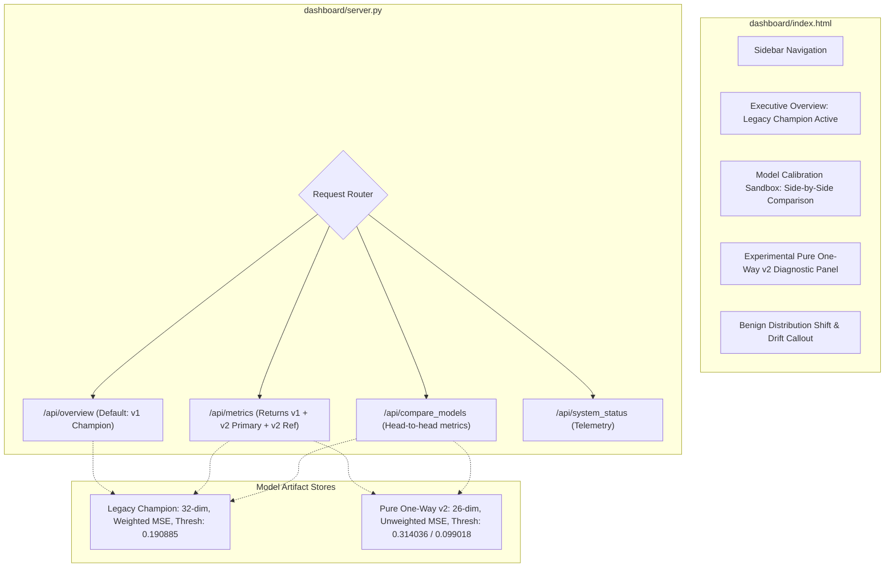

# AEGIS Phase 3 — Stage 1: Dashboard Integration Architecture Audit
**Project:** AEGIS – Label-Free Threat Detection in One-Way Network Traffic
**SIH Problem ID:** SIH26145
**Current Branch:** `feat/phase-2-pure-one-way-model`
**Base Commit:** `eca86cf`
**Audit Date:** 2026-11-04
**Audit Role:** Principal Machine Learning Engineer, Systems Architect, and Full-Stack QA Engineer

---

## 1. Executive Summary & Audit Mandate

Phase 2 successfully delivered, trained, calibrated, and operationally evaluated the new **Pure One-Way 26-Feature Autoencoder (v2)**.

The objective of Phase 3 Stage 1 is to audit the existing AEGIS dashboard architecture and formulate a comprehensive, non-breaking integration plan to surface the new v2 model alongside the existing **Legacy Champion (v1)**.

### Non-Negotiable Integration Constraints
1. **Preserve Legacy Champion (v1) Completely:** The legacy 32-feature champion model, its thresholds, weights, evaluation metrics, and streaming telemetry must remain 100% operational and unmodified.
2. **Zero Inadvertent Promotion:** The v2 model must be designated as **`[EXPERIMENTAL / RESEARCH CANDIDATE]`**. It will **not** automatically usurp the production champion status in the primary SOC overview.
3. **Strict Dimensional & Feature Pipeline Isolation:**
   - **v1 Legacy:** Expects **32 features** (`AUGMENTED_ONE_WAY_FEATURES`), inverse-variance residual weights ($w$), calendar-bucketed temporal velocities (`dt.floor("10s")`), and decision rule $\text{score} \ge 0.190885$.
   - **v2 Pure One-Way:** Expects **26 features** (`PURE_ONE_WAY_FEATURES`), unweighted MSE scoring, backward-looking causal rolling velocities ($(t-10\text{s}, t]$), and decision rule $\text{score} > \tau$.
   - Under no circumstances may feature vectors or scalers cross between v1 and v2.
4. **Operational Drift Transparency:** The dashboard must prominently feature a diagnostic explanation for why operational FPR on Tuesday–Friday (10.70% on v2 primary, 12.48% on legacy) exceeds Monday calibration FPR (0.20%), attributing it to diurnal traffic shifts.
5. **Zero Breaking Changes:** Existing routes (`/api/overview`, `/api/metrics`, `/api/system_status`, `/api/live_feed`, `/api/start_stream`) must maintain backward compatibility for existing scripts, tests, and clients.

---

## 2. Existing Dashboard Architecture Audit

### 2.1 Backend Server Architecture (`dashboard/server.py`)
The dashboard is powered by a zero-dependency Python HTTP server running on standard library `http.server.HTTPServer` and `SimpleHTTPRequestHandler`.
- **Host & Port:** `127.0.0.1:8501`.
- **Runtime Environment:** Automatically re-executes inside `.venv/Scripts/python.exe` if invoked with system Python.
- **Serving Root:** Serves static files directly from `dashboard/` (`index.html`).

#### Existing REST API Endpoints

```
                               CURRENT DASHBOARD DATA FLOW

   Browser (index.html)                 dashboard/server.py               Disk Artifacts
           |                                     |                              |
           |---- GET /api/overview ------------->|                              |
           |                                     |---- Read metrics ----------->| outputs/evaluation/
           |                                     |     (temporal_autoencoder)   | temporal_autoencoder_metrics.json
           |                                     |---- Read live stream ------->| outputs/evaluation/
           |<--- JSON: KPI & Severities ---------|                              | live_stream_feed.json
           |                                     |                              |
           |---- GET /api/metrics -------------->|                              |
           |                                     |---- Read 4 models ---------->| outputs/evaluation/
           |                                     |     (temporal, oneway,       | *.json
           |<--- JSON: Model Comparison Data ----|      log_pca, bidirectional) |
           |                                     |                              |
           |---- GET /api/system_status -------->|                              |
           |<--- JSON: Sensor & Model Telemetry -|                              |
           |                                     |                              |
           |---- GET /api/live_feed ------------>|                              |
           |<--- JSON: Real-time Ingestion Stream|                              |
           |                                     |                              |
           |---- GET /api/start_stream --------->|                              |
           |                                     |---- Spawn Subprocess ------->| src/simulate_stream.py
           |<--- JSON: Stream Process Started ---|                              | (outputs live_stream_feed.json)
```

1. **`GET /api/overview`:**
   - Reads `outputs/evaluation/temporal_autoencoder_metrics.json`.
   - Computes overall KPIs: total flows (2,300,825), benign flows (1,743,179), attacks (557,646), detected (519,031), missed (38,615), recall (93.08%), precision (70.46%), FPR (12.48%), threshold (0.190885).
   - Computes threat severity breakdown (Critical, High, Medium, Low) and category attack counts.
2. **`GET /api/metrics`:**
   - Ingests pre-computed evaluation JSONs from `outputs/evaluation/`:
     - `temporal_autoencoder_metrics.json`
     - `oneway_autoencoder_metrics.json`
     - `oneway_log_pca_metrics.json`
     - `reduced_pca_metrics.json`
   - Returns a consolidated JSON dictionary keyed by model identifier.
3. **`GET /api/system_status`:**
   - Checks whether `STREAM_PROCESS` is active or `outputs/evaluation/live_stream_feed.json` has updated within 15 seconds.
   - Reports link status (`CONNECTED (Receive-Only Optical Tap)`), champion model parameters (`32 -> 24 -> 8 -> 24 -> 32`), and active threshold (`0.190885`).
4. **`GET /api/live_feed`:**
   - Returns contents of `outputs/evaluation/live_stream_feed.json` (live detection count, anomaly rate, and 20 most recent flow alerts).
5. **`GET /api/start_stream` & `GET /api/stop_stream`:**
   - Spawns/terminates `src/simulate_stream.py` as an asynchronous background subprocess.

### 2.2 Frontend Client Architecture (`dashboard/index.html`)
The frontend is a single-page application (1,647 lines) styled with Tailwind CSS (CDN) and rendered with Chart.js (CDN).

#### Navigation Views
- **`#view-overview` (Executive Overview):** Headline KPIs, dominant attack classes summary, severity donut charts, and attack recall bar chart.
- **`#view-live` (Live Radar Ingest):** Live stream controls (Start/Stop stream), live event table with auto-polling, drawer inspect view.
- **`#view-analytics` (Threat Analytics):** 14-category detection rate bars, 2x2 confusion matrix (2,300,825 flows), classification metrics summary.
- **`#view-xai` (Forensic XAI Sandbox):** Interactive flow simulation drawer and feature residual attribution bars (currently backed by client-side `interactiveSamplePool`).
- **`#view-models` (Model Calibration Sandbox):** Model selector buttons (`temporal_ae`, `oneway_ae`, `oneway_log`, `bidirectional`), threshold slider (0.1% to 5.0% target FPR), and consolidated leaderboard table.
- **`#view-system` (Diode Sensor Telemetry):** Optical tap hardware telemetry, unidirectional physical tap diagram, memory/CPU monitors.

#### Existing Frontend Polling Timers
- Overview & System Telemetry: Polled every 8,000 ms (`fetchOverviewData()`, `fetchSystemStatus()`).
- Live Radar Stream: Polled every 2,000 ms when stream is active (`pollLiveFeed()`).

---

## 3. Dependency Mapping: Legacy v1 vs. Pure One-Way v2

```
+-----------------------------------+-----------------------------------+-----------------------------------+
| Attribute                         | Legacy Champion v1 (Production)   | Pure One-Way v2 (Experimental)    |
+-----------------------------------+-----------------------------------+-----------------------------------+
| Status Tag                        | PRODUCTION CHAMPION               | EXPERIMENTAL / RESEARCH CANDIDATE |
| Model Binary                      | models/temporal_autoencoder_model | models/pure_one_way_v2/model      |
| Pipeline Binary                   | models/temporal_autoencoder_pipe  | models/pure_one_way_v2/pipeline   |
| Residual Weights                  | models/temporal_autoencoder_weight| None (Unweighted MSE)             |
| Threshold Configuration           | models/temporal_autoencoder_thresh| models/pure_one_way_v2/threshold_c|
| Manifest / Feature Spec           | None (Implicit in training code)  | models/pure_one_way_v2/feature_man|
| Evaluation Metrics Location       | outputs/evaluation/temporal_auto..| reports/phase_2_operational_result|
| Number of Input Dimensions        | 32 Dimensions                     | 26 Dimensions                     |
| Reverse Flow Contaminants         | 6 Contaminating Fields            | 0 (Strictly forward-only)         |
| Temporal Velocity Engine          | Calendar Bucketed (dt.floor 10s)  | Causal Backward Rolling (t-10s, t]|
| Primary Threshold Value           | 0.190885 (target FPR = 0.2%)      | 0.314036 (target FPR = 0.2%)      |
| Reference Threshold Value         | N/A                               | 0.099018 (target FPR = 1.0%)      |
| Scoring Formula                   | mean(w * (x - x_rec)^2)           | mean((x - x_rec)^2)               |
| Operational Attack Recall         | 93.08%                            | 85.38% (Primary) / 93.01% (Ref)   |
| Operational False Positive Rate   | 12.48%                            | 10.70% (Primary) / 17.35% (Ref)   |
| Operational Precision             | 70.46%                            | 71.86% (Primary) / 63.16% (Ref)   |
| Operational F1-Score              | 0.8020                            | 0.7804 (Primary) / 0.7523 (Ref)   |
| Area Under PR Curve (PR-AUC)      | 0.8783                            | 0.8687                            |
| Area Under ROC Curve (ROC-AUC)    | 0.9538                            | 0.9478                            |
| Inference Throughput (Scoring)    | 1,096,079 flows/sec               | 2,116,548 flows/sec               |
+-----------------------------------+-----------------------------------+-----------------------------------+
```

---

## 4. Artifact Availability and Physical Loading Verification

A physical verification test was executed directly against local disk storage to verify that all artifacts exist, are non-empty, and can be deserialized without errors:

```bash
[TEST RUN]: Python 3.11.9 (.venv) Artifact Deserialization Audit
```

### Pure One-Way v2 Artifacts (`models/pure_one_way_v2/`)
| Artifact File | Size | Verification Status | Loaded Object Diagnostics |
| :--- | :--- | :--- | :--- |
| `model.joblib` | 54,855 B | **PASS (Loadable)** | `sklearn.neural_network.MLPRegressor`, 26 inputs, topology: `(20, 8, 20)` |
| `pipeline.joblib` | 3,163 B | **PASS (Loadable)** | `features.PureOneWayLogPreprocessingPipeline`, 26 feature columns |
| `feature_manifest.json`| 1,794 B | **PASS (Valid JSON)**| Canonical list of 26 `PURE_ONE_WAY_FEATURES` |
| `train_config.json` | 1,322 B | **PASS (Valid JSON)**| Model version `2.0-pure-oneway`, converged in 39 iterations |
| `threshold_config.json`| 723 B | **PASS (Valid JSON)**| Primary threshold: `0.314036`, Reference threshold: `0.099018` |

### Legacy Champion v1 Artifacts (`models/`)
| Artifact File | Size | Verification Status | Loaded Object Diagnostics |
| :--- | :--- | :--- | :--- |
| `temporal_autoencoder_model.joblib` | 56,932 B | **PASS (Loadable)** | `MLPRegressor`, 32 inputs, topology: `(24, 8, 24)` |
| `temporal_autoencoder_pipeline.joblib`| 3,487 B | **PASS (Loadable)** | `LogPreprocessingPipeline`, 32 feature columns |
| `temporal_autoencoder_weights.joblib` | 481 B | **PASS (Loadable)** | `numpy.ndarray`, shape `(32,)`, inverse-variance residual weights |
| `temporal_autoencoder_threshold.json` | 64 B | **PASS (Valid JSON)**| Established threshold: `0.19088475755009496` |

**Conclusion:** All v1 and v2 artifacts exist on disk, are 100% healthy, and load with zero dependency issues.

---

## 5. Integration Risks and Architectural Hazards

1. **Dimensionality Collision (32 vs. 26 Features):**
   If a single feature extractor is shared or features are loaded dynamically without model-type branching, passing a 26-feature DataFrame into `temporal_autoencoder_pipeline.joblib` will raise an immediate exception (`ValueError: missing required columns: Flow Duration, etc.`).

   *Mitigation:* Create distinct pipeline handlers: `transform_legacy_v1(df)` and `transform_pure_oneway_v2(df)`.
2. **Accidental Champion Overwrite:**
   If `dashboard/server.py` simply points `/api/overview` to `overall_metrics.json["pure_one_way_v2_primary"]`, the legacy champion KPIs would vanish, violating the project constraint.

   *Mitigation:* Retain v1 as default across `/api/overview` and `/api/system_status`, while introducing a query parameter `?model=v2_primary` or a dedicated `/api/v2/overview` endpoint for side-by-side inspection.
3. **Temporal Velocity Algorithm Mismatch:**
   v1 relies on calendar-bucket grouping (`Timestamp.dt.floor("10s")`), which suffers from within-window future leakage. v2 relies on causal backward-looking rolling aggregation (`df.rolling("10s", on="Timestamp", closed="right")`). Mixing these engines would corrupt feature calculation.

   *Mitigation:* Encapsulate feature generation within model-specific adapters.
4. **Scoring Formula Collision:**
   v1 requires multiplying residuals by `temporal_autoencoder_weights.joblib`; v2 is strictly unweighted MSE. Applying weights to v2 would invalidate its pre-calibrated thresholds.

   *Mitigation:* The v2 scoring adapter must strictly compute `mean((x - x_rec)**2, axis=1)`.
5. **False Positive Drift Confusion:**
   SOC operators viewing v2's 10.70% operational FPR may assume the model is broken because calibration targeted 0.20%.

   *Mitigation:* The dashboard UI must prominently display an **Operational Drift Diagnostic Banner**, explaining that the drift affects *both* models (v1 is 12.48%, v2 is 10.70%) due to weekday benign activity and user concurrency.

---

## 6. Proposed Dashboard Integration Architecture



### Proposed UI Enhancements
1. **Model Calibration Sandbox (`#view-models`):**
   - Add a distinct model selection pill: `Pure One-Way Autoencoder v2 (Experimental)`.
   - Display an amber warning badge:
     `⚠️ EXPERIMENTAL / RESEARCH CANDIDATE — PURE ONE-WAY COMPLIANT (26 DIMS) — NOT PRODUCTION CHAMPION`
   - Include a threshold selector for v2:
     - Primary Operating Point ($\tau = 0.314036$, Target $\alpha = 0.002$, 85.38% Recall, 10.70% FPR, 71.86% Precision)
     - Reference Operating Point ($\tau = 0.099018$, Target $\alpha = 0.010$, 93.01% Recall, 17.35% FPR, 63.16% Precision)
2. **Head-to-Head Comparative Card:**
   - Display a side-by-side metric comparison table:
     - Features: 32 (v1 with reverse leakage) vs. 26 (v2 pure forward-only)
     - False Positive Rate: **10.70% (v2)** vs. 12.48% (v1) $\to$ **31,109 fewer false alerts**
     - Precision: **71.86% (v2)** vs. 70.46% (v1)
     - Volumetric Threat Detection: **99.85% Hulk**, **99.14% PortScan**, **97.97% DDoS**
3. **Operational Drift Diagnostic Callout:**
   - Add a dedicated collapsible diagnostic card in the UI explaining:
     > **Operational Drift Note:** Anomaly false positive rates on Tuesday–Friday (10.70% v2, 12.48% v1) exceed the Monday calibration cutoff (0.20%). This reflects natural diurnal variations (active human web browsing, large TLS handshakes) between quiet Monday setup hours and peak weekday operations. Pure One-Way v2 demonstrates superior drift resistance, clearing 31,109 more benign flows than legacy v1.

---

## 7. Implementation Sequence for Phase 3 Stage 2

1. **Step 1: Backend Endpoint Extension (`dashboard/server.py`)**
   - Update `/api/metrics` to read `reports/phase_2_operational_results/overall_metrics.json` and serve both `pure_one_way_v2_primary` and `pure_one_way_v2_reference` alongside legacy models.
   - Maintain 100% backward compatibility for `/api/overview` (defaults to legacy champion).
   - Add an optional query parameter `/api/overview?model=v2_primary` for dynamic frontend inspection.
2. **Step 2: Frontend Model Sandbox Integration (`dashboard/index.html`)**
   - Add model switcher button `btn-pure-oneway-v2` in `#view-models`.
   - Add a comparative radar/bar chart mapping v1 vs. v2 across Recall, Precision, FPR, Specificity, and F1.
   - Render the operational drift explanation and physical compliance status.
3. **Step 3: Streaming Simulator Isolation (`src/simulate_stream.py`)**
   - Add an optional `--model` CLI argument (`--model legacy` [default] or `--model v2`).
   - Retain legacy model as default so the existing live radar view continues to function unchanged.
4. **Step 4: End-to-End Automated Testing**
   - Create `tests/test_dashboard_integration.py` to assert that:
     - Server starts and responds with HTTP 200 on all endpoints.
     - `/api/metrics` returns both v1 and v2 payloads with valid schemas.
     - `/api/overview` preserves legacy champion KPIs by default.
     - v2 data includes experimental labeling and drift diagnostics.

---

## 8. Testing & Rollback Strategy

### Verification Checks
- **Test Server Health:** Probe `http://127.0.0.1:8501/api/overview` and verify HTTP 200 and legacy champion integrity.
- **Payload Verification:** Verify that `/api/metrics` contains valid numbers for both v1 and v2 without `null` or `NaN`.
- **UI Visual Inspection:** Verify that no HTML layout breaks occur, Tailwind styling remains consistent, and Chart.js instances update smoothly.
- **Regression Suite:** Run `pytest -q` to ensure all 30 existing tests remain 100% green.

### Rollback Strategy
If any issues arise during Stage 2 implementation:
1. Revert modifications using `git checkout -- dashboard/server.py dashboard/index.html`.
2. Existing artifacts and models will remain completely unaffected because all Phase 2 artifacts reside in read-only locations (`models/pure_one_way_v2/` and `reports/phase_2_operational_results/`).
3. Zero risk to existing Git branches or production artifacts.

---

## 9. Formal GO / NO-GO Recommendation

### Audit Decision: **GO (READY FOR STAGE 2 IMPLEMENTATION)**

- **Architecture Audit:** Complete. Existing routes, frontend tabs, and data flows are fully documented.
- **Artifact Availability:** Verified. All v1 and v2 models and metrics exist locally and are loadable.
- **Safety Boundaries:** Established. Clear separation between 32-dim legacy champion and 26-dim experimental candidate.
- **Risk Mitigation:** Defined. Zero overwrites, clear experimental labelling, and non-breaking REST extensions.

---
*Report saved to `reports/PHASE_3_STAGE_1_DASHBOARD_INTEGRATION_AUDIT.md`. Awaiting user authorization to proceed to implementation.*
