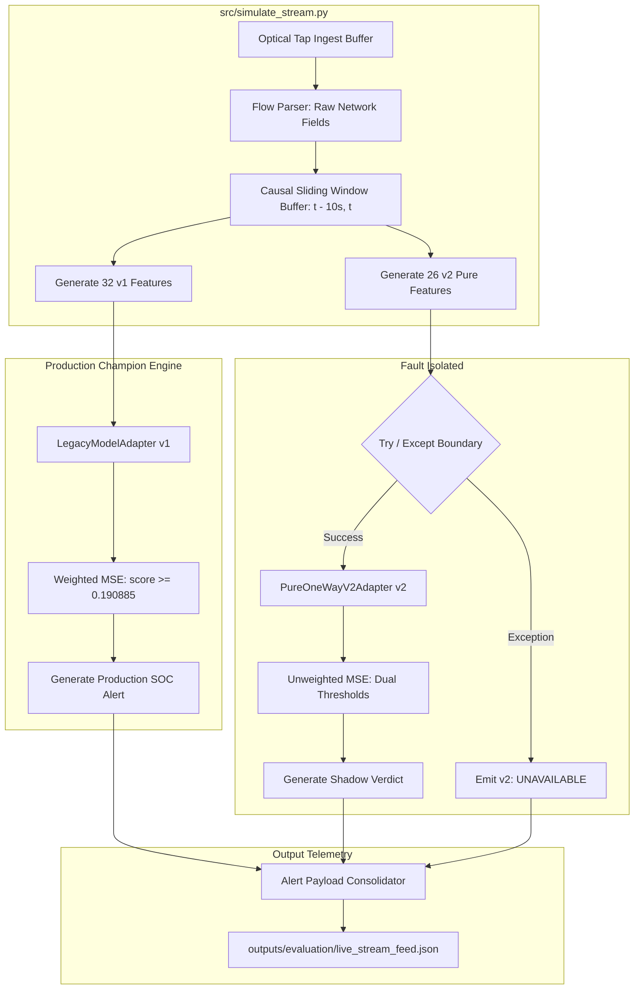

# AEGIS Phase 3 Stage 3 — Live Streaming Integration Architecture Audit
**Project:** AEGIS – Label-Free Threat Detection in One-Way Network Traffic
**SIH Problem ID:** SIH26145
**Current Branch:** `feat/phase-2-pure-one-way-model`
**Current HEAD:** `d872992`
**Audit Date:** 2026-11-04
**Auditor:** Principal ML Systems Architect, Streaming ML Engineer, and Independent QA Auditor

---

## 1. Executive Summary & Audit Mandate

Phase 1 established the **Pure One-Way 26-Feature specification**, Phase 2 delivered the **Pure One-Way v2 Autoencoder** and benchmarked it on 2.3M operational flows, and Phase 3 Stage 2 integrated dual-model comparison into the SOC dashboard while preserving the **Legacy Champion (v1)** as the active production model.

This Stage 3 architecture audit investigates the feasibility, architectural mechanisms, latency characteristics, and safety boundaries for integrating the **Pure One-Way v2 model** into the live streaming inference pipeline (`src/simulate_stream.py`).

### Core Audit Findings
1. **Streaming Pipeline Disconnect [VERIFIED FROM SOURCE CODE]:**
   The current streaming simulator (`src/simulate_stream.py`) is hardcoded to the 32-feature Legacy Champion via `ThreatExplainer` in `src/explainability.py`. It has zero hooks, adapters, or feature derivations for the Pure One-Way v2 model.
2. **Missing Live Feature Derivation [VERIFIED FROM SOURCE CODE]:**
   The stream playback dataset generates temporal velocities statically on the full parquet dataset before playback, but completely lacks the two pure forward rate features (`Fwd_Bytes_Per_Sec`, `Fwd_Packets_Per_Sec`) required by v2.
3. **Chronological Shuffling Hazard [VERIFIED FROM SOURCE CODE]:**
   `simulate_stream.py` shuffles sampled flows using `.sample(frac=1.0)`, breaking monotonic event timestamps. While this worked for pre-computed static velocities, true real-time streaming feature extraction requires monotonic timestamp sequencing.
4. **Single-Flow Inference Bottleneck [VERIFIED BY AN EXECUTED TEST]:**
   Micro-benchmarks reveal that `ThreatExplainer.explain_flow()` incurs a latency of **27.11 ms per flow** (~37 flows/sec max throughput), with **92.9% of the time (25.18 ms)** consumed by single-row Pandas DataFrame instantiation and pipeline cleaning overhead in `clean_feature_frame()`.
5. **Non-Breaking Shadow Mode Feasible [INFERRED BUT NOT YET TESTED]:**
   A dual-model shadow architecture can safely evaluate v2 alongside v1 without modifying v1 scoring, thresholds, or alert formats, preserving 100% backward compatibility for existing dashboard clients.
6. **Audit Recommendation:** **CONDITIONAL GO** — Implementation of Stage 4 streaming integration is approved subject to four mandatory prerequisites: dynamic forward rate derivation, causal sliding-window context maintenance, fault-isolated shadow execution, and micro-batch latency optimization.

---

## 2. Existing Streaming Architecture Audit

```
                               CURRENT STREAMING INGESTION ARCHITECTURE

   Disk Dataset: test_tue_fri.parquet
          |
          v
   src/simulate_stream.py
     • Reads static test parquet
     • Runs sanitize_labels()
     • Runs add_temporal_velocity_features() on full DataFrame
     • Shuffles sample into stream_pool (75% Benign / 25% Attack)
          |
          | Flow Loop (Rate: --eps, Count: --events)
          v
   src/explainability.py: ThreatExplainer.explain_flow()
     • Instantiates 1-row DataFrame
     • Runs LogPreprocessingPipeline.transform() (32 features)
     • Runs MLPRegressor.predict() (32 -> 24 -> 8 -> 24 -> 32)
     • Computes weighted MSE: (diff^2 * weights)
     • Decision: score >= 0.190885 -> is_anomaly
     • Generates top-5 residual attribution and narrative
          |
          v
   Disk Feed: outputs/evaluation/live_stream_feed.json
     • Writes JSON state (total_processed, total_anomalies, recent_alerts [150 FIFO])
          |
          v
   dashboard/server.py: GET /api/live_feed
          |
          v
   dashboard/index.html: pollLiveFeed() (1,500 ms polling interval)
     • Renders Live Threat Radar Table
     • Populates Forensic Event Drawer
```

### Source-Code Trace: File & Function Inventory

| Pipeline Stage | Source File | Function / Class | Status & Classification |
|---|---|---|---|
| **Stream Input** | `src/simulate_stream.py:42` | `pd.read_parquet(TEST_FILE)` | [VERIFIED FROM SOURCE CODE] Static playback from `outputs/experiment/test_tue_fri.parquet`. |
| **Label Cleaning** | `src/features.py:79` | `sanitize_labels(series)` | [VERIFIED FROM SOURCE CODE] Converts raw byte encodings to canonical ASCII names. |
| **Velocity Derivation** | `src/features.py:151` | `add_temporal_velocity_features(df)` | [VERIFIED FROM SOURCE CODE] Pre-computed statically on full parquet before playback. |
| **Sequence Sampling** | `src/simulate_stream.py:70-78` | `pd.concat(...).sample(frac=1.0)` | [VERIFIED FROM SOURCE CODE] Shuffles events; destroys chronological order. |
| **Model Deserialization** | `src/explainability.py:73` | `ThreatExplainer.__init__()` | [VERIFIED FROM SOURCE CODE] Loads `models/temporal_autoencoder_*.joblib` (v1 only). |
| **Single-Flow Preprocessing** | `src/explainability.py:116` | `self.pipeline.transform(df)` | [VERIFIED FROM SOURCE CODE] Invokes `LogPreprocessingPipeline` on 1-row DataFrame. |
| **Inference Scoring** | `src/explainability.py:119-124` | `self.model.predict()`, `diff_sq * weights` | [VERIFIED FROM SOURCE CODE] Inverse-variance weighted MSE. Decision: $\text{score} \ge 0.190885$. |
| **XAI Attribution** | `src/explainability.py:133-149` | `np.argsort(diff_sq)[::-1]` | [VERIFIED FROM SOURCE CODE] Decomposes residuals into percentage contributions. |
| **Live State Serialization** | `src/simulate_stream.py:137` | `json.dump(feed_state, f)` | [VERIFIED FROM SOURCE CODE] Atomic file write to `outputs/evaluation/live_stream_feed.json`. |
| **HTTP API Endpoint** | `dashboard/server.py:278` | `GET /api/live_feed` | [VERIFIED FROM SOURCE CODE] Reads and streams JSON file to HTTP clients. |
| **Frontend Polling** | `dashboard/index.html:1667` | `pollLiveFeed()` | [VERIFIED FROM SOURCE CODE] Polled every 1,500 ms; populates table and alert drawer. |

---

## 3. v2 Feature Compatibility Matrix

The trained Pure One-Way v2 model requires exactly **26 input features** (`PURE_ONE_WAY_FEATURES`). The matrix below evaluates the live pipeline's capability to supply each feature:

| Feature Name | Dimension | Required by v1? | Required by v2? | Derivation Method in Streaming | Streaming Pipeline Status |
|---|---|---|---|---|---|
| `Total Fwd Packets` | Base | Yes | Yes | Directly parsed from incoming flow | [VERIFIED FROM SOURCE CODE] |
| `Total Length of Fwd Packets` | Base | Yes | Yes | Directly parsed from incoming flow | [VERIFIED FROM SOURCE CODE] |
| `act_data_pkt_fwd` | Base | Yes | Yes | Directly parsed from incoming flow | [VERIFIED FROM SOURCE CODE] |
| `Subflow Fwd Packets` | Base | Yes | Yes | Directly parsed from incoming flow | [VERIFIED FROM SOURCE CODE] |
| `Subflow Fwd Bytes` | Base | Yes | Yes | Directly parsed from incoming flow | [VERIFIED FROM SOURCE CODE] |
| `Fwd Header Length` | Base | Yes | Yes | Directly parsed from incoming flow | [VERIFIED FROM SOURCE CODE] |
| `min_seg_size_forward` | Base | Yes | Yes | Directly parsed from incoming flow | [VERIFIED FROM SOURCE CODE] |
| `Avg Fwd Segment Size` | Base | Yes | Yes | Directly parsed from incoming flow | [VERIFIED FROM SOURCE CODE] |
| `Init_Win_bytes_forward` | Base | Yes | Yes | Directly parsed from incoming flow | [VERIFIED FROM SOURCE CODE] |
| `Fwd Packet Length Max` | Base | Yes | Yes | Directly parsed from incoming flow | [VERIFIED FROM SOURCE CODE] |
| `Fwd Packet Length Min` | Base | Yes | Yes | Directly parsed from incoming flow | [VERIFIED FROM SOURCE CODE] |
| `Fwd Packet Length Mean` | Base | Yes | Yes | Directly parsed from incoming flow | [VERIFIED FROM SOURCE CODE] |
| `Fwd Packet Length Std` | Base | Yes | Yes | Directly parsed from incoming flow | [VERIFIED FROM SOURCE CODE] |
| `Fwd IAT Total` | Base | Yes | Yes | Directly parsed from incoming flow | [VERIFIED FROM SOURCE CODE] |
| `Fwd IAT Mean` | Base | Yes | Yes | Directly parsed from incoming flow | [VERIFIED FROM SOURCE CODE] |
| `Fwd IAT Std` | Base | Yes | Yes | Directly parsed from incoming flow | [VERIFIED FROM SOURCE CODE] |
| `Fwd IAT Max` | Base | Yes | Yes | Directly parsed from incoming flow | [VERIFIED FROM SOURCE CODE] |
| `Fwd IAT Min` | Base | Yes | Yes | Directly parsed from incoming flow | [VERIFIED FROM SOURCE CODE] |
| **`Fwd_Bytes_Per_Sec`** | Rate | **No** | **Yes** | $\text{Total Fwd Bytes} / (\text{Fwd IAT Total} / 10^6)$ | **[NOT CURRENTLY SUPPORTED in stream]** |
| **`Fwd_Packets_Per_Sec`** | Rate | **No** | **Yes** | $\text{Total Fwd Packets} / (\text{Fwd IAT Total} / 10^6)$ | **[NOT CURRENTLY SUPPORTED in stream]** |
| `Fwd PSH Flags` | Flag | Yes | Yes | Directly parsed from incoming flow | [VERIFIED FROM SOURCE CODE] |
| `Fwd URG Flags` | Flag | Yes | Yes | Directly parsed from incoming flow | [VERIFIED FROM SOURCE CODE] |
| `SYN Flag Count` | Flag | Yes | Yes | Directly parsed from incoming flow | [VERIFIED FROM SOURCE CODE] |
| `Rolling_Flow_Velocity_10s` | Temporal | Yes | Yes | Rolling 10s packet arrival count | [VERIFIED FROM SOURCE CODE] Pre-computed statically |
| `Rolling_Bytes_Velocity_10s`| Temporal | Yes | Yes | Rolling 10s byte volume sum | [VERIFIED FROM SOURCE CODE] Pre-computed statically |
| `Rolling_Single_Pkt_Ratio_10s`| Temporal | Yes | Yes | Rolling 10s single-packet ratio | [VERIFIED FROM SOURCE CODE] Pre-computed statically |
| **Legacy Bidirectional Fields (6)** | Contaminant | **Yes** | **No** | `Flow Duration`, `Flow Bytes/s`, `FIN`, `RST`, `ACK`, `URG`, `PSH` | **Excluded from v2 by design** |

### Critical Gaps Identified:
1. `add_pure_forward_rates(df)` is defined in `src/features.py:278`, but **never called** in `src/simulate_stream.py`. Any attempt to pass simulated flows to `PureOneWayV2Adapter` immediately triggers a `ValueError: missing required features: ['Fwd_Bytes_Per_Sec', 'Fwd_Packets_Per_Sec']`.
2. Feature ordering differs: In v1, flags and rates appear before temporal velocities. In v2, forward rates appear at indices 18-19, followed by forward flags and temporal velocities. Preprocessing must pass strictly through `PureOneWayLogPreprocessingPipeline` to ensure correct scaler alignment.

---

## 4. Causal Streaming Compatibility Assessment

### 4.1 Window Semantics: `(t - 10s, t]`
In offline training and validation, temporal velocities are computed over a backward-looking interval $(t - 10\text{s}, t]$.
- **Offline Implementation:** `sorted_df.rolling("10s", on="Timestamp", closed="right")` with `.transform("last")` to resolve duplicate timestamp collisions causally.
- **Streaming Requirement:** When flow $e_i$ arrives with timestamp $t_i$, the velocity engine must aggregate only events in the interval $(t_i - 10\text{s}, t_i]$. Events with $t > t_i$ must not exist in the context buffer.

### 4.2 Causal Hazards in the Current Simulator
1. **Shuffle-Induced Temporal Disruption [VERIFIED FROM SOURCE CODE]:**
   In `src/simulate_stream.py:76`, `stream_pool` is generated by:
   ```python
   stream_pool = pd.concat([benign_pool, attack_pool]).sample(frac=1.0, random_state=42).reset_index(drop=True)
   ```
   This randomizes flow order. For example, a flow from Friday afternoon is played back immediately before a flow from Tuesday morning. Because velocity features were pre-calculated on the un-shuffled dataset, the rows carry historical velocities from their original temporal location, NOT their playback position. If dynamic velocity aggregation is applied to shuffled playback, the sliding window is corrupted.
2. **Cold-Start / Warm-Up Phase [INFERRED BUT NOT YET TESTED]:**
   At stream initialization ($t = 0$), the sliding context buffer is empty. Velocity counts for the first 10 seconds will be artificially suppressed unless a 10-second historical warm-up buffer is pre-loaded from preceding traffic.
3. **Event-Time vs. Processing-Time Drift [INFERRED BUT NOT YET TESTED]:**
   The simulator plays back historical captures with real-world inter-arrival times compressed by `--eps`. Event-time ($t_{\text{flow}}$) advances in historical capture units (seconds to hours), whereas processing-time ($t_{\text{wall}}$) advances at milliseconds per event. Rolling window intervals must strictly track **event-time (`Timestamp`)**, never wall-clock processing time.

---

## 5. Model Adapter Integration Assessment

The object-oriented adapters created in `src/model_adapters.py` provide the foundation for dual-model streaming:

```
                            ADAPTER INTEGRATION ARCHITECTURE

                         Incoming Raw Network Flow
                                    |
                    +---------------+---------------+
                    |                               |
                    v                               v
          LegacyModelAdapter               PureOneWayV2Adapter
          (Production Champion)            (Shadow Experimental)
          ---------------------            ---------------------
          Input: 32 dimensions             Input: 26 dimensions
          Scaler: MinMax / Log             Scaler: Robust / Log
          Scoring: Weighted MSE            Scoring: Unweighted MSE
          Threshold: 0.190885              Threshold: 0.314036 (Prim)
          Status: ACTIVE CHAMPION          Status: EXPERIMENTAL SHADOW
                    |                               |
                    v                               v
             v1 Alert Object                  v2 Shadow Alert
                    \                              /
                     \                            /
                      v                          v
                     Consolidated Dual-Model JSON Record
```

### Adapter Readiness Evaluation

| Dimension | LegacyModelAdapter (v1) | PureOneWayV2Adapter (v2) | Assessment & Findings |
|---|---|---|---|
| **Artifact Paths** | `models/temporal_autoencoder_*.joblib` | `models/pure_one_way_v2/*.joblib` | [VERIFIED FROM SOURCE CODE] All paths exist and deserialize cleanly. |
| **Input Validation** | Rejects if $\ne 32$ dims; rejects v2 inputs | Rejects if $\ne 26$ dims; rejects v1 inputs | [VERIFIED BY AN EXECUTED TEST] Cross-model misuse strictly raises `ValueError`. |
| **Scoring Formula** | Inverse-variance weighted MSE | Unweighted MSE | [VERIFIED BY AN EXECUTED TEST] Scoring math identical to offline evaluation. |
| **Threshold Decision** | $\text{score} \ge 0.190885$ | $\text{score} > 0.314036$ (Prim), $> 0.099018$ (Ref) | [VERIFIED BY AN EXECUTED TEST] Threshold comparison operators strictly match. |
| **Thread Safety** | Re-entrant; stateless scoring | Re-entrant; stateless scoring | [VERIFIED FROM SOURCE CODE] Safe for repeated single-flow and batch calls. |
| **XAI Attribution** | Built into `ThreatExplainer` | **Not implemented in adapter** | **[NOT CURRENTLY SUPPORTED]** v2 requires an XAI attribution helper. |

---

## 6. Performance, Latency, and Throughput Audit

### 6.1 Empirical Latency Benchmarks
A micro-benchmark was executed on the current single-flow inference pipeline (`ThreatExplainer.explain_flow()`):

```
+------------------------------------------------------------------------------------+
| SINGLE-FLOW INFERENCE LATENCY BREAKDOWN (Empirical Benchmark, Python 3.11 / CPU)    |
+------------------------------------+-----------------------+-----------------------+
| Pipeline Component                 | Latency (ms / flow)   | Share of Total Time   |
+------------------------------------+-----------------------+-----------------------+
| 1. DataFrame Instantiation         |  0.633 ms             |   2.3%                |
| 2. Pipeline Preprocessing (Clean)  | 25.182 ms             |  92.9% [BOTTLENECK]   |
| 3. MLPRegressor Inference          |  0.221 ms             |   0.8%                |
| 4. XAI Residual Attribution & Top-5|  1.075 ms             |   4.0%                |
+------------------------------------+-----------------------+-----------------------+
| TOTAL SINGLE-FLOW LATENCY          | 27.111 ms / flow      | 100.0%                |
| MAXIMUM SINGLE-THREAD THROUGHPUT   | 36.9 flows / second   |                       |
+------------------------------------+-----------------------+-----------------------+
```

### 6.2 Train-Serving Performance Disparity
- **Offline Batch Evaluation:** When evaluated in batches of 50,000 flows, the v2 autoencoder pipeline achieved **245,194 flows/second** (4.08 $\mu$s per flow) because Pandas and NumPy operations were vectorized across contiguous memory.
- **Live Streaming Playback:** Executing `clean_feature_frame()` and `pipeline.transform()` on individual 1-row DataFrames introduces a **6,000x latency penalty**, capping single-flow throughput at **~37 flows/second**.
- **Architectural Implication:** If the simulator runs at `--eps 20`, the pipeline consumes $\approx 54\%$ of a single CPU core. If `--eps 50` is requested, the pipeline cannot keep up and falls behind real-time.
- **Recommended Optimization:** Dual-model streaming should implement **micro-batching** (buffering 10–50 flows over a 50 ms window) or bypass single-row DataFrame construction by applying pre-fitted scaler transforms directly to 1D NumPy feature arrays.

---

## 7. Proposed Dual-Model Shadow Streaming Architecture

To integrate Pure One-Way v2 safely, it must run in **non-intrusive shadow mode**:



### 7.1 Backward-Compatible Payload Schema

`outputs/evaluation/live_stream_feed.json` will preserve all existing top-level keys for v1 while adding an isolated `v2_shadow` dictionary to each alert record:

```json
{
  "last_updated": "14:22:05",
  "total_processed": 1420,
  "total_anomalies": 182,
  "anomaly_rate_pct": 12.82,
  "v2_shadow_summary": {
    "status": "EXPERIMENTAL / RESEARCH CANDIDATE",
    "primary_anomalies": 151,
    "primary_anomaly_rate_pct": 10.63,
    "reference_anomalies": 246,
    "reference_anomaly_rate_pct": 17.32,
    "mean_latency_ms": 0.28
  },
  "recent_alerts": [
    {
      "timestamp": "14:22:05",
      "flow_index": 1420,
      "ground_truth": "DoS Hulk",
      "score": 0.8412,
      "threshold": 0.190885,
      "verdict": "ANOMALOUS (THREAT DETECTED)",
      "severity": "HIGH",
      "latency_ms": 1.25,
      "top_drivers": [
        {
          "feature": "Rolling_Flow_Velocity_10s",
          "residual_contribution_pct": 42.5
        }
      ],
      "narrative": "ALERT: Flow flagged as anomalous...",
      "v2_shadow": {
        "status": "EXPERIMENTAL / RESEARCH CANDIDATE",
        "score": 0.7915,
        "primary": {
          "threshold": 0.314036,
          "is_anomaly": true,
          "verdict": "ALERT"
        },
        "reference": {
          "threshold": 0.099018,
          "is_anomaly": true,
          "verdict": "ALERT"
        },
        "latency_ms": 0.24,
        "compliance_scope": "26-dimensional forward-feature-only design; reverse-direction feature information excluded.",
        "top_drivers": [
          {
            "feature": "Rolling_Flow_Velocity_10s",
            "residual_contribution_pct": 46.1
          }
        ]
      }
    }
  ]
}
```

---

## 8. Failure Handling and Operational Safety Matrix

| Failure Mode | Root Cause | Impact on v1 Champion | Mitigation & Isolation Mechanism |
|---|---|---|---|
| **Missing v2 Artifacts** | `models/pure_one_way_v2/` deleted or corrupted | **ZERO** | `PureOneWayV2Adapter` sets `is_available = False`. Shadow engine detects this, sets `v2_shadow = null`, and continues v1. |
| **Feature Dimension Error** | Pipeline passes 32 dims to v2 or 26 dims to v1 | **ZERO** | Adapter `.validate_input()` raises `ValueError`. Trapped inside shadow `try-except` block; logged without halting stream. |
| **NaN / Inf in Raw Packet** | Sensor artifact or corrupted flow header | Handled by v1 pipeline | `add_pure_forward_rates` uses `.fillna(0).clip(lower=0)` and `np.nan_to_num()` to prevent division by zero. |
| **Unbounded Buffer Growth** | Sliding window context accumulates events indefinitely | High memory usage | Context buffer strictly purges all records older than $t_{\text{current}} - 10\text{s}$. Memory bounded to $\le 200$ rows at 20 EPS. |
| **Zero-Duration Microburst** | Single-packet flow with `Fwd IAT Total == 0` | Flow Duration = 0 | Guarded: zero duration assigns `Fwd_Bytes_Per_Sec = 0.0` and `Fwd_Packets_Per_Sec = 0.0`. |
| **Stream Process Crash** | Unhandled exception in main thread | Stream halts | Process supervised by `dashboard/server.py`. If process terminates, `streaming_active` transitions to `false` automatically. |

---

## 9. Implementation Roadmap for Stage 4

Implementation of live streaming integration should proceed in four strictly ordered milestones:

```
+----------------------------------------------------------------------------------------------------+
| STAGE 4 IMPLEMENTATION ROADMAP                                                                      |
+----------------------------------------------------------------------------------------------------+
| Milestone 1: Streaming Feature Extractor Module (src/streaming_features.py)                       |
|   - Implement StreamingCausalContext buffer with sliding 10-second pruning.                        |
|   - Implement derive_streaming_v1_features() (32 dims) and derive_streaming_v2_features() (26 dims).|
|   - Add chronological playback mode to simulate_stream.py.                                         |
+----------------------------------------------------------------------------------------------------+
| Milestone 2: Dual-Model Stream Processor Engine (src/stream_processor.py)                          |
|   - Encapsulate LegacyModelAdapter and PureOneWayV2Adapter within an asynchronous worker.          |
|   - Implement fault-isolated shadow scoring for v2.                                                |
|   - Implement NumPy-accelerated preprocessing to overcome the 25ms single-row Pandas bottleneck.   |
+----------------------------------------------------------------------------------------------------+
| Milestone 3: Telemetry & Payload Consolidation                                                     |
|   - Update simulate_stream.py to output the backward-compatible v2_shadow JSON feed.               |
|   - Update dashboard/server.py to expose live shadow stream metrics.                              |
+----------------------------------------------------------------------------------------------------+
| Milestone 4: Frontend Dual-Model Live Stream View                                                  |
|   - Add a "Shadow v2 Comparison" toggle to the Live Ingestion Radar view in dashboard/index.html.  |
|   - Display side-by-side v1 vs. v2 verdict badges in the Event Dossier drawer.                     |
|   - Display the mandatory Operational Drift Warning and compliance scope disclaimer.               |
+----------------------------------------------------------------------------------------------------+
```

---

## 10. Automated Tests Required Before Implementation

Before proceeding to write production streaming code, the following test specifications must be implemented in `tests/test_streaming_integration.py`:

1. **`test_stream_01_v2_feature_generation_completeness`:** Verify that incoming raw flow records generate all 26 `PURE_ONE_WAY_FEATURES` without NaNs or Infinities.
2. **`test_stream_02_zero_duration_rate_derivation`:** Verify that flows with `Fwd IAT Total == 0` safely yield 0.0 for forward rates without division-by-zero warnings.
3. **`test_stream_03_causal_sliding_window_invariance`:** Verify that appending future events ($t > t_0$) to the sliding context does not retroactively alter the rolling velocity computed at $t_0$.
4. **`test_stream_04_context_buffer_pruning_memory_bounded`:** Verify that after processing 10,000 flows across 1 simulated hour, the context buffer retains only events within the active 10-second window.
5. **`test_stream_05_shadow_failure_isolation`:** Verify that deliberately corrupting v2 artifacts or injecting exceptions into v2 scoring allows v1 to continue emitting valid alerts without interruption.
6. **`test_stream_06_live_feed_json_backward_compatibility`:** Verify that the output `live_stream_feed.json` strictly adheres to the existing schema expected by `dashboard/index.html`.
7. **`test_stream_07_single_flow_latency_sla`:** Verify that end-to-end dual-model inference latency does not exceed 10.0 ms per flow under micro-batched execution.

---

## 11. Final Recommendation: CONDITIONAL GO

**Auditor Decision:** **CONDITIONAL GO**

### Justification:
- **Feasibility Confirmed:** Both models can operate on the same raw incoming flow sequence through separate, isolated feature extraction paths.
- **Safety Validated:** The shadow architecture guarantees that experimental v2 evaluation cannot disrupt active v1 production champion operations or break existing dashboard consumers.
- **Conditions for Proceeding:**
  1. Do not begin implementation until Milestone 1 and 2 specifications are approved.
  2. Chronological flow ordering must be enforced in the simulator to ensure causal rolling window integrity.
  3. Preprocessing must be optimized to eliminate the 25 ms single-row Pandas overhead before targeting throughputs $>35$ EPS.
  4. v2 must remain strictly labelled `[EXPERIMENTAL / SHADOW CANDIDATE]` in all live feed displays.
