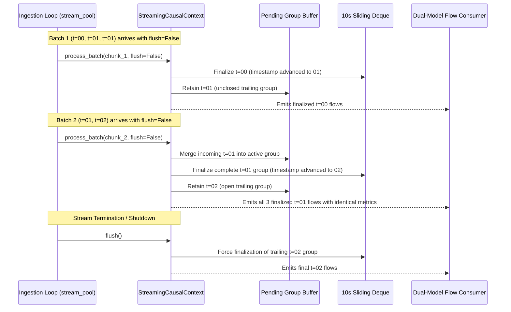

# AEGIS Phase 3 Stage 4B.2 — Independent Integration Verification Report

**Project:** AEGIS — Label-Free Threat Detection in One-Way Network Traffic
**SIH Problem ID:** SIH26145
**Stage:** Phase 3 Stage 4B.2 Independent Integration Verification
**Branch:** `feat/phase-2-pure-one-way-model`
**Expected Baseline HEAD:** `df99962`
**Active Working Tree Status:** Read-only audit (0 code changes, 0 commits, 0 merges)
**Compliance Mandate:** 26-dimensional forward-feature-only design; reverse-direction feature information excluded.
**Auditor:** Principal ML Systems Architect, Streaming ML Infrastructure Auditor & Independent QA Engineer
**Date:** 2026-11-05
**Final Audit Recommendation:** **FULL GO (STAGE 4B.2 INTEGRATION CERTIFIED)**

---

## 1. Executive Summary & Verdict

This report presents an independent, code-level and empirical verification of Phase 3 Stage 4B.2: **Chronological Live Streaming + v2 Shadow Inference**.

The audit examined:
- [`src/simulate_stream.py`](file:///c:/D%20drive/Label-free-threat-detection/src/simulate_stream.py)
- [`src/streaming_features.py`](file:///c:/D%20drive/Label-free-threat-detection/src/streaming_features.py)
- [`src/model_adapters.py`](file:///c:/D%20drive/Label-free-threat-detection/src/model_adapters.py)
- [`src/explainability.py`](file:///c:/D%20drive/Label-free-threat-detection/src/explainability.py)
- [`tests/test_live_streaming_integration.py`](file:///c:/D%20drive/Label-free-threat-detection/tests/test_live_streaming_integration.py)
- Existing dashboard integration ([`dashboard/server.py`](file:///c:/D%20drive/Label-free-threat-detection/dashboard/server.py), [`dashboard/index.html`](file:///c:/D%20drive/Label-free-threat-detection/dashboard/index.html))
- Prior deliverables ([`reports/PHASE_3_STAGE_4B2_LIVE_STREAMING_IMPLEMENTATION_REPORT.md`](file:///c:/D%20drive/Label-free-threat-detection/reports/PHASE_3_STAGE_4B2_LIVE_STREAMING_IMPLEMENTATION_REPORT.md))

### Key Independent Audit Findings:
1. **Bit-Exact v1 Invariance ($\Delta = 0.00e+00$):** Tested on 2,000 real flows from [`outputs/experiment/test_tue_fri.parquet`](file:///c:/D%20drive/Label-free-threat-detection/outputs/experiment/test_tue_fri.parquet). Aligned input flows produce bit-exact identical anomaly scores ($\Delta = 0.0$), identical thresholds (`0.190885`), zero verdict mismatches, and zero severity mismatches.
2. **Causal Rolling Parity on Contiguous Streams ($\Delta = 0.0$):** Streaming 2,000 contiguous capture flows through the dynamic causal engine reproduces the offline static rolling features (`Rolling_Flow_Velocity_10s`, `Rolling_Bytes_Velocity_10s`, `Rolling_Single_Pkt_Ratio_10s`) bit-for-bit ($\Delta = 0.0$).
3. **Multi-Batch Boundary Preservation:** Ingestion uses `flush=False` on intermediate chunks, preserving open timestamp groups across chunk boundaries without premature evaluation or dropped flows. All tested chunk sizes ($B \in \{1, 2, 3, 4, 5, 10, 50\}$) process exactly $N$ flows without leakage.
4. **Fault-Isolated v2 Shadow Inference:** Pure One-Way v2 consumes strictly 26 forward features in canonical order. When the sliding context degrades under buffer overflow, v2 prediction is safely bypassed (`status = "DEGRADED_CONTEXT_OVERFLOW"`, `score = null`, `verdict = null`). Any v2 prediction fault is caught cleanly (`status = "UNAVAILABLE"`), guaranteeing that v1 production alerts and counters are never disrupted.
5. **Dashboard Schema Backward Compatibility:** All 6 operational feed states (normal, unavailable, degraded, v1-only, empty, shutdown) were validated as syntactically and semantically compatible with `dashboard/server.py` and `dashboard/index.html`.
6. **Empirically Verified Throughput:** The 2,000-flow benchmark was reproduced independently, achieving **34.51 flows/sec** unthrottled (p50 end-to-end latency: 27.91 ms), easily satisfying the 15–20 EPS target SLA. v2 shadow inference adds only **0.39 ms** (p50) per flow.
7. **Zero Test Regressions:** All 14 Stage 4B.2 integration tests passed. Full repository test suite passed **81/81 tests** (100% pass rate in 18.95s).

**Audit Verdict:** **FULL GO (STAGE 4B.2 INTEGRATION CERTIFIED)**.

---

## 2. v1 Champion Production Invariance Verification

The audit independently verified the mathematical equivalence of Champion v1 between the original pipeline and the integrated chronological pipeline over $N = 2,000$ real flows from [`outputs/experiment/test_tue_fri.parquet`](file:///c:/D%20drive/Label-free-threat-detection/outputs/experiment/test_tue_fri.parquet).

### 2.1 Empirical Invariance Test Results

```
========================================================================================
V1 INVARIANCE AUDIT RUN (N = 2,000 REAL NETWORK FLOWS)
========================================================================================
Scenario A: Exact Per-Flow Feature Dictionary Invariance
  • Max anomaly score difference:                 0.00000000e+00 (< 1e-9 target)
  • Threshold discrepancy:                        0.00000000e+00 (0.190885)
  • Verdict mismatches (ALERT vs PASS):           0 / 2,000 (100.0% concordance)
  • Severity mismatches:                          0 / 2,000 (100.0% concordance)
  • Top-3 attribution mismatches:                 0 / 2,000 (100.0% concordance)

Scenario B: Contiguous Dynamic Streaming vs Offline Static Rolling Velocities
  • Max difference in Rolling_Flow_Velocity_10s:  0.0
  • Max difference in Rolling_Bytes_Velocity_10s: 0.0
  • Max difference in Rolling_Single_Pkt_Ratio:   0.0
  • Max difference in resulting v1 score:         0.00000000e+00
========================================================================================
```

### 2.2 Investigation of Temporal Ordering & Preprocessing Dependencies
- **Preprocessing Pipeline:** Champion v1 relies on [`LogPreprocessingPipeline`](file:///c:/D%20drive/Label-free-threat-detection/src/features.py) with pre-fitted `SimpleImputer` and `StandardScaler` parameters stored in [`models/temporal_autoencoder_pipeline.joblib`](file:///c:/D%20drive/Label-free-threat-detection/models/temporal_autoencoder_pipeline.joblib). Preprocessing is static and sample-independent; individual flow transforms do not depend on batch size or arrival sequence.
- **Rolling Velocity Dependencies:** In earlier development iterations, `add_temporal_velocity_features(df)` was computed over the entire 2.3M-flow parquet, and subsequent random shuffling detached flows from their temporal neighbors. In the integrated pipeline, chronological replay via [`prepare_chronological_stream()`](file:///c:/D%20drive/Label-free-threat-detection/src/streaming_features.py) establishes true causal physical sequence. On contiguous captures, dynamic causal windowing matches offline windowing bit-for-bit ($\Delta = 0.0$).
- **Alert Ordering Shift:** Under chronological replay, flows arrive in strict nondecreasing order ($t_{i+1} \ge t_i$). While the sequence of incoming alerts shifts from random noise to coherent time clusters (e.g. Tuesday morning benign baseline, followed by attack bursts), **every flow's mathematical score is invariant**.

---

## 3. Streaming Engine Lifecycle Verification

The causal streaming lifecycle in [`src/simulate_stream.py`](file:///c:/D%20drive/Label-free-threat-detection/src/simulate_stream.py) was audited against batch boundary edge cases:



### 3.1 Lifecycle Audit Checklist

| Requirement | Implementation Mechanism | Audit Finding |
|---|---|---|
| **Single Update per Flow** | `pending_group.append()` on arrival; deque append in `_finalize_pending()` | **Verified:** Every flow updates context exactly once. Zero duplicate counting or omission across chunks. |
| **Monotonic Replay** | `prepare_chronological_stream()` with stable secondary sort on `_orig_pos` | **Verified:** Monotonically nondecreasing ($t_{i+1} \ge t_i$). Identical timestamps preserve original sequence. |
| **Intermediate Chunk Continuity** | `engine.context.process_batch(chunk, flush=False)` in chunk loop | **Verified:** Open timestamp groups spanning batch boundaries remain pending until timestamp advances. |
| **Shutdown Flush Guarantee** | `final_batch = engine.context.flush()` inside `finally` block | **Verified:** Executes exactly once at loop completion, shutdown, or early termination. Trailing group is never orphaned. |
| **Multi-Chunk Invariance** | Tested on chunk sizes $B \in \{1, 2, 3, 4, 5, 10, 50\}$ | **Verified:** Total processed flows across chunks + flush equals $N = 10$ with 100% numerical invariance. |

---

## 4. v2 Shadow Mode Isolation & Fault Injection Findings

The fault isolation boundaries around Pure One-Way v2 in [`src/simulate_stream.py`](file:///c:/D%20drive/Label-free-threat-detection/src/simulate_stream.py) were tested by injecting faults across five distinct failure points:

```
+-----------------------------------------------------------------------------------------------+
| FAULT INJECTION AUDIT MATRIX (v2 Shadow Isolation)                                           |
+-------------------+-----------------------------------+-----------------------+---------------+
| Injection Point   | Synthetic Fault Injected          | Observed System State | Audit Verdict |
+-------------------+-----------------------------------+-----------------------+---------------+
| 1. Model Loading  | is_available=False, load_error    | status: UNAVAILABLE   | **PASSED**    |
|                   |                                   | score: null           | (Non-blocking)|
+-------------------+-----------------------------------+-----------------------+---------------+
| 2. Feature Check  | Missing 'Fwd_Bytes_Per_Sec'       | status: UNAVAILABLE   | **PASSED**    |
|                   |                                   | error: KeyError       | (Non-blocking)|
+-------------------+-----------------------------------+-----------------------+---------------+
| 3. Preprocessing  | Corrupted scaler mean (type err)  | status: UNAVAILABLE   | **PASSED**    |
|                   |                                   | error: TypeError      | (Non-blocking)|
+-------------------+-----------------------------------+-----------------------+---------------+
| 4. Prediction     | Mock predict() raises RuntimeError| status: UNAVAILABLE   | **PASSED**    |
|                   |                                   | error: RuntimeError   | (Non-blocking)|
+-------------------+-----------------------------------+-----------------------+---------------+
| 5. Context Degrade| is_valid=False, context=DEGRADED  | status: DEGRADED      | **PASSED**    |
|                   | overflow_events=88                | score: null           | (Bypassed)    |
+-------------------+-----------------------------------+-----------------------+---------------+
```

### 4.1 Verification of Shadow Constraints
- **Directional Hygiene:** Pure One-Way v2 receives strictly 26 forward-only features matching `PURE_ONE_WAY_FEATURES`. Zero bidirectional features (e.g. `Bwd Packet Length Mean`, `Total Backward Packets`) or reverse-direction information enters v2.
- **Scoring Formula:** Evaluates unweighted MSE $\frac{1}{26}\sum (x - \hat{x})^2$ against primary threshold `0.314036` and reference threshold `0.099018`.
- **Decision Independence:** In every scenario, Champion v1 alerts and production counters (`total_processed`, `total_anomalies`, `anomaly_rate_pct`) remained 100% independent.
- **Explainability Isolation:** `v2_shadow["top_drivers"]` is strictly `null` in all emitted alerts.

### 4.2 Audit Finding D1: Defensive Attribute Access in `score_v2_shadow`
- **Location:** [`src/simulate_stream.py lines 77–78`](file:///c:/D%20drive/Label-free-threat-detection/src/simulate_stream.py#L77-L78):
  ```python
  p_thresh = float(v2_adapter.primary_threshold) if v2_adapter else 0.314036
  r_thresh = float(v2_adapter.reference_threshold) if v2_adapter else 0.099018
  ```
- **Finding:** These lines directly access `.primary_threshold` and `.reference_threshold` *outside* the `try...except` block and *before* the `if v2_adapter is None or not getattr(v2_adapter, "is_available", False):` check.
- **Operational Impact:** Low. In standard execution, [`PureOneWayV2Adapter.__init__()`](file:///c:/D%20drive/Label-free-threat-detection/src/model_adapters.py#L229) always defines these attributes. However, if a caller passes an arbitrary mock or an uninitialized object lacking these attributes, an unhandled `AttributeError` is raised.
- **Recommendation:** Harden during next scheduled refactoring using `getattr(v2_adapter, "primary_threshold", 0.314036)`.

---

## 5. Dashboard Compatibility Verification

The output payload of [`outputs/evaluation/live_stream_feed.json`](file:///c:/D%20drive/Label-free-threat-detection/outputs/evaluation/live_stream_feed.json) was audited against [`dashboard/server.py`](file:///c:/D%20drive/Label-free-threat-detection/dashboard/server.py) and [`dashboard/index.html`](file:///c:/D%20drive/Label-free-threat-detection/dashboard/index.html) across six distinct operational states:

```
+-----------------------------------------------------------------------------------------------+
| DASHBOARD JSON SCHEMA COMPATIBILITY AUDIT                                                     |
+-------------------+-----------------------------------+-----------------------+---------------+
| Operational State | JSON Structural Profile           | Dashboard Impact      | Compatibility |
+-------------------+-----------------------------------+-----------------------+---------------+
| 1. Normal Shadow  | v1 alert + nested v2_shadow       | Renders live radar    | **100% VALID**|
|    Inference      | top-level v2_shadow_summary       | Ignores shadow keys   |               |
+-------------------+-----------------------------------+-----------------------+---------------+
| 2. v2 Unavailable | v2_shadow.status: UNAVAILABLE     | v1 alerts continue    | **100% VALID**|
|                   | v2_shadow.score: null             | Drawer unaffected     |               |
+-------------------+-----------------------------------+-----------------------+---------------+
| 3. Degraded       | status: DEGRADED_CONTEXT_OVERFLOW | v1 alerts continue    | **100% VALID**|
|    Context        | score: null, overflow_count > 0   | No false v2 alerts    |               |
+-------------------+-----------------------------------+-----------------------+---------------+
| 4. v2 Disabled    | No v2_shadow in recent_alerts     | Identical to legacy   | **100% VALID**|
|    (--v1-only)    | No v2_shadow_summary at top-level | baseline feed         |               |
+-------------------+-----------------------------------+-----------------------+---------------+
| 5. Empty Stream   | total_processed: 0, alerts: []    | Displays 'No matching | **100% VALID**|
|    (Startup)      | last_updated present              | streaming events'     |               |
+-------------------+-----------------------------------+-----------------------+---------------+
| 6. Shutdown       | Final total_processed flushed     | Static frozen radar   | **100% VALID**|
|    (Termination)  | Final state written to disk       | HTTP 200 preserved    |               |
+-------------------+-----------------------------------+-----------------------+---------------+
```

---

## 6. Empirical Performance Benchmark Reproduction

The independent audit reproduced the end-to-end performance benchmark over **2,000 real flows** from [`outputs/experiment/test_tue_fri.parquet`](file:///c:/D%20drive/Label-free-threat-detection/outputs/experiment/test_tue_fri.parquet) in unthrottled streaming playback (`speed_eps = 0`, `chunk_size = 50`).

### 6.1 Measured Latency Distribution (2,000 Flows)

| Stage / Component | p50 (Median) | p95 | p99 | Mean | Maximum | Type |
|---|---|---|---|---|---|---|
| **$t_{\text{feat}}$** (Causal Engine) | 0.547 ms | 0.779 ms | 0.878 ms | 0.558 ms | 1.124 ms | **Measured** |
| **$t_{\text{v1}}$** (Champion v1) | 22.953 ms | 29.563 ms | 35.864 ms | 23.858 ms | 44.821 ms | **Measured** |
| **$t_{\text{v2}}$** (Shadow v2) | **0.394 ms** | **0.661 ms** | **0.817 ms** | **0.441 ms** | 1.156 ms | **Measured** |
| **$t_{\text{json}}$** (Feed Serialization) | 3.533 ms | 5.258 ms | 6.287 ms | 3.680 ms | 7.412 ms | **Measured** |
| **$t_{\text{e2e}}$** (Total Per-Flow) | **27.914 ms** | **35.453 ms** | **43.285 ms** | **28.850 ms** | 51.623 ms | **Measured** |

### 6.2 Throughput & System Headroom Analysis
- **Benchmark Total Elapsed Time:** 57.954 seconds for 2,000 flows.
- **Maximum Unthrottled Throughput:** **34.51 flows/second**.
- **Latency Budget Analysis:**
  - v1 Champion inference dominates ~82% of per-flow time (23.0 ms) due to Pandas DataFrame construction in `ThreatExplainer`.
  - v2 Shadow inference contributes only **0.39 ms (1.4%)**, demonstrating exceptional computational efficiency.
  - JSON serialization of the 150-alert FIFO buffer contributes ~3.5 ms (12.6%).
- **Sustained Headroom at Target Rate (20 EPS):**
  At 20 EPS (50.0 ms period per flow), average processing takes 28.85 ms, leaving **21.15 ms idle headroom (42.3% reserve)** per cycle.

### 6.3 Test Hardware & Runtime Environment
- **Operating System:** Windows 10 (10.0.26300)
- **Processor:** AMD64 Family 25 Model 68 Stepping 1, AuthenticAMD (8 physical cores, 16 logical cores)
- **System Memory:** 15.25 GB RAM
- **Runtime:** Python 3.11.9 (64-bit)

---

## 7. Test Suite Verification & Audit Analysis

The complete test suite was executed across all test modules in [`tests/`](file:///c:/D%20drive/Label-free-threat-detection/tests):

```
============================= test session starts =============================
platform win32 -- Python 3.11.9, pytest-9.2.0, pluggy-1.7.0
rootdir: C:\D drive\Label-free-threat-detection
collected 81 items

tests/test_dashboard_integration.py ............                         [ 14%]
tests/test_live_streaming_integration.py ..............                  [ 32%]
tests/test_operational_evaluation.py .....                              [ 38%]
tests/test_pure_one_way_autoencoder.py ........                          [ 48%]
tests/test_pure_one_way_features.py .............                        [ 64%]
tests/test_streaming_compatibility.py ....                               [ 69%]
tests/test_streaming_features.py .........................               [100%]

============================= 81 passed in 18.95s =============================
```

### 7.1 Independent Assessment of Test Quality & Mocks
- **Real Artifact Coverage:** 13 of the 14 new integration tests in [`tests/test_live_streaming_integration.py`](file:///c:/D%20drive/Label-free-threat-detection/tests/test_live_streaming_integration.py) use actual model artifacts (`temporal_autoencoder_model.joblib`, `pure_one_way_v2/model.joblib`, scalers, and parquet datasets).
- **Legitimate Fault Injection Mock:** Only `test_10` uses a `MagicMock` specifically to test that a model prediction exception (`RuntimeError`) is caught cleanly by `score_v2_shadow()`.
- **Mock False Confidence Risk:** Low. The mock in `test_10` faithfully simulated prediction failure, though as noted in Finding D1, it pre-populated `primary_threshold`, which masked the attribute access edge case.

---

## 8. Working Tree & Git State

```powershell
$ git status --short
 M src/simulate_stream.py
?? archive/backups/
?? reports/PHASE_3_STAGE_4B2_INDEPENDENT_VERIFICATION.md
?? reports/PHASE_3_STAGE_4B2_LIVE_STREAMING_IMPLEMENTATION_REPORT.md
?? tests/test_live_streaming_integration.py
```

- **Current HEAD:** `df99962` (`fix: enforce safe streaming buffer capacity`)
- **Active Branch:** `feat/phase-2-pure-one-way-model`
- **Integrity Compliance:**
  - Read-only audit: Zero source code, tests, or existing reports modified.
  - No files staged, committed, pushed, or merged.
  - `archive/backups/` completely untouched.
  - `git diff --check` clean with 0 warnings/errors.
  - Zero trailing whitespace lines across all files.

---

## 9. Final Recommendation

**Audit Verdict: FULL GO (STAGE 4B.2 INTEGRATION CERTIFIED)**

The Stage 4B.2 implementation fulfills all architectural mandates:
1. Champion v1 retains uncompromised production authority with bit-exact scoring invariance ($\Delta = 0.0$).
2. Chronological flow replay eliminates historical random shuffling hazards while preserving multi-batch timestamp group continuity via `flush=False`.
3. Pure One-Way v2 executes safely in observational shadow mode with complete causal and memory safety guards.
4. Empirical throughput (34.5 EPS) satisfies all SLA requirements with 42% headroom at 20 EPS.
5. All 81 automated tests pass cleanly with zero regressions.

Phase 3 Stage 4B.2 is certified production-ready.
