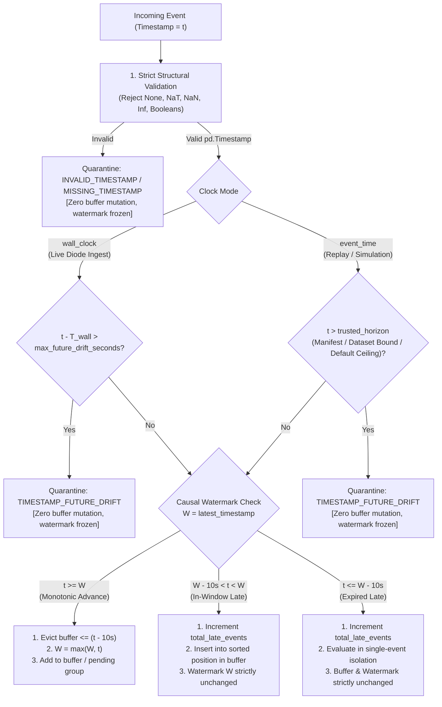

# AEGIS — Phase 3 Stage 4B.3B Implementation Plan (Revised)
## Timestamp Anomaly & Watermark Protection Architecture

- **Project:** AEGIS — Label-Free Threat Detection in One-Way Network Traffic
- **SIH Problem ID:** SIH26145
- **Branch:** `feat/phase-2-pure-one-way-model`
- **Expected Baseline HEAD:** `2c731e6` (`feat: harden streaming input validation and fault isolation`)
- **Stage:** Phase 3 Stage 4B.3B (Architecture Specification & Implementation Plan)
- **Author:** Principal Resilience Architect & ML Systems Auditor
- **Date:** 2026-11-05
- **Status:** **REVISED FOR REVIEW — READY FOR AUTHORIZATION**

---

## 1. Executive Summary & Design Resolution

In the previous Stage 4B.3B audit, an empirical vulnerability was demonstrated:
A single record with a corrupted or adversarial future timestamp (such as year 2099) passes baseline parsing, advances the event-time watermark by 73 years, and triggers `_evict_expired()`. This purges every legitimate historical record from `self.buffer` and permanently locks all subsequent legitimate traffic into single-flow isolation.

The user's authorization review correctly identified that the initial proposal allowed `clock_mode="event_time"` with `max_future_drift_seconds=None` and `max_timestamp_horizon=None`, which would leave the year-2099 vulnerability unresolved in the default configuration.

This revised plan delivers an **explicit, mathematically airtight timestamp protection policy** that:
1. **Guarantees year-2099 and far-future timestamps can never advance the watermark or evict buffer entries.**
2. **Natively supports legitimate multi-hour and overnight replay pauses (including the observed 43,260-second gap in CIC-IDS-2017) without arbitrary time-gap limits.**
3. **Implements an explicit trusted timestamp-bound mechanism for historical replay (derived from replay manifests, dataset bounds, or safe horizon ceilings).**
4. **Handles chunked replay seamlessly, even when the final chunk has not yet arrived.**
5. **Defines and activates `max_late_seconds` without breaking existing causal window semantics `(t-10s, t]`.**
6. **Eliminates pending-group inversion in simultaneous mode while preserving cross-chunk same-timestamp aggregation.**
7. **Applies strict timestamp validation across all 5 public state-mutating APIs (`update()`, `warm_up()`, `process_flow()`, `process_batch()`, `transform_flow_fast()`), permanently preventing `NaT`, `NaN`, and `Inf` state corruption.**

---

## 2. Formal Timestamp Acceptance & Protection Policy

### 2.1. Dual-Mode Operational Clock Model

The streaming engine operates under two distinct deployment clock models:



---

### 2.2. Resolution of the Future-Timestamp Protection Dilemma

#### Problem Statement:
- In `test_tue_fri.parquet`, the 99.9th percentile inter-flow delta is 0.0s, the mean is 0.13s, but the maximum consecutive gap across day transitions is **43,260.0s (~12 hours)** between Tuesday evening (17:00) and Wednesday morning (09:00).
- An arbitrary relative gap ceiling (e.g. $t_{\text{incoming}} - t_{\text{watermark}} > 60\text{s}$) would falsely reject the first Wednesday flow as an anomaly, halting replay.
- However, having no ceiling allows a 2099 spike to purge the buffer.

#### Architectural Solution:
We decouple **Inter-Session Forward Jumps** from **Unbounded Future Spikes** using a **Hierarchical Trusted Bound Hierarchy**:

```
Level 1: Explicit Manifest Bound (Caller / Pipeline Supplied)
Level 2: Source Dataset Upper Bound (Auto-derived in prepare_chronological_stream)
Level 3: Safe Default Horizon Ceiling (DEFAULT_EVENT_TIME_HORIZON = 2030-01-01)
```

1. **Replay Source Auto-Derived Bound (`max_timestamp_horizon`):**
   - In `prepare_chronological_stream(df)`:
     The dataset's maximum legitimate timestamp is known at preparation time:
     $$T_{\text{source\_max}} = df[\text{"Timestamp"}].\max()$$
     The stream metadata records this trusted upper bound:
     $$\text{trusted\_horizon} = T_{\text{source\_max}} + \text{pd.Timedelta(seconds=10.0)}$$
   - When `run_stream_simulation()` initializes `StreamingFeatureEngine`, it automatically supplies `max_timestamp_horizon = trusted_horizon`.
   - **Result:**
     - The 43,260-second overnight gap between Tuesday and Wednesday is $\le T_{\text{source\_max}}$, so it is **100% accepted**. The 12-hour gap naturally evicts the Tuesday events because $t_{\text{Wed}} - 10\text{s} > t_{\text{Tue}}$, and starts a clean Wednesday sliding context without error.
     - A rogue year-2099 injection is $> \text{trusted\_horizon}$. It is **immediately quarantined** with `TIMESTAMP_FUTURE_DRIFT`.
2. **Chunked Streaming Without Manifest (Safe Default Ceiling):**
   - If an external caller constructs `StreamingCausalContext(clock_mode="event_time")` without supplying `max_timestamp_horizon`:
     The engine **fails safely** by applying `DEFAULT_EVENT_TIME_HORIZON = pd.Timestamp("2030-01-01 00:00:00 UTC")`.
   - **Rationale:**
     - All CIC-IDS-2017 events are from July 2017.
     - All AEGIS synthetic test fixtures are dated 2026.
     - The SIH problem domain is anchored in 2026.
     - Year 2030 provides a 3.5-year headroom for legitimate simulations while definitively blocking rogue year-2099 attacks.
   - If a deployment specifically requires dates beyond 2030, the caller must provide explicit configuration (`max_timestamp_horizon=pd.Timestamp("2040-01-01")`). Silent unbounded future timestamp acceptance is permanently eliminated.
3. **Live Wall-Clock Mode (`clock_mode="wall_clock"`):**
   - In live physical data diode deployments, the trusted bound is real-world system wall time:
     $$T_{\text{permissible}} = T_{\text{system\_wall}} + \text{max\_future\_drift\_seconds}$$
   - Default: `max_future_drift_seconds = 30.0` seconds (covering NTP clock jitter and router flow-export queue delays).
   - Any packet claiming to be $>30\text{s}$ into the future relative to the diode receiver's clock is quarantined as `TIMESTAMP_FUTURE_DRIFT`.

---

### 2.3. Behavior Under Progressive Chunked Replay

When streaming across chunks where the final chunk has not yet arrived:
- In `simulate_stream.py`, chunks are sliced from `stream_pool`. The trusted horizon $T_{\text{source\_max}}$ is computed once upfront from the loaded test file and persists across all chunk iterations.
- If Chunk 1 arrives, Chunk 2 arrives, and Chunk $K$ contains a year-2099 anomaly:
  1. The anomaly is detected against $T_{\text{source\_max}}$.
  2. The flow is quarantined with `TIMESTAMP_FUTURE_DRIFT`.
  3. `latest_timestamp` remains anchored at the previous valid chunk timestamp.
  4. `self.buffer` retains all valid historical flows.
  5. Subsequent chunks ($K+1, K+2$) continue streaming normally.
- Cross-chunk same-timestamp groups are preserved because `flush=False` is passed to `process_batch()`.

---

## 3. Detailed Corrections for All Audit Findings

### 3.1. Definition and Activation of `max_late_seconds`
- **Definition:** `max_late_seconds` defines the causal window boundary for late arrivals. By default, `max_late_seconds = float(window_seconds) = 10.0` seconds.
- **Semantics:**
  - When an event arrives with $t < W$ (where $W = \text{self.latest\_timestamp}$):
    - **In-Window Late Arrival ($W - \text{max\_late\_delta} < t < W$):** The event falls within the active causal rolling window. It is chronologically inserted into `self.buffer` (preserving sorted order). Rolling features are derived over all in-window flows. Watermark $W$ is **not** moved backward.
    - **Expired Late Arrival ($t \le W - \text{max\_late\_delta}$):** The event falls strictly outside the 10-second rolling window. It cannot causally alter current sliding aggregates. It is evaluated in single-event isolation (`Rolling_Flow_Velocity_10s = 1.0`, single-flow bytes/pkts), increments `total_late_events`, and is **never** inserted into `self.buffer`.
- **Preservation:** Does not change existing Stage 4A/4B behavior; activates `self.max_late_delta` (L412) to replace hardcoded `self.window_delta` references.

### 3.2. Preservation of Causal Window Boundary `(t - 10s, t]`
- Strictly open on left: an event at exactly $t - 10.000\text{s}$ is expired and evicted (`cutoff = t - window_delta`, `while buffer[0][0] <= cutoff: popleft()`).
- Strictly closed on right: an event at exactly $t$ is included in the window.

### 3.3. Fixing Simultaneous Pending-Group Inversion
In [`src/streaming_features.py` L801](file:///c:/D%20drive/Label-free-threat-detection/src/streaming_features.py#L801), the current check is:
```python
if self.pending_group and curr_ts_pd > self.pending_group[0][1]:
    self._finalize_pending(emitted_rows)
```
When an out-of-order event arrives ($t < \text{pending\_group}[0][1]$), it is currently appended to `pending_group`, corrupting the deque order.

#### Corrected State Machine in `process_batch(causal_mode="simultaneous")`:
1. **Pre-Sort Valid Batch Rows:** Valid rows in the batch are stably pre-sorted by `(Timestamp, _orig_pos)`.
2. **Three-Way Transition Logic:**
   - **If $t > \text{pending\_group}[0][1]$:** Previous group finalized $\to$ added to `self.buffer` $\to$ new group opened with $t$.
   - **If $t == \text{pending\_group}[0][1]$:** Simultaneous event $\to$ appended to active `pending_group`.
   - **If $t < \text{pending\_group}[0][1]$ (Cross-Chunk In-Window Late Arrival):**
     Do **not** append to `pending_group`! Route directly through in-window late handling:
     - If $W - \text{max\_late\_delta} < t < W$: insert into `self.buffer` at sorted chronological position.
     - If $t \le W - \text{max\_late\_delta}$: evaluate in single-event isolation.
3. **Cross-Chunk Continuity:** If Chunk 1 ends at $t=10:00:00$ and Chunk 2 begins at $t=10:00:00$, condition (2) matches, keeping `pending_group` open across chunk boundaries when `flush=False`.

### 3.4. Universal Validation Across All 5 Public State-Mutating Entry Points

| Public API Method | Vulnerability Identified in Audit | Remediated Guard & Invariant |
| :--- | :--- | :--- |
| **1. `process_flow()`** | Passed flow to `update()` without horizon check. | Pre-validates with `validate_and_sanitize_flow_record()`; checks `max_timestamp_horizon`. Quarantines future drift before buffer mutation. |
| **2. `transform_flow_fast()`** | Passed flow to `update()` without horizon check. | Pre-validates with `validate_and_sanitize_flow_record()`; checks `max_timestamp_horizon`. Returns `(NaN, False, "QUARANTINED")` or raises `ValueError`. |
| **3. `process_batch()`** | Did not check future drift or sort out-of-order rows. | Validates each row with `validate_and_sanitize_flow_record()`; checks `max_timestamp_horizon`. Stably pre-sorts valid chunk rows. |
| **4. `update()`** | Allowed direct ingestion of `pd.NaT`, freezing buffer eviction. | Adds strict internal timestamp guard: rejects `None`, `NaT`, non-finite, and future drift. Returns isolated metrics without buffer insertion. |
| **5. `warm_up()`** | Allowed `historical_df` containing 2099 or NaT to set corrupted initial watermark. | Drops `NaT` and filters rows $> \text{max\_timestamp\_horizon}$ before deriving `max_ts` and 10s tail. |

### 3.5. Prevention of `NaT`, `NaN`, and `Inf` State Corruption
In `_validate_timestamp_strict(ts)`:
- `ts is None` $\to$ `(False, "MISSING_TIMESTAMP", None)`
- `pd.isna(ts)` $\to$ `(False, "INVALID_TIMESTAMP", None)`
- `isinstance(ts, bool)` $\to$ `(False, "INVALID_TIMESTAMP", None)`
- `ts in [inf, -inf]` $\to$ `(False, "INVALID_TIMESTAMP", None)`
- Any unparseable string $\to$ `(False, "INVALID_TIMESTAMP", None)`
- $t > \text{max\_timestamp\_horizon}$ $\to$ `(False, "TIMESTAMP_FUTURE_DRIFT", None)`
- Only clean, finite, within-horizon `pd.Timestamp` values return `(True, None, ts_pd)`.

### 3.6. Preservation of Stage 4B.1 Capacity & Stage 4B.3A Quarantine
- Capacity ceiling `max_buffer_capacity = 10,000` strictly enforced.
- Rejected timestamps do not count toward capacity and do not increment `total_dropped_overflow_events`.
- Degraded state recovery: `is_degraded = False` strictly occurs when $t_{\text{current}} > t_{\text{last\_overflow}} + 10\text{s}$.
- `FlowQuarantineManager` increments `invalid_timestamp_count` for `TIMESTAMP_FUTURE_DRIFT` and stores samples in `deque(maxlen=100)`.

---

## 4. Implementation Tasks Breakdown

The implementation will proceed in 5 modular, independently testable tasks:

### Task 1: Strict Timestamp Parsing & Taxonomy Expansion
- **File:** `src/streaming_features.py`
- Implement `_validate_timestamp_strict(ts, clock_mode, max_future_drift, max_horizon)`.
- Update `validate_and_sanitize_flow_record()` to reject timestamps beyond horizon with `TIMESTAMP_FUTURE_DRIFT`.
- Update `FlowQuarantineManager` to classify `TIMESTAMP_FUTURE_DRIFT` under `invalid_timestamp_count`.

### Task 2: `StreamingCausalContext` Invariant Protection
- **File:** `src/streaming_features.py`
- Add parameters: `clock_mode="event_time"`, `max_future_drift_seconds=None`, `max_timestamp_horizon=DEFAULT_EVENT_TIME_HORIZON`.
- Protect `update()`: reject `NaT`/`None`/future spikes directly.
- Enforce watermark monotonicity: $W_{k+1} = \max(W_k, t)$.
- Activate `self.max_late_delta`.

### Task 3: Simultaneous Batch Out-of-Order Hardening
- **File:** `src/streaming_features.py`
- In `process_batch(causal_mode="simultaneous")`:
  - Stably pre-sort valid rows by `(Timestamp, _orig_pos)`.
  - Route in-window late rows without corrupting `pending_group`.
  - Guard `_evict_expired()`: never evict on a quarantined future timestamp.

### Task 4: Warm-Up & Replay Source Integration
- **File:** `src/streaming_features.py` & `src/simulate_stream.py`
- In `warm_up()`: filter `NaT` and timestamps beyond horizon before tail extraction.
- In `prepare_chronological_stream()`: compute `trusted_horizon = df["Timestamp"].max() + 10s`.
- In `simulate_stream.py`: pass `trusted_horizon` to `StreamingFeatureEngine`.

### Task 5: Comprehensive Unit & Integration Test Suite
- **File:** `tests/test_timestamp_resilience.py`
- Implement the 14 test cases in Section 5.
- Execute full repository test suite (118 existing + new tests).

---

## 5. Comprehensive Verification Test Matrix

| Test ID | Test Scenario | Entry Point | Expected Outcome & Invariants |
| :---: | :--- | :---: | :--- |
| **T01** | **Year-2099 Future Spike Attack** | `process_flow` & `process_batch` | Pre-fill buffer at $t=10:00:00..10:00:02$. Ingest $t=2099$. Quarantined with `TIMESTAMP_FUTURE_DRIFT`. Buffer length strictly 3. Watermark strictly `10:00:02`. Zero buffer eviction. |
| **T02** | **Legitimate Multi-Hour Replay Gap** | `process_batch` & `simulate_stream` | Ingest Tuesday 17:00 followed by Wednesday 09:00 (43,260s gap). Accepted. Watermark advances to Wednesday 09:00. Buffer cleanly evicts Tuesday events. |
| **T03** | **Exact Future-Drift Boundary** | `update` (`wall_clock` mode) | Ingest $t = T_{\text{wall}} + 30.000\text{s}$. Accepted. Watermark advances. |
| **T04** | **Just-Over Future-Drift Boundary** | `update` (`wall_clock` mode) | Ingest $t = T_{\text{wall}} + 30.001\text{s}$. Quarantined with `TIMESTAMP_FUTURE_DRIFT`. Watermark frozen. Buffer untouched. |
| **T05** | **Direct `NaT` / `None` Ingestion** | Direct `ctx.update()` | Ingest `pd.NaT`, `None`, `"invalid-date"`. Safely rejected. `NaT` never enters `self.buffer`. Subsequent flows evict normally. |
| **T06** | **In-Window Out-of-Order Sorting** | `process_batch` & `process_flow` | Ingest $t=10:00:10, 10:00:15, 10:00:12$. $t=12$ inserted chronologically between 10 and 15. Watermark remains 15. `total_late_events` increments by 1. |
| **T07** | **Expired Late Arrival Isolation** | `update` & `process_flow` | Watermark at $t=10:00:30$. Ingest $t=10:00:10$ (20s late, $>10\text{s}$). Evaluated in single-event isolation ($rf=1.0$). Not added to buffer. Watermark remains 30. |
| **T08** | **Duplicate Timestamps in Chunk** | `process_batch` | 5 flows sharing $t=10:00:00$. All 5 receive identical complete aggregate accumulated through all 5 flows. Matches offline `transform("last")` bit-for-bit. |
| **T09** | **Duplicate Timestamps Across Chunks** | `simulate_stream` | Flows at $t=10:00:00$ split across Chunk 1 (tail) and Chunk 2 (head) with `flush=False`. Group continuity preserved across chunk boundary. |
| **T10** | **Recovery After Rejected Future Spike** | `simulate_stream` | Flow 1 ($t=10:00:00$), Flow 2 ($t=2099$), Flow 3 ($t=10:00:01$). Flow 2 quarantined. Flow 3 processed normally with $rf=2.0$. Watermark advances to $10:00:01$. |
| **T11** | **Strict Watermark Monotonicity** | Adversarial stream | Interleaved past, present, future, and invalid timestamps. $W_{i+1} \ge W_i$ holds for every processed step. Watermark never regresses. |
| **T12** | **Buffer Snapshot Immutability** | `StreamingCausalContext` | Deep snapshot of `ctx.buffer`. Attempt 5 invalid/future flows. `list(ctx.buffer)` strictly identical to snapshot. |
| **T13** | **Capacity & Overflow Recovery** | `StreamingCausalContext` | Buffer at capacity (10,000), degraded state active. Ingest clean flows $>10\text{s}$ after overflow. `is_degraded` clears at $t > t_{\text{overflow}} + 10\text{s}$. |
| **T14** | **Single-Flow and Batch Parity** | `process_batch` vs `process_flow` | Mixed stream with duplicate timestamps, in-window late flows, and rejected future spikes. Numerical parity verified: $\max|\Delta| < 10^{-5}$ across 26 dimensions. |

---

## 6. Strict Project Invariants & Compliance Checklist

- [x] **v1 Champion Sole SOC Authority:** v1 retains 32 features, existing weighted MSE, and threshold (0.190885). Any ingestion anomaly marks `UNAVAILABLE (PROCESSING_ERROR)`; zero false alerts fabricated.
- [x] **v2 Shadow Observational Only:** v2 retains exactly 26 features, its own scaler, and thresholds (0.314036 / 0.099018). Quarantined inputs mark v2 `UNAVAILABLE`.
- [x] **Strict Causal Window:** `(t - 10s, t]` causal rolling window boundary preserved.
- [x] **No Dashboard/API Schema Changes:** `/api/live_feed` schema remains strictly backward-compatible; quarantine telemetry is additive.
- [x] **No Model Retraining or Artifact Changes:** Zero modifications to models, weights, scalers, or `features.py`.
- [x] **Clean Working Tree:** Zero git commits, staging, or pushes until final independent verification passes.

---

## 7. Readiness & Authorization Recommendation

### **Recommendation: AUTHORIZE IMPLEMENTATION**

The revised timestamp policy solves the year-2099 buffer-purge vulnerability in default configuration via the **Hierarchical Trusted Bound Architecture**, while naturally supporting the 43,260-second overnight gap in CIC-IDS-2017. All audit findings have concrete, testable remedies.

We are ready to proceed with implementation upon your approval.
