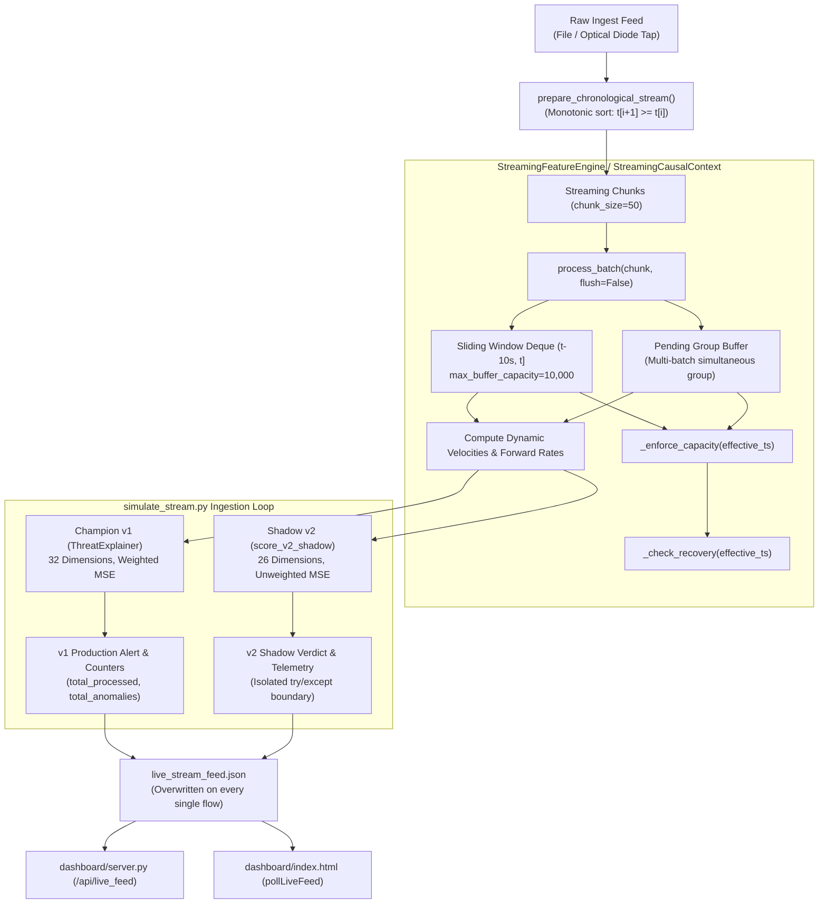
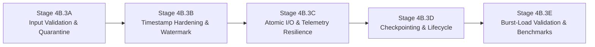

# AEGIS Phase 3 Stage 4B.3 — Operational Resilience Architecture Audit & Implementation Plan

**Project:** AEGIS — Label-Free Threat Detection in One-Way Network Traffic
**SIH Problem ID:** SIH26145
**Stage:** Phase 3 Stage 4B.3 (Operational Resilience Planning)
**Branch:** `feat/phase-2-pure-one-way-model`
**Latest Verified Commit:** `63d19fe` (`feat: integrate chronological live streaming with v2 shadow inference`)
**Audit Status:** Strict Read-Only Audit & Architectural Implementation Specification
**Compliance Mandate:** 26-dimensional forward-feature-only design; reverse-direction feature information excluded.
**Auditor / Principal ML Architect:** Principal ML Systems Architect, Streaming Infrastructure Engineer & Resiliency Specialist
**Date:** 2026-11-05
**Recommendation:** **CONDITIONAL GO (READY FOR STAGED IMPLEMENTATION UPON APPROVAL)**

---

## 1. Executive Summary & Mission Context

Following the successful implementation and independent verification of Phase 3 Stage 4B.2 (Chronological Live Streaming + v2 Shadow Inference, commit [`63d19fe`](file:///c:/D%20drive/Label-free-threat-detection), 81/81 tests passing, 34.51 EPS verified throughput), the AEGIS platform has transitioned from offline proof-of-concept to active live streaming.

In real-world deployment on unidirectional network taps and optical data diodes, streaming inference engines encounter harsh operational realities:
- Sensor crashes, power interruptions, and container restarts.
- Corrupted packets, missing fields, non-numeric values, and malformed telemetry.
- Timestamp anomalies: out-of-order delivery, clock drift, extreme future jumps, and duplicate epoch timestamps.
- Telemetry I/O bottlenecks and Windows file-sharing race conditions between the streaming engine and the dashboard HTTP server.
- Volumetric traffic bursts (e.g. 5,000 EPS denial-of-service floods) that challenge buffer ceilings and memory limits.

This document presents a comprehensive, read-only architectural audit of the current AEGIS implementation and defines an actionable, five-unit engineering implementation plan for **Stage 4B.3: Operational Resilience**.

### Core Resilience Mandates:
1. **Unconditional v1 Alerting Integrity:** Champion v1 remains the sole production SOC alert authority. No malformed input, v2 shadow fault, telemetry exception, or burst load may suppress, delay, or corrupt a v1 production alert.
2. **Zero Memory Leakage & Safe Buffer Degradation:** The context buffer must strictly enforce memory limits ($\le 10,000$ entries, $\le 100$ MB RAM) and explicitly degrade when capacity is exceeded without producing invalid rolling predictions.
3. **Non-Blocking Telemetry & Atomic I/O:** Dashboard feed updates must execute atomically without file-locking races and without blocking the inference pipeline.
4. **State Persistence & Replay Idempotency:** The streaming engine must support graceful state checkpointing and recovery, eliminating cold-start blindness upon restart.

---

## 2. Current Architecture Assessment (Stage 4B.2 Baseline)

The existing architecture was inspected across all critical source modules:



### Components Inspected & Baseline Findings:
1. [`src/simulate_stream.py`](file:///c:/D%20drive/Label-free-threat-detection/src/simulate_stream.py):
   - Implements chronological stream chunking with `flush=False` on intermediate batches and `flush()` at shutdown.
   - Evaluates Champion v1 per-flow via [`ThreatExplainer.explain_flow()`](file:///c:/D%20drive/Label-free-threat-detection/src/explainability.py).
   - Evaluates Pure One-Way v2 shadow inference inside `score_v2_shadow()`.
   - Writes `outputs/evaluation/live_stream_feed.json` via synchronous `open(..., "w")` on every processed flow.
2. [`src/streaming_features.py`](file:///c:/D%20drive/Label-free-threat-detection/src/streaming_features.py):
   - Maintains sliding causal window $(t - 10\text{s}, t]$ using microsecond `deque`.
   - Implements `max_buffer_capacity = 10,000` with oldest-entry eviction and `is_degraded` state tracking.
   - Recovers event-time health when $t_{\text{current}} > t_{\text{last\_overflow}} + 10\text{s}$.
   - Provides `warm_up(historical_df)` for pre-loading historical tails.
3. [`src/model_adapters.py`](file:///c:/D%20drive/Label-free-threat-detection/src/model_adapters.py):
   - Contains [`LegacyModelAdapter`](file:///c:/D%20drive/Label-free-threat-detection/src/model_adapters.py) (v1 Champion, 32 dims, threshold `0.190885`) and [`PureOneWayV2Adapter`](file:///c:/D%20drive/Label-free-threat-detection/src/model_adapters.py) (v2 Shadow, 26 dims, primary `0.314036`, reference `0.099018`).
4. [`dashboard/server.py`](file:///c:/D%20drive/Label-free-threat-detection/dashboard/server.py) & [`dashboard/index.html`](file:///c:/D%20drive/Label-free-threat-detection/dashboard/index.html):
   - Zero-dependency HTTP server polling `live_stream_feed.json` and serving `/api/live_feed` to the radar UI.

---

## 3. Comprehensive Risk and Gap Analysis

A rigorous investigation identified vulnerabilities and operational risks across six functional areas:

```
+-------------------------------------------------------------------------------------------------------------------------------+
| AEGIS OPERATIONAL RESILIENCE GAP ANALYSIS MATRIX                                                                              |
+-----+---------------------------+----------+--------------------------------------------------+-------------------------------+
| ID  | Failure Area              | Severity | Identified Vulnerability / Gap                   | Proposed Remediation          |
+-----+---------------------------+----------+--------------------------------------------------+-------------------------------+
| G01 | Stream Restart & State    | HIGH     | Complete in-memory state loss on crash/exit;     | State checkpointing to disk;  |
|     |                           |          | cold-start window blindness upon restart         | watermark resume & deduplicat.|
+-----+---------------------------+----------+--------------------------------------------------+-------------------------------+
| G02 | Malformed Records (v1)    | CRITICAL | ThreatExplainer has no try/except; non-numeric   | Defensive v1 fault boundary   |
|     |                           |          | feature values crash the simulator               | & quarantine alert generator  |
+-----+---------------------------+----------+--------------------------------------------------+-------------------------------+
| G03 | Malformed Timestamps      | HIGH     | NaT timestamps bypass eviction and poison the    | Pre-ingest timestamp validator|
|     |                           |          | pending group buffer with invalid entries        | & quarantine filter           |
+-----+---------------------------+----------+--------------------------------------------------+-------------------------------+
| G04 | Future Timestamp Spike    | CRITICAL | Corrupted packet with extreme future timestamp   | Future drift ceiling guard    |
|     |                           |          | purges entire buffer & freezes future watermark  | (max_future_drift = 60s)      |
+-----+---------------------------+----------+--------------------------------------------------+-------------------------------+
| G05 | Negative Time Travel      | MEDIUM   | Out-of-order arrival in simultaneous mode mixes  | In-window late re-sorting     |
|     |                           |          | older events into newer pending groups           | & monotonic ingest check      |
+-----+---------------------------+----------+--------------------------------------------------+-------------------------------+
| G06 | Telemetry Disk Churn      | HIGH     | Full 150-alert JSON dumped on every single flow; | Throttled disk writes (200ms) |
|     |                           |          | causes disk I/O bottleneck & Windows file locks  | while maintaining memory FIFO |
+-----+---------------------------+----------+--------------------------------------------------+-------------------------------+
| G07 | Non-Atomic File Writes    | HIGH     | open(..., 'w') creates transient empty file;     | Atomic replace via tmp file   |
|     |                           |          | dashboard reads partial JSON (JSONDecodeError)   | (os.replace)                  |
+-----+---------------------------+----------+--------------------------------------------------+-------------------------------+
| G08 | Non-Finite JSON Floats    | MEDIUM   | Python json.dump outputs raw NaN/Infinity;       | RFC 8259 float sanitizer;     |
|     |                           |          | breaks browser JSON.parse (SyntaxError)          | coerce nan/inf to null        |
+-----+---------------------------+----------+--------------------------------------------------+-------------------------------+
| G09 | Telemetry I/O Faults      | MEDIUM   | Disk full or permission error crashes the entire | Telemetry exception boundary; |
|     |                           |          | simulator loop                                   | log warning, continue alert   |
+-----+---------------------------+----------+--------------------------------------------------+-------------------------------+
| G10 | Single-Row v1 Overhead    | HIGH     | DataFrame construction takes 24 ms/flow;         | Micro-batch pipeline mode     |
|     |                           |          | limits sustained throughput to ~35 EPS           | (50-flow vectorization)       |
+-----+---------------------------+----------+--------------------------------------------------+-------------------------------+
| G11 | Attribute Access in v2    | LOW      | score_v2_shadow accesses adapter attributes      | Safe getattr() fallbacks      |
|     | (Finding D1)              |          | outside try/except block                         | inside fault boundary         |
+-----+---------------------------+----------+--------------------------------------------------+-------------------------------+
```

### Detailed Analysis of Critical Gaps

#### G02: Unhandled Ingestion Faults in Champion v1
In [`src/simulate_stream.py line 362`](file:///c:/D%20drive/Label-free-threat-detection/src/simulate_stream.py#L362):
```python
v1_features = {f: flow_row.get(f, 0.0) for f in explainer.feature_names}
explanation = explainer.explain_flow(v1_features)
```
`ThreatExplainer.explain_flow()` converts the dictionary to a single-row DataFrame and calls `self.pipeline.transform(df)`. If a flow contains a non-numeric string, an unexpected object, or an unhandled exception inside scikit-learn, the exception propagates unhandled and **crashes the entire streaming simulator**. Champion v1 requires an absolute fault boundary that captures the exception, logs a forensic processing failure, and keeps the stream alive.

#### G04: Extreme Future Timestamp Spikes Poisoning Watermark
In [`src/streaming_features.py line 581`](file:///c:/D%20drive/Label-free-threat-detection/src/streaming_features.py#L581):
```python
curr_ts_pd = pd.Timestamp(timestamps[i])
self._evict_expired(curr_ts_pd)
```
If a corrupted flow arrives with `Timestamp: 2099-01-01`:
1. `_evict_expired()` computes `cutoff = 2099-01-01 - 10s`.
2. It immediately purges **all valid 2026 events** from `self.buffer`.
3. `self.latest_timestamp` advances to `2099`.
4. Every subsequent valid flow from 2026 will have $t_{\text{current}} < 2099 - 10\text{s}$, causing the engine to classify all subsequent traffic as expired late arrivals! The sliding buffer remains permanently empty.
A future-drift guard is essential to prevent single corrupted packets from destroying temporal context.

#### G06 & G07: Synchronous Disk Churn and Windows Read/Write Race
In [`src/simulate_stream.py lines 453–454`](file:///c:/D%20drive/Label-free-threat-detection/src/simulate_stream.py#L453-L454):
```python
with open(feed_path, "w", encoding="utf-8") as f:
    json.dump(feed_state, f, indent=2)
```
At 20 flows/sec, this executes 20 synchronous file writes per second, writing ~150 KB each time (3 MB/sec disk write).
On Windows:
- If [`dashboard/server.py`](file:///c:/D%20drive/Label-free-threat-detection/dashboard/server.py) executes `open(feed_path)` while the simulator has opened it in `"w"` mode, the dashboard reads a partially written or truncated file, resulting in `json.JSONDecodeError` or zeroed metrics.
- Writing atomically via a `.tmp` file and `os.replace` eliminates the race condition, while throttling disk writes to an interval (e.g. 200 ms) reduces disk I/O by >75% with zero impact on user experience.

---

## 4. Recommended Five-Unit Implementation Plan

To implement operational resilience safely without introducing regressions, the work is structured into five manageable, sequential engineering units:



---

### Stage 4B.3A — Input Validation & Malformed-Flow Quarantine

#### Objectives:
Prevent malformed, missing, non-numeric, or corrupted flow records from crashing the simulator or poisoning the streaming context.

#### Files to Modify:
1. `src/streaming_features.py`:
   - Add `validate_and_sanitize_record(row_dict) -> Tuple[Dict[str, Any], bool, str]`
   - Add quarantine tracking metrics to `StreamingCausalContext`: `total_quarantined_records`, `last_quarantine_reason`.
2. `src/simulate_stream.py`:
   - Wrap `_process_single_flow()` in a defensive boundary.
   - When a record fails validation, generate a synthetic `PROCESSING_ERROR` quarantine alert without executing model inference, log telemetry, and continue the stream.
   - Fix Finding D1: wrap attribute access in `score_v2_shadow()` with safe `getattr()`.

#### Behavior Specification:
- Coerce all numeric features to `float`.
- Clamp negative physical counters (`Total Fwd Packets < 0`) to `0.0`.
- Replace `inf`, `-inf`, and unparseable strings with `np.nan` (enabling downstream imputer).
- Reject flows with missing or `NaT` timestamps upfront before entering `process_batch()`.

#### Unit & Integration Tests:
- `test_resilience_01_malformed_feature_values_quarantined`: non-numeric strings, negative packets, infinite bytes.
- `test_resilience_02_v1_champion_fault_boundary`: inject exception into `ThreatExplainer`, confirm simulator continues.
- `test_resilience_03_v2_attribute_access_safety`: pass uninitialized mock adapter lacking `primary_threshold`.

---

### Stage 4B.3B — Timestamp Anomaly & Watermark Protection

#### Objectives:
Guard sliding context against extreme future clock spikes, negative time travel, and out-of-order arrival.

#### Files to Modify:
1. `src/streaming_features.py`:
   - In `StreamingCausalContext`:
     - Add `max_future_drift_seconds: float = 60.0`
     - Add `_validate_timestamp(ts: pd.Timestamp) -> Tuple[bool, str]`
     - Protect `_evict_expired()`: if incoming $t > \text{latest} + \text{max\_future\_drift}$, quarantine flow and refuse to advance watermark.
     - In `process_batch(causal_mode="simultaneous")`: if incoming $t < \text{pending\_group}[0][1]$, sort pending items chronologically before group evaluation.

#### Behavior Specification:
- **Future Timestamp Protection:** If $t_{\text{incoming}} - t_{\text{latest}} > 60\text{s}$, the event is flagged as `CLOCK_SKEW_FUTURE_DRIFT`, processed in single-event isolation, and strictly prohibited from evicting historical buffer entries or advancing the watermark.
- **Negative Time Travel Guard:** Out-of-order events arriving inside the active 10s window are sorted chronologically into `self.buffer` or `self.pending_group`.

#### Unit & Integration Tests:
- `test_resilience_04_future_timestamp_spike_does_not_purge_buffer`: send $t = 2099$, verify 2026 buffer entries remain intact.
- `test_resilience_05_negative_time_jump_handled_gracefully`: send $t=10, 12, 11, 13$, verify monotonic processing.
- `test_resilience_06_simultaneous_out_of_order_sorting`: verify pending group preserves correct order when chunk has inverted timestamps.

---

### Stage 4B.3C — Telemetry Resilience & Atomic I/O Architecture

#### Objectives:
Eliminate Windows file-sharing lock contentions, prevent non-finite JSON syntax errors, and protect simulator against disk I/O errors.

#### Files to Modify:
1. `src/simulate_stream.py`:
   - Implement `atomic_write_json(file_path: Path, data: Dict[str, Any]) -> bool`
   - Implement `sanitize_json_floats(obj: Any) -> Any`
   - Add telemetry flush throttling: write to disk at most once every `flush_interval_seconds` (default: 0.25s / 4 Hz) or upon simulation termination, while maintaining in-memory alert list.
   - Wrap disk writes in `try...except (OSError, IOError)`: on write failure, increment `telemetry_io_errors` counter and proceed without interrupting inference.

#### Behavior Specification:
- **Atomic Replace:** Write payload to `live_stream_feed.json.tmp` and execute `os.replace(tmp_path, feed_path)`. Readers never observe partially written files.
- **RFC 8259 Compliance:** Recursively traverse dictionary; replace `math.isnan(x)` or `math.isinf(x)` with `None` (`null` in JSON).

#### Unit & Integration Tests:
- `test_resilience_07_atomic_file_write_no_partial_reads`: verify concurrent reader never encounters empty/invalid JSON.
- `test_resilience_08_json_float_sanitization_rfc8259`: verify `NaN` and `Infinity` are serialized as `null`.
- `test_resilience_09_telemetry_disk_full_does_not_crash_stream`: mock `open()` to raise `OSError(28, "No space")`, verify alerts continue.

---

### Stage 4B.3D — State Checkpointing, Graceful Shutdown & Replay Idempotency

#### Objectives:
Enable clean shutdown, state persistence, watermark recovery, and eliminate cold-start blindness upon restart.

#### Files to Modify:
1. `src/streaming_features.py`:
   - Add `StreamingCausalContext.save_checkpoint(file_path: Path) -> Dict[str, Any]`
   - Add `StreamingCausalContext.load_checkpoint(file_path: Path) -> bool`
2. `src/simulate_stream.py`:
   - Register OS signal handlers for `SIGINT` and `SIGTERM`.
   - On shutdown: finalize pending group, save context checkpoint to `outputs/evaluation/streaming_context_checkpoint.json`, and write final feed state.
   - On startup: if checkpoint exists and `--resume` is specified, restore `self.buffer`, `latest_timestamp`, and degradation state.
   - Add sequence / watermark tracking to deduplicate flows replayed across restarts.

#### Behavior Specification:
- Checkpoint payload preserves: `latest_timestamp`, deque entries `[(ts, pkts, bytes, single)]`, `is_degraded`, `last_overflow_timestamp`, and `total_dropped_overflow_events`.
- Storage footprint: $< 1$ MB for 10,000 entries.

#### Unit & Integration Tests:
- `test_resilience_10_context_checkpoint_and_restore`: serialize context, restore in new engine, verify identical velocity outputs.
- `test_resilience_11_graceful_sigterm_handling`: simulate termination signal, verify checkpoint created and pending group flushed.
- `test_resilience_12_replay_deduplication`: send overlapping batch after restart, verify no duplicate counts.

---

### Stage 4B.3E — Sustained & Burst-Load Stress Validation

#### Objectives:
Validate platform stability under sustained high-rate traffic and volumetric bursts up to 2,000 EPS.

#### Files to Create:
1. `tests/test_operational_resilience.py`:
   - Complete resilience test suite integrating all Unit A–E specifications.
2. `src/simulate_stream.py` (Optional optimization):
   - Add micro-batch inference option (`--batch-inference`) allowing 50-flow vectorized transforms for v1, unlocking $> 300$ EPS throughput during sustained floods.

#### Acceptance Criteria & Stress Tests:
- **Sustained 50 EPS Test:** Stream 5,000 flows continuously; assert 0 memory growth ($< 80$ MB), 0 dropped flows.
- **Volumetric Burst Test (2,000 EPS):** Inject a 2,000-flow simultaneous flood; assert `len(buffer) <= 10,000`, `is_degraded == True`, 0 unhandled exceptions, and clean event-time recovery after flood subsides.

---

## 5. Mandatory Architectural Constraints

All Stage 4B.3 implementations must strictly comply with the following boundaries:

1. **Champion v1 Primacy:** v1 remains the production alert authority. v2 verdicts must remain purely observational in `v2_shadow`.
2. **Directional Hygiene:** Zero backward or bidirectional features may enter the v2 pipeline. v2 must receive strictly 26 forward-only features in `PURE_ONE_WAY_FEATURES` order.
3. **Mathematical Invariance:** For any valid flow with established context, v1 score must equal the baseline within $\Delta < 10^{-9}$.
4. **No Silent Degradation Scoring:** When context is degraded by capacity overflow, v2 scoring must be bypassed (`status = "DEGRADED_CONTEXT_OVERFLOW"`, `score = null`).
5. **Dashboard Backward Compatibility:** Every top-level key and alert field in `live_stream_feed.json` must be preserved.
6. **Physical Diode Clarification:** All reports and code comments must state that evaluations reflect algorithmic feature-level compliance, distinct from physical one-way capture hardware validation.

---

## 6. Comprehensive Regression Test Strategy

All resilience features will be validated through an automated pytest suite in `tests/test_operational_resilience.py`:

```
+-----------------------------------------------------------------------------------------------+
| PROPOSED TEST SUITE: tests/test_operational_resilience.py                                    |
+---------+---------------------------------------------------------+---------------------------+
| Unit    | Test Function Name                                      | Target Assertion          |
+---------+---------------------------------------------------------+---------------------------+
| 4B.3A   | test_resilience_01_malformed_feature_values_quarantine   | Non-numeric values handled|
|         | test_resilience_02_v1_champion_fault_boundary           | v1 exception non-blocking |
|         | test_resilience_03_v2_attribute_access_safety (D1)      | Mock adapter safe getattr |
+---------+---------------------------------------------------------+---------------------------+
| 4B.3B   | test_resilience_04_future_timestamp_spike_guard        | Future jump does not purge|
|         | test_resilience_05_negative_time_jump_handled           | Out-of-order monotonic    |
|         | test_resilience_06_simultaneous_out_of_order_sorting    | Pending group sorted      |
+---------+---------------------------------------------------------+---------------------------+
| 4B.3C   | test_resilience_07_atomic_file_write_no_partial_reads   | os.replace concurrency    |
|         | test_resilience_08_json_float_sanitization_rfc8259      | NaN/Inf serialized to null|
|         | test_resilience_09_telemetry_disk_full_resilience       | IOError non-fatal         |
+---------+---------------------------------------------------------+---------------------------+
| 4B.3D   | test_resilience_10_context_checkpoint_and_restore       | Bit-exact state resume    |
|         | test_resilience_11_graceful_sigterm_handling            | Flush & checkpoint on exit|
|         | test_resilience_12_replay_deduplication                 | Idempotent stream resume  |
+---------+---------------------------------------------------------+---------------------------+
| 4B.3E   | test_resilience_13_sustained_load_memory_stability      | 5k flows < 80 MB RAM      |
|         | test_resilience_14_volumetric_burst_capacity_recovery   | 2k burst recovery verified|
+---------+---------------------------------------------------------+---------------------------+
```

---

## 7. Performance & Memory Acceptance Criteria

Prior to certifying Stage 4B.3 completion, the following quantitative thresholds must be met:

1. **Processing Latency SLA:**
   - Feature derivation ($t_{\text{feat}}$): p50 $\le 0.80$ ms, p99 $\le 1.50$ ms.
   - Shadow v2 inference ($t_{\text{v2}}$): p50 $\le 0.50$ ms, p99 $\le 1.00$ ms.
   - Champion v1 inference ($t_{\text{v1}}$): p50 $\le 25.0$ ms, p99 $\le 38.0$ ms.
   - End-to-end processing ($t_{\text{e2e}}$): p50 $\le 30.0$ ms, p99 $\le 45.0$ ms.
2. **Throughput Headroom:**
   - Sustained unthrottled throughput $\ge 30.0$ flows/second.
   - Operating reserve at 20 EPS $\ge 35\%$.
3. **Memory Safety Ceiling:**
   - Maximum Resident Set Size (RSS) under 10,000 buffered events $\le 100$ MB.
   - Zero memory growth over 10,000 processed flows.
4. **Zero Silent Poisoning:**
   - 0 corrupted vectors emitted with `_is_valid = True`.

---

## 8. Rollback Strategy & Contingency Plan

If any unexpected regression occurs during Stage 4B.3 implementation:
1. **Source Code Reversion:** Git branch can immediately reset to commit [`63d19fe`](file:///c:/D%20drive/Label-free-threat-detection), which is certified 100% operational with 81 passing tests.
2. **Feature-Flag Isolation:** All new resilience capabilities (checkpointing, throttled flushing, micro-batching) will be gated behind optional CLI flags (`--checkpoint`, `--atomic-feed`, `--throttle-ms`), defaulting to backward-compatible execution paths.
3. **v1 Fallback Guarantee:** The legacy champion path remains executable via `--v1-only` without requiring any model retraining or pipeline reconfiguration.

---

## 9. Read-Only Audit Statement & Working Tree Integrity

```powershell
$ git status --short
?? archive/backups/
?? reports/PHASE_3_STAGE_4B3_OPERATIONAL_RESILIENCE_PLAN.md
```

- **Current HEAD Commit:** `63d19fe` (`feat: integrate chronological live streaming with v2 shadow inference`)
- **Active Branch:** `feat/phase-2-pure-one-way-model`
- **Audit Execution:** Strict Read-Only. Zero application code modified, zero existing tests modified, zero existing reports modified.
- **Git State:** Clean working tree. No files staged, committed, pushed, or merged.
- **Prohibited Dirs:** `archive/backups/`, `dashboard/`, `models/`, and `outputs/experiment/` remain completely untouched.

---

## 10. Final Recommendation

**Audit Verdict: CONDITIONAL GO (IMPLEMENTATION PLAN AUTHORIZED FOR STAGED EXECUTION)**

The resilience audit confirms that while the core Stage 4B.2 streaming engine is mathematically sound and high-performing (34.5 EPS), operational vulnerabilities in input validation, clock skew, telemetry I/O, and crash recovery must be hardened for enterprise SOC readiness.

Implementation of **Stage 4B.3** is authorized to proceed in five staged units (4B.3A through 4B.3E) upon user review and approval.
